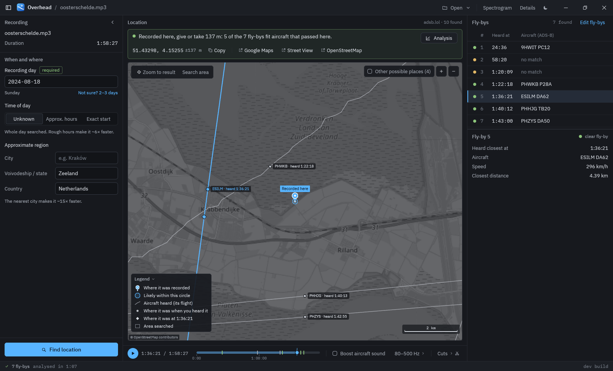
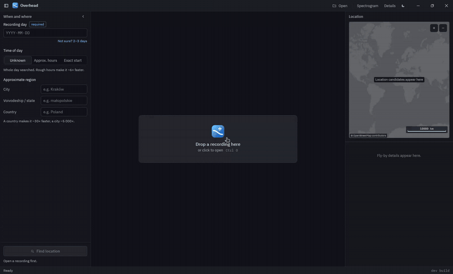
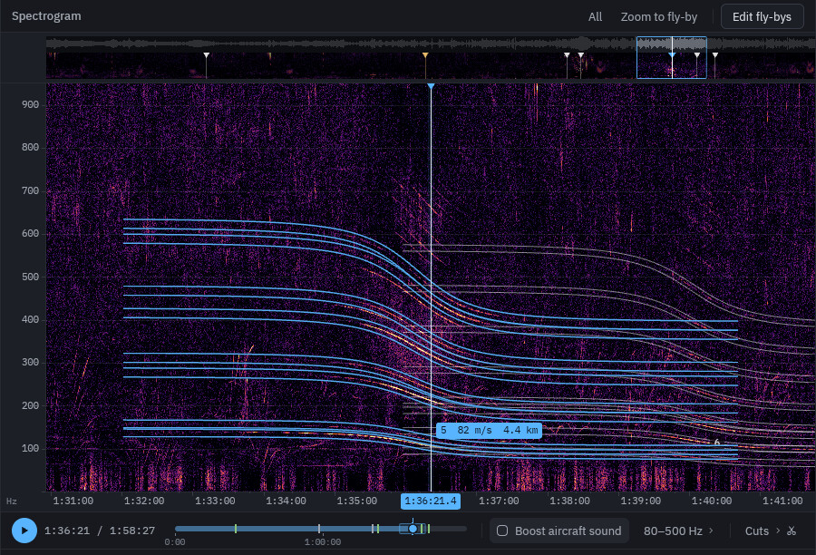

<p align="center"></p>

<h1 align="center">Overhead</h1>

<p align="center"><b>Find where a sound recording was made, from the planes you can hear in it.</b></p>

<p align="center"><br>
<sub>A two-hour field recording, given only the day and the province: placed 41 m from where the microphone stood. The lines are the aircraft that were heard, each marked where it was when its sound reached the microphone.</sub></p>

You have an audio recording, say a nature recording, a voice memo or the
soundtrack of a video, and you want to know where it was made. If a small
plane or a helicopter flew past while it was recording, Overhead can often
tell you, sometimes to within a few dozen metres.

It needs nothing but the audio and the day of the recording. A time of day
and a rough region (a country, a province, a city) make it faster and more
certain.

<p align="center"><br>
<sub>The whole search, with the waiting sped up 10×. <a href="docs/images/demo.mp4">Video in full quality</a>.</sub></p>

## How it works

1. **Hearing the planes.** As a propeller aircraft flies past, its hum
   slides from a higher pitch to a lower one: the Doppler effect, the same
   thing you hear when an ambulance passes. On a spectrogram (a picture of
   sound, time left to right, pitch bottom to top) each fly-by draws an
   S-shaped curve. Its shape tells you the plane's **speed**, how **close**
   it came, and the **moment** it was nearest.
2. **Looking up who was flying.** Most aircraft broadcast their position
   every second (ADS-B), and volunteers around the world record these
   broadcasts. Overhead downloads that day's flight history from
   [adsb.lol](https://www.adsb.lol), an open archive.
3. **Finding the one place that fits.** For every candidate place, Overhead
   works out exactly what each real flight would have sounded like there,
   with the speed of sound, terrain height and timing included, and compares
   those curves with the recording. The place where real flights explain
   the fly-bys you hear, and where nothing loud flew past unheard, wins.

The more different aircraft are heard, the more certain the answer: one
fly-by fits a whole line of places, three or four fit only one.

The idea comes from [this video](https://www.youtube.com/watch?v=UytYrhYLOKI),
which shows the method worked out by hand. Overhead does every step
automatically, and also shows its working: you can compare the curves of the
best places on the spectrogram, see a score map, and check which aircraft
should have been heard.

<p align="center"><br>
<sub>One fly-by on the spectrogram: a Diamond DA62 passing 4.4 km away. Each blue curve is one line of its engine sound; all of them bend at the same moment, which tells Overhead its speed, distance and time.</sub></p>

## Does it really work?

Tested on 14 real recordings published by field recordists (on Freesound,
aporee and xeno-canto), in four modes from "exact start time known" to "only
the day known", and on 33 synthetic recordings built from real flight
tracks. The full results are in [docs/evidence.md](docs/evidence.md).

- **The best case:** a two-hour recording on the Oosterschelde mud flats in
  the Netherlands with seven fly-bys. Given only the day and the province,
  Overhead placed it **41 m** from where the microphone stood, and named the
  five aircraft that were heard.
- **On the real recordings,** 14 of 54 runs land within 2 km, most of them
  with a start time. Recordings with a single fly-by and only a day are
  almost never placed: one curve fits too many places.
- **It says when it is not sure.** Every answer has a confidence. In all
  tests, no wrong answer was reported as certain: when Overhead is unsure it
  says so and shows the whole area it could be.
- **On synthetic recordings,** 28 of 33 land within 500 m and 30 within 2 km.

It works best:

- with **light aircraft and helicopters** (propeller sound). Jets are not
  used yet.
- where those aircraft broadcast their **GPS position**: in the US nearly
  all do. In parts of Europe many small aircraft are only tracked by
  multilateration, which is less precise, and some are not tracked at all.
- with **longer recordings** that hear several different aircraft.
- recorded since **10 March 2023**, the first day of the adsb.lol archive.

## Getting started

### Windows

Download `overhead.exe` from the latest
[release](../../releases) and run it. It needs no installer and updates
itself, without any setup.

### Linux (build from source)

You need [Rust](https://rustup.rs) and, on Ubuntu or Debian, a few system
libraries:

```sh
sudo apt install build-essential pkg-config libasound2-dev libxkbcommon-dev \
    libxkbcommon-x11-dev libwayland-dev libvulkan1 libfontconfig-dev libx11-xcb-dev
git clone https://github.com/mlodygbelmondo/overhead
cd overhead
cargo build --release -p overhead-app
./target/release/overhead
```

To get it in your app menu with its icon:

```sh
install -Dm755 target/release/overhead ~/.local/bin/overhead
install -Dm644 assets/linux/overhead.png ~/.local/share/icons/hicolor/512x512/apps/overhead.png
install -Dm644 assets/linux/overhead.desktop ~/.local/share/applications/overhead.desktop
```

macOS is not tested.

### Using it

1. **Open a recording** (Ctrl+O, or drop it on the window). WAV, FLAC, MP3,
   OGG and M4A open directly; video and other formats too if
   [ffmpeg](https://ffmpeg.org) is installed. Overhead finds the fly-bys by itself; they appear in
   the table and on the spectrogram.
2. **Enter the day** of the recording (the local date). If you are not sure,
   give a 2–3 day range.
3. **Add what else you know:** the start time or rough hours, and a region
   (city, province or state, country). Each of these makes the search faster
   and the answer more certain.
4. **Press Find location** (Ctrl+Enter). The first search on a new day
   downloads that day's flight history (about 3.8 GB, of which about
   0.9 GB is kept), which takes a few minutes. Later searches on that day
   take seconds to a few minutes.
5. **Read the answer.** A sentence says where the recording was made and how
   sure Overhead is. The map shows a pin with the circle it is likely in and
   the aircraft that were heard, each at the spot where it was heard. When
   the answer is uncertain, the map shades every place it could be and
   says what would narrow it down.

Found a fly-by Overhead missed, or one that is wrong? **Edit fly-bys** lets
you trace a curve by hand, move or delete one, and search again.

Everything is also available on the command line:

```sh
cargo build --release
./target/release/overhead-cli detect recording.wav > flybys.json
./target/release/overhead-adsb locate recording.wav --day 2024-08-18 --region "Zeeland, Netherlands"
```

## Responsible use

Overhead was built for verification: checking where a published recording
or video was really made, recovering lost metadata of field recordings, and
research. Locating where someone recorded something can also reveal where
they live or were. **Do not use it to find people who have not agreed to
it.** Treat every answer as evidence to check, not as proof: read its
confidence, and look at the alternatives it shows.

## More

- [docs/technical.md](docs/technical.md): how every part works, all options
  of the app and the command lines.
- [docs/evidence.md](docs/evidence.md): every test recording, result and
  failure.
- [docs/testset.md](docs/testset.md): the test recordings and how their
  ground truth was found.
- [CONTRIBUTING.md](CONTRIBUTING.md): building, testing and changing the
  code.

## Credits

- Flight history: [adsb.lol](https://www.adsb.lol) and its feeders, under
  the [Open Database License](https://opendatacommons.org/licenses/odbl/1-0/).
- Maps and place search: © [OpenStreetMap](https://www.openstreetmap.org/copyright)
  contributors (tiles and Nominatim). Time zones: [tzf](https://github.com/ringsaturn/tzf-rs),
  from OpenStreetMap data.
- Terrain: SRTM through [AWS Terrain Tiles](https://registry.opendata.aws/terrain-tiles/);
  geoid: EGM96 (NGA).
- Aircraft types: [tar1090-db](https://github.com/wiedehopf/tar1090-db) (ICAO Doc 8643).
- Test recordings: the recordists credited in [docs/testset.md](docs/testset.md),
  each under its own Creative Commons licence.
- Fonts: [IBM Plex](https://github.com/IBM/plex) (SIL Open Font License).
- The method: [this video](https://www.youtube.com/watch?v=UytYrhYLOKI).

## Licence

Overhead is free software under the [GNU General Public License v3.0 or later](LICENSE).
You may use, study, share and change it; versions you distribute must stay
under the same licence, with their source.
