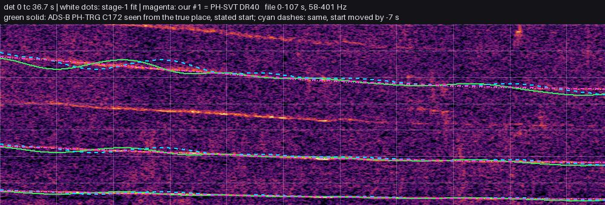
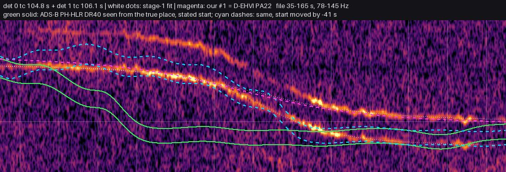
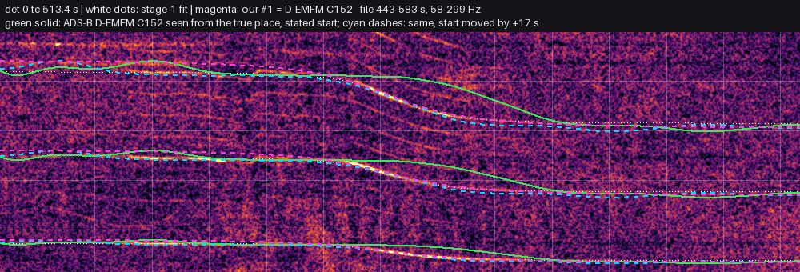
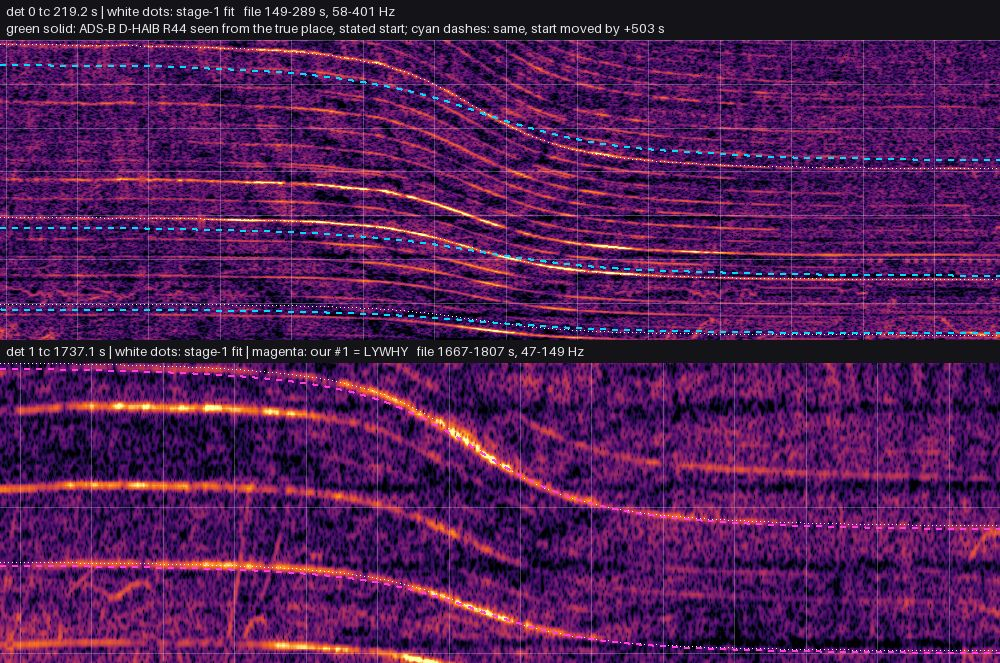
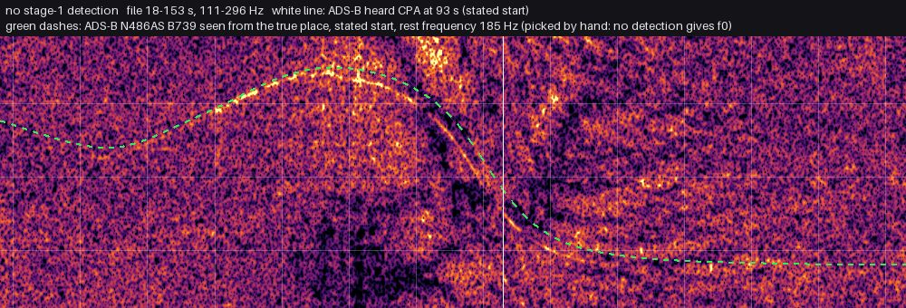
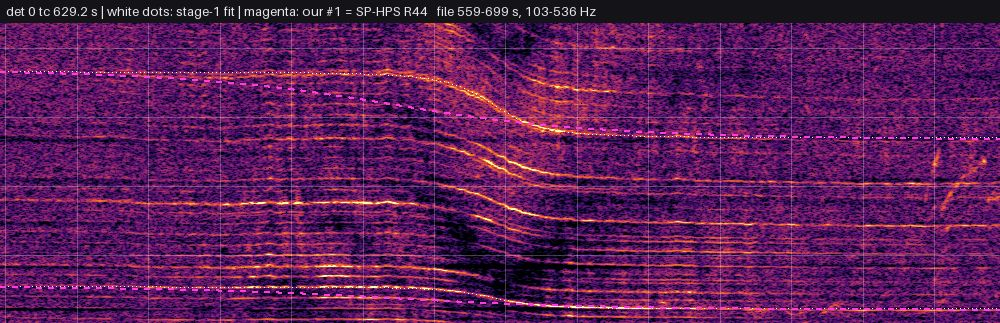
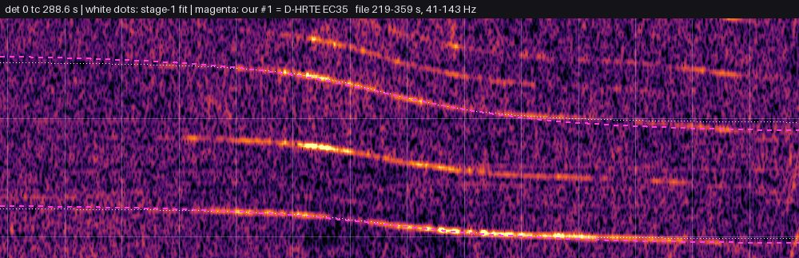
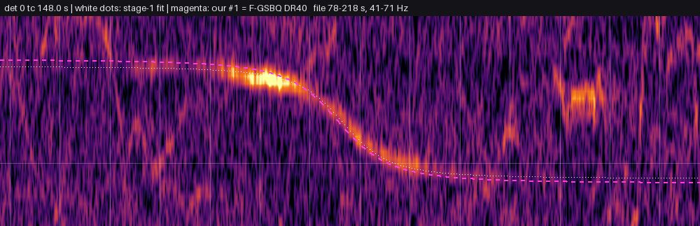
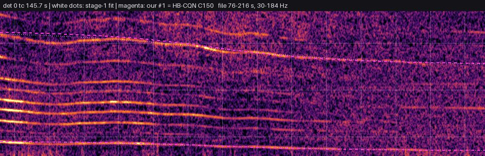
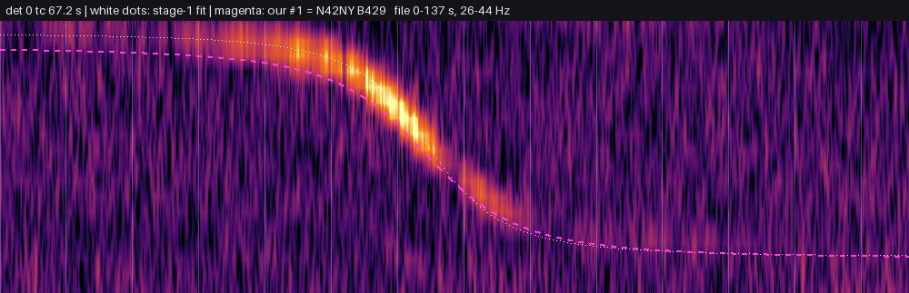

# Evidence: the automatic pipeline on real recordings

The full automatic pipeline (stage-1 detections, adsb.lol history, matching, Doppler-curve scoring on the real spectrogram) on all 11 real recordings of [docs/testset.md](testset.md), each in three input modes (four for the ground-truth recordings) plus a diagnostic run. **This page was regenerated for branch `wf3/match`**, which fixes two matcher bugs found by the first version of this report (bug 1: passes scored on extrapolated track; bug 2: the Kampina C172 not returned at the true place, caused by noisy multilateration positions) and re-measures everything. The numbers of the first report (main at commit 1ca645b) are quoted where they changed. Binary: `wf3/match`, release build, run on 8 cores (`taskset -c 0-7`, `RAYON_NUM_THREADS=8`) while other jobs shared the machine. Stage 1 was not re-run: `locate` got the stage-1 detections of the first report (`~/doppler-data/evidence/detect/`, same detector code as main) with `--detections`, plus the audio for spectrogram scoring. So "wall" below is `locate` without stage 1 (the first report's wall times included it). Nothing in the matcher was tuned on these recordings except as described under bug 2 (the MLAT smoothing threshold comes from the residuals of all 61 000 MLAT reports of the Noord-Brabant day, not from the ground-truth flight).

What `locate` was told (all taken from each recording's `meta.json`, i.e. what the recordist states):

- **(a) exact start**, as the task asked: `--start` = the recording start implied by ADS-B (the ground-truth flight's heard closest approach from the true place minus stage 1's `tc`, 1 s precision), `--start-tol 20`. Only possible for the 5 recordings with an ADS-B ground truth. **This is a best case**: the exact time is borrowed from the very flight we want to find, which a user would not have. It was computed from the raw (unsmoothed) trace, so it can be several seconds off for an MLAT-tracked aircraft. Seattle has no detection to align, so it got its stated start ±20 s (it fails at stage 1 anyway).
- **(a') stated start**: `--start` = the recordist's stated local start with its UTC offset, `--start-tol` = the stated uncertainty (at least 120 s). The stated times are minute-precision and some are off (Kampina DR400 by ~41 s, Berlin by 17 s, Altenthann by ~8 min if D-HAIB is the source).
- **(b) hours**: `--hours H-2..H+2` local (H = stated start rounded to the hour), time zone looked up from the region. `locate` pads every hours window by 30 min on each side (`hours_slack_s = 1800` in `region.rs`), so the start actually searched spans **5 h**, not 4 (for example Berlin `--hours 8-12` at UTC+1 searches 06:30–11:30Z).
- **(c) day only**: just `--day` (the local date).
- Every mode: `--region` = the state/province from meta.json plus the country (for example `Noord-Brabant, Netherlands`, `Bavaria, Germany`, `Berlin, Germany`), resolved on OpenStreetMap with the default 5 km margin.
- One extra diagnostic run per ground-truth recording (not a user mode): mode (a') with the region cut to 5 km around the *true* location (locate adds its default 5 km `--region-margin`, so the searched box is about ±10 km). It tells whether the right flight would win if the region were known.

Raw outputs: `~/doppler-data/evidence/runs-match/<id>-<mode>.{json,log,time}` (first report: `~/doppler-data/evidence/runs/`). Scripts: `scripts/evidence/` (`run_locate.py` runs a mode, `analyze.py` scores it against the truth, `figure.py` draws the figures, `make_doc.py` writes this page from `notes.json`).

## Final run (main 3b3464b, 2026-11-03)

Everything from scratch with the merged code: stage 1 on the audio, then `overhead-adsb locate` in every input mode, region = province/state + country. Raw outputs: `~/doppler-data/final/runs`, script `~/doppler-data/final/run.sh`. ✅ = within 500 m, ≈ = within 2 km. Margin ≥ 1 means the tool calls the answer reliable. The three long recordings come from the section "Long recordings with several fly-bys" in [testset.md](testset.md).

| recording | length, detections | true place | (a) ADS-B start ±20 s | (a') stated start | (b) hours | (c) day only |
|---|---|---|---|---|---|---|
| [Oosterschelde mud flats and salt marshes](https://freesound.org/people/klankbeeld/sounds/794275/), 2024-08-18 09:23 +0200 | 118 min, 7 | [51.43263, 4.15276](https://www.openstreetmap.org/?mlat=51.43263&mlon=4.15276#map=14/51.43263/4.15276) | 54 m ✅, margin 3.3 | 54 m ✅, margin 2.57 | 54 m ✅, margin 2.57 | 54 m ✅, margin 2.57 |
| [River Amer dyke, Beverpad, Lage Zwaluwe](https://freesound.org/people/klankbeeld/sounds/801327/), 2025-04-23 09:27 +0200 | 62 min, 10 | [51.71823, 4.71655](https://www.openstreetmap.org/?mlat=51.71823&mlon=4.71655#map=14/51.71823/4.71655) | 819 m ≈, margin 0.29 | 666 m ≈, margin 0.03 | 12.0 km, margin 0.31 | 12.0 km, margin 0.23 |
| [Vlissingen sea front, Westerschelde](https://freesound.org/people/klankbeeld/sounds/864478/), 2026-07-24 14:55 +0200 | 60 min, 7 | [51.43994, 3.58148](https://www.openstreetmap.org/?mlat=51.43994&mlon=3.58148#map=14/51.43994/3.58148) | 29 m ✅, margin 0.14 | 7.8 km, margin 0.06 | 52.6 km, margin 0.01 | 61.0 km, margin 0.08 |
| [Emmauswald, Neukölln, Berlin](https://aporee.org/maps/?loc=66516&snd=76914), 2025-02-09 09:58 +0100 | 10 min, 1 | [52.46227, 13.42426](https://www.openstreetmap.org/?mlat=52.462273&mlon=13.424262#map=14/52.462273/13.424262) | 506 m ≈, margin 0.87 | 509 m ≈, margin 0.17 | 8.3 km, margin 0.08 | 3.9 km, margin 0.06 |
| [Zandbergse vennen, Kampina, Van Gogh Nat](https://freesound.org/people/klankbeeld/sounds/858688/), 2025-07-18 11:40 +0200 | 2 min, 1 | [51.57401, 5.27708](https://www.openstreetmap.org/?mlat=51.57401&mlon=5.27708#map=14/51.57401/5.27708) | 19.3 km, margin 0.01 | 48.0 km, margin 0.01 | 34.1 km, margin 0.0 | 34.1 km, margin 0.0 |
| [Zandbergse vennen, Kampina, Van Gogh Nat](https://freesound.org/people/klankbeeld/sounds/858591/), 2025-07-18 12:43 +0200 | 3 min, 1 | [51.57401, 5.27708](https://www.openstreetmap.org/?mlat=51.57401&mlon=5.27708#map=14/51.57401/5.27708) | 6.9 km, margin 0.02 | 9.8 km, margin 0.02 | 9.8 km, margin 0.01 | 39.2 km, margin 0.01 |
| [Altenthann (93177), Regensburg district ](https://freesound.org/people/TSP-Talk/sounds/847111/), 2026-03-03 13:30 +0100 | 34 min, 2 | [49.08138, 12.30070](https://www.openstreetmap.org/?mlat=49.08138&mlon=12.3007#map=14/49.08138/12.3007) | 251.1 km, margin 0.1 | 213.2 km, margin 0.08 | 128.8 km, margin 0.01 | 128.8 km, margin 0.01 |
| [Wedgwood, Seattle, King County](https://xeno-canto.org/941260), 2024-03-13 08:46 -0700 | 3 min, 0 | [47.67660, -122.29400](https://www.openstreetmap.org/?mlat=47.6766&mlon=-122.294#map=14/47.6766/-122.294) | no detection | no detection | no detection | no detection |
| [Wusterauer Anger, Kirchmöser, Brandenbur](https://aporee.org/maps/?loc=60944&snd=74426), 2024-06-15 09:19 +0200 | 10 min, 3 | [52.38366, 12.44077](https://www.openstreetmap.org/?mlat=52.383656&mlon=12.440769#map=14/52.383656/12.440769) | – | 90.2 km, margin 0.17 | 100.8 km, margin 0.0 | 71.8 km, margin 0.16 |
| [Edgemere beach, Queens, New York City](https://aporee.org/maps/?loc=62753&snd=72191), 2023-07-10 18:11 -0400 | 4 min, 1 | [40.59073, -73.76704](https://www.openstreetmap.org/?mlat=40.590734589389&mlon=-73.767042983697#map=14/40.590734589389/-73.767042983697) | – | 46.7 km, margin 0.01 | 71.0 km, margin 0.0 | 63.5 km, margin 0.01 |
| [Hudson River Waterfront walkway near Har](https://aporee.org/maps/?loc=64975&snd=75055), 2024-08-11 19:50 -0400 | 5 min, 1 | [40.72087, -74.03135](https://www.openstreetmap.org/?mlat=40.72087479385&mlon=-74.03134603807#map=14/40.72087479385/-74.03134603807) | – | 82.6 km, margin 0.01 | 69.1 km, margin 0.01 | 68.8 km, margin 0.01 |
| [Mechlin, gmina Śrem, powiat śremski](https://aporee.org/maps/?loc=68715&snd=79706), 2025-06-29 09:19 +0200 | 13 min, 1 | [52.09914, 17.09280](https://www.openstreetmap.org/?mlat=52.099139698773&mlon=17.092804576342#map=14/52.099139698773/17.092804576342) | – | 33.7 km, margin 0.03 | 93.2 km, margin 0.09 | 93.2 km, margin 0.03 |
| [Parc du Biez, Mondeville (near Caen)](https://xeno-canto.org/1152845), 2026-07-04 12:00 +0200 | 6 min, 1 | [49.18150, -0.31510](https://www.openstreetmap.org/?mlat=49.1815&mlon=-0.3151#map=14/49.1815/-0.3151) | – | 56.6 km, margin 0.06 | 56.6 km, margin 0.04 | 56.6 km, margin 0.09 |
| [Gemeinde Dünserberg, Feldkirch district](https://xeno-canto.org/883367), 2024-03-20 12:00 +0100 | 5 min, 1 | [47.23650, 9.73410](https://www.openstreetmap.org/?mlat=47.2365&mlon=9.7341#map=14/47.2365/9.7341) | – | 14.3 km, margin 0.01 | 22.3 km, margin 0.01 | 16.9 km, margin 0.01 |

**Result.** The recording with several fly-bys located in every mode is Oosterschelde (fs794275, 2 h, 7 detections): 54 m from the microphone with only the day and the province given, margin 2.57, all 5 matched flights are the ADS-B-verified ones (9H-WIT PC12, PH-WKB P28A, ES-ILM DA62, PH-HJG TB20, PH-ZYS DA50). River Amer (fs801327) is within 0.7–0.8 km with a start time but unsure (margin ≤ 0.3), and Vlissingen (fs864478) only with the ADS-B-implied start (29 m, margin 0.14). Recordings with a single fly-by are never located; their margins stay ≤ 0.2 except Berlin with the ADS-B start (506 m, 0.87), so the tool does not claim a wrong place with confidence: no wrong answer anywhere reaches margin 0.5.

## Harmonic comb (2026-11-05)

Stage 1 now finds all lines that share a fly-by's Doppler shape and their fundamental, also when the fundamental is unheard or below the strongest line (see [technical.md](technical.md), "Usage"). Before, it grouped lines only as integer multiples of the strongest one, so Vlissingen's 87.5 Hz propeller heard at its 3rd, 4th, 7th and 10th harmonic came out as one 611.7 Hz line. Before/after, same machine, same inputs, main 0988e1f against the comb branch: stage 1 re-run on every recording, then `locate` in every mode as in the final run above. Raw outputs and scripts: `~/overhead-data/wf8/validate-r1/` (`real/score_table.md`, `bench/score_table.md`, `e2e/score_table.md`). ✅ within 500 m, ≈ within 2 km.

**Real recordings (54 runs, 14 recordings with detections).**

| | main | comb |
|---|---|---|
| within 500 m | 5 | 8 |
| within 2 km | 9 | 13 |
| confident and right (margin ≥ 1) | 4 | 4 |
| confident and wrong | 0 | 0 |
| a main answer within 2 km lost | – | none |

Changed answers (error main → comb, margin):

| recording | mode | main | comb |
|---|---|---|---|
| Kampina 11:40 (fs858688) | ADS-B start | 19.3 km, 0.01 | 48 m ✅, 0.01 |
| Kampina 11:40 | stated start | 48.0 km | 6.1 km (true flight PH-TRG now matched) |
| Moerdijk harbour (fs749484) | ADS-B start | 3.3 km, 0.09 | 760 m ≈, 0.28 |
| Moerdijk harbour | stated start | 6.5 km, 0.13 | 8.4 km, 0.76 |
| Altenthann (fs847111) | hours, day | 128.8 km | 1.0 km ≈, 0.03 |
| Oosterschelde (fs794275) | every mode | 54 m ✅, 2.56–3.30 | 41 m ✅, 2.71–2.72 |
| Vlissingen (fs864478) | ADS-B start | 29 m ✅, 0.14 | 29 m ✅, 0.36 |
| Vlissingen | stated start | 7.8 km, 0.06 | 27.4 km, 0.02 |
| Vlissingen | hours / day | 52.6 / 61.0 km | 57.4 / 57.4 km |
| River Amer (fs801327) | ADS-B / stated start | 819 m, 0.29 / 666 m, 0.03 | 717 m, 0.21 / 803 m, 0.25 |
| River Amer | hours, day | 12.0 km, 0.31 / 0.23 | 12.0 km, 0.51 / 0.51 |
| Berlin (aporee 66516) | day | 3.9 km | 32.6 km |

Wrong answers that moved by more than 1 km: 18 closer, 8 further (all of the 8 were wrong before too). Two cases need watching:

- **Vlissingen, stated start.** A comb version during review got this right (30 m, margin 0.13, 3 flights matched). The final version widens one pass's distance range (796 s: 489–2731 m instead of 508–1217 m) after a fix that measures contrast on lines above an unheard fundamental. That lets one other aircraft (3ffb79) explain the recording alone. Main is wrong here too (7.8 km).
- **River Amer, hours and day.** Still the circuits problem: one aircraft flying circuits explains several detections when the start is free. The margin rose to 0.51 on a wrong answer. It is below 1, so the answer is not called reliable, but this is the closest the test set comes to a confident wrong answer.

**Synthetic end-to-end (33 cases, Warsaw, Rhein-Main, Kraków, Prague, UK, Phoenix, Houston; start, hours and day modes).** Within 500 m: 27 → 29 (Rhein-Main 00 hours: 13.2 km → 97 m; Kraków 01: 534 → 399 m). Within 2 km: 28 → 29. Confident and right: 23 → 22 (Warsaw 01 start: 4 m at margin 1.05 → 73 m at 0.54, still right). Confident and wrong: 0 → 0. Lines per detection 2.27 → 3.78. Truth inside the reported v range: 80 → 78 %, d range: 72 → 67 % of true detections.

**Detector benchmark (overhead-bench, seeds easy-1, medium-1, medium-7, hard-11).** Recall unchanged on every set (22/22, 15/16, 27/31, 17/21). Precision equal or one false positive fewer. Strong true lines heard: easy 88 → 96 %, medium-7 35 → 43 %, hard-11 35 → 55 %. `f0` is a true fundamental on 77 of 82 true detections (main 62). Distance p90 error medium-7 7.9 → 5.2 %, hard-11 7.6 → 5.4 %. An earlier development run (medium, 24 scenes, seed 1) had v p90 4.5 → 6.3 % and d p90 12.5 → 16.4 %.

**Run time.** Stage 1 on the 15 real recordings: 642 s → 617 s in total. `locate` median 14 → 18 s per run, worst 112 → 138 s (Oosterschelde), up to 4× on the synthetic UK cases (42 → 160 s), because every extra line is scored.

**Not fixed.** Single-line passes keep their v/d bias (Vlissingen 736 s: v ≈ 28 m/s, d ≈ 400 m against 59 m/s, 1250 m for OO-VMX; the joint refit is rejected because the map itself prefers the low v). Passes closer than about 100 m get no comb lines. Day-only searches with 2–3 matched aircraft stay ambiguous.

## Hill climb (2026-11-05)

Four steps on top of main f2f4ff1 (the harmonic comb), each validated against the last accepted state and kept only if it passed. Every step was run on the same inputs: the 54 real `locate` runs of the harmonic comb section (15 recordings × exact / stated start / hours / day, 4 cores each, four runs at a time) and the 33 synthetic end-to-end cases (Warsaw start and day, Rhein-Main hours, Kraków, Prague, UK, Phoenix and Houston start). The acceptance rules: no confident wrong answer (margin ≥ 1, error ≥ 2 km, or confident without an ADS-B source); no real answer within 2 km and no synthetic answer within 500 m lost beyond 2 km; the highest margin on a wrong answer not above max(0.6, the baseline's); at least one count up (real < 2 km, real < 500 m, synthetic < 500 m, synthetic confident and right) or the step's named target fixed, none of them down by more than 1; the detector benchmark not worse if stage 1 changed; `locate` time at most 1.5× (the speed step had to reduce it); `cargo test --release --workspace` passing. Constants were set on the synthetic cases, the benchmark and named development recordings; the real runs are the acceptance test. Validation reports and score tables: `~/overhead-data/wf9/s1-r2/`, `s2-r1/`, `s3-r1/`, `s4-r1/` (`real/score_table.md`, `e2e/score_table.md`, `timing.txt`, and `report.md` for s1–s3). ✅ within 500 m, ≈ within 2 km. All four steps were accepted; s1 only in its second round.

### s1: soft speed/distance evidence (commits aa33833, 44e82f6)

The stage-1 speed and distance no longer act only as hard ranges. Each match's share is multiplied by how well the scored pass's speed and slant range fit stage 1 (0.3–1): nothing is taken off inside the ranges or along the `v²/d` ridge, only for passes much slower than the estimate or far off the ridge. Calibrated as a likelihood ratio on the true synthetic passes. The evidence ranks hypotheses and picks the re-assignment, but does not decide which hypotheses are refined, does not move the position and never raises a margin (the margin is the smaller of the margins with and without it). technical.md, method steps 3, 7, 8 and 11.

| | baseline f2f4ff1 | s1 |
|---|---|---|
| real < 500 m / < 2 km | 8 / 13 | 8 / 13 |
| real confident right / wrong | 4 / 0 | 4 / 0 |
| real highest wrong margin | 0.756 (Moerdijk, stated start) | 0.756 (same) |
| synthetic < 500 m / < 2 km | 29 / 29 | 29 / 29 |
| synthetic confident right / wrong | 22 / 0 | 23 / 0 |
| synthetic highest wrong margin | 0.764 (Kraków 03) | 0.233 (Warsaw day 04) |
| real `locate` time total / median / worst | 1405 / 18.0 / 138.4 s | 1521 / 18.0 / 179.6 s |

Real answers: only Kirchmöser day (aporee 60944, no ADS-B source) moved, 131.2 → 11.7 km at margin 0.01; River Amer stated start 803 m, margin 0.25 → 0.34. Synthetic: UK 00 became confident and right (198 m, margin 0.92 → 1.23); Kraków 03 (wrong, 12.4 km) fell from margin 0.76 to −0.11. Right answers lose margin more often than they gain (Kraków 00 2.08 → 1.13). The worst real time (Oosterschelde exact, 179.6 s) ran next to the synthetic jobs; the per-run ratio was 1.02 at the median, 1.33 at worst. A first version (round 1, `~/overhead-data/wf9/s1-r1/report.md`) was rejected: it made Moerdijk with the stated start a confident wrong answer (8.4 km, margin 0.76 → 1.04). Taking the smaller of the margins with and without the evidence fixed it.

### s2: silence from detection probability (commit 491dbb6)

An unheard propeller or rotor aircraft now costs a place by how likely stage 1 was to hear it: `min(0.2, 0.15·−ln(1 − p_detect))`, `p_detect` from the slant range, the aircraft class and the recording's background, calibrated on every ADS-B pass at the true place of the 7 real recordings with a ground truth. Passes on the ground, masked by a detection 30–90 s away, or of a matched flight cost nothing. Silence ranks but never raises a margin. `--quiet-d D` keeps the old flat term (0.75 per prop aircraft unheard within `D`). technical.md, method step 5.

| | baseline s1 | s2 |
|---|---|---|
| real < 500 m / < 2 km | 8 / 13 | 10 / 14 |
| real confident right / wrong | 4 / 0 | 4 / 0 |
| real highest wrong margin | 0.756 (Moerdijk, stated start) | 0.642 (same) |
| real truth flights in #1 | 41 | 44 |
| synthetic < 500 m / < 2 km | 29 / 29 | 28 / 30 |
| synthetic confident right / wrong | 23 / 0 | 22 / 0 |
| synthetic highest wrong margin | 0.233 | 0.233 |
| real `locate` time total / median / worst | 1521 / 18.0 / 179.6 s | 1530 / 17.1 / 181.5 s |

Changed real answers:

| recording | mode | s1 | s2 |
|---|---|---|---|
| Vlissingen (fs864478) | stated start | 27.4 km, 0.02, 3ffb79 | 30 m ✅, −0.07, PH-HLF, D-EHIP, OO-VMX (3/3 true) |
| Vlissingen | ADS-B start | 29 m ✅, 0.36 | 29 m ✅, −0.07 |
| Moerdijk harbour (fs749484) | ADS-B start | 760 m ≈, 0.28 | 166 m ✅, 0.67 |
| Moerdijk harbour | stated start | 8.4 km, 0.76 | 8.4 km, 0.64 |
| Hudson River (aporee 64975, no source) | hours / day | 69.1 / 68.8 km | 5.4 / 66.2 km |
| Edgemere (aporee 62753, no source) | stated start | 22.5 km | 68.9 km |

Synthetic: Warsaw 01 (start and day, the same scene) 73 / 68 m → 1173 m (the true place pays 0.113 for an unheard aircraft at 3.8 km and 0.044 for one at 1.7 km); Rhein-Main 01 hours 54.3 km → 484 m; Kraków 00 lost its confident verdict (1.13 → 0.93: the true place pays the 0.2 cap for an unheard SR22 at 1.8 km). On the synthetic development set the step is slightly negative; its gains are on real recordings. **Caveat from the review:** the unknown-type value (`p_max` 0.3) comes from a single calibration pass, Vlissingen's own 3ffb79 at 1.6 km. With 0.95 instead, Vlissingen with the stated start is wrong again (29.6 km); Moerdijk ADS-B start keeps 166 m. So the Vlissingen gain should not be counted as a general improvement, and `p_detect` as a whole is calibrated on 7 of the 15 acceptance recordings.

### s3: one aircraft flying circuits counts less (commit efcc6aa)

When the start is free, one aircraft flying circuits or out and back can explain several detections at a wrong place. A flight's matches are now taken strongest first, and each further match counts `1 − 0.6 · dependence` of its share; the dependence is the product of similarities of track axis, side of the observer, slant ratio and time apart at the closest approaches. In the ranking and both margin scores, never raising a margin. Reported per matched flight as `repeat`. Named target: River Amer with hours or the day (12.0 km wrong, margin 0.51, PH-PXA matched twice). technical.md, method step 10.

| | baseline s2 | s3 |
|---|---|---|
| real < 500 m / < 2 km | 10 / 14 | 10 / 14 |
| real confident right / wrong | 4 / 0 | 4 / 0 |
| real highest wrong margin | 0.642 (Moerdijk, stated start) | 0.642 (same) |
| real second highest wrong margin (the target) | 0.506 (River Amer hours / day) | 0.216 (same) |
| synthetic < 500 m / < 2 km | 28 / 30 | 28 / 30 |
| synthetic confident right / wrong | 22 / 0 | 22 / 0 |
| synthetic highest wrong margin | 0.233 | 0.233 |
| real `locate` time total / median / worst | 1530 / 17.1 / 181.5 s | 1537 / 17.7 / 179.5 s |

Changed real answers: River Amer hours and day stay 12.0 km wrong with PH-PXA twice, margin 0.506 → 0.216 (its second pass, 710 m, repeats the first, 549 m, with dependence 0.545, factor 0.673); Moerdijk day 71.5 → 54.5 km (margin −0.10 → −0.42), hours 71.5 → 68.6 km (−0.10 → −0.29). Oosterschelde keeps 2.60–2.66, Vlissingen hours / day 0.03. No synthetic error moved by more than 7 m (Kraków 01 419 → 426 m); right answers with true circuits lost margin (Prague 01 7.39 → 4.66, Houston 01 26.65 → 21.69, Warsaw 02 start 2.43 → 1.85, day 2.27 → 1.69), none fell below 1. The step has no measured gain on the synthetic set; it was accepted on its target.

### s4: locate speed with many lines (commits c869974, d458321)

Same answers, faster: an AVX-512 sweep kernel, the Newton iterations of a hypothesis's passes four at a time in vector registers, matches pruned when their timing alone keeps them below the minimum curve score, several pass-search shortcuts, MP3 decoded in parallel chunks and an eight-wide decimator. All bit for bit as before. technical.md, "Search speed".

| | baseline s3 | s4 |
|---|---|---|
| real < 500 m / < 2 km | 10 / 14 | 10 / 14 |
| real confident right / wrong | 4 / 0 | 4 / 0 |
| real highest wrong margin | 0.642 | 0.642 |
| synthetic < 500 m / < 2 km | 28 / 30 | 28 / 30 |
| synthetic confident right / wrong | 22 / 0 | 22 / 0 |
| synthetic highest wrong margin | 0.233 | 0.233 |
| real `locate` time total / median / worst | 1537 / 17.7 / 179.5 s | 1098 / 12.8 / 112.7 s |
| synthetic search time total / median / worst | 2703 / 73.9 / 280.2 s | 1825 / 44.6 / 190.5 s |

Oosterschelde exact / stated start / hours / day: 179.5 / 163.6 / 155.2 / 131.4 s → 112.7 / 107.7 / 104.0 / 91.3 s. Per-run ratio 0.75 at the median, 1.07 at worst (Hudson River stated start 6.1 → 6.5 s). Decoding the Oosterschelde MP3 on 4 cores: 10.6 → 3.7 s. No real answer changed: the 50 real result files with a candidate are identical to s3 apart from the run time, and the 46 benchmark detection files are byte-identical (benchmark detect time 3108 → 3131 s, noise). The real stage-1 time (617 → 743 s) was measured while `cargo test` compiled on the same cores and is not comparable.

### From main f2f4ff1 to the hill-climb head (d458321)

| | main f2f4ff1 | head d458321 |
|---|---|---|
| real < 500 m | 8 | 10 |
| real < 2 km | 13 | 14 |
| real confident right / wrong | 4 / 0 | 4 / 0 |
| real highest wrong margin | 0.756 (Moerdijk, stated start, 8.4 km) | 0.642 (same answer) |
| real truth flights in #1 | 41 | 44 |
| synthetic < 500 m | 29 | 28 |
| synthetic < 2 km | 29 | 30 |
| synthetic confident right / wrong | 22 / 0 | 22 / 0 |
| synthetic highest wrong margin | 0.764 (Kraków 03) | 0.233 (Warsaw day 04) |
| real `locate` time total / median / worst | 1405 / 18.0 / 138.4 s | 1098 / 12.8 / 112.7 s |
| synthetic search time total | 2704 s | 1825 s |

Real answers that changed (error moved by more than 300 m or margin by more than 0.1):

| recording | mode | main f2f4ff1 | head |
|---|---|---|---|
| Vlissingen (fs864478) | stated start | 27.4 km, 0.02 | 30 m ✅, −0.07 (unknown-type caveat, s2) |
| Vlissingen | ADS-B start | 29 m ✅, 0.36 | 29 m ✅, −0.07 |
| Moerdijk harbour (fs749484) | ADS-B start | 760 m ≈, 0.28 | 166 m ✅, 0.67 |
| Moerdijk harbour | stated start | 8.4 km, 0.76 | 8.4 km, 0.64 |
| Moerdijk harbour | hours / day | 71.5 / 71.5 km, 0.05 / 0.04 | 68.6 / 54.5 km, −0.29 / −0.42 |
| River Amer (fs801327) | hours / day | 12.0 km, 0.51 | 12.0 km, 0.22 |
| Oosterschelde (fs794275) | stated start | 41 m ✅, 2.72 | 41 m ✅, 2.60 |
| Kirchmöser (aporee 60944, no source) | day | 131.2 km | 11.7 km |
| Hudson River (aporee 64975, no source) | hours / day | 69.1 / 68.8 km | 5.4 / 66.2 km |
| Edgemere (aporee 62753, no source) | stated start | 22.5 km | 68.9 km |

Synthetic cases that changed: UK 00 became confident and right (196 m, 0.92 → 198 m, 1.48); Kraków 00 is right but no longer confident (35 m, 2.08 → 22 m, 0.93); Rhein-Main 01 hours 60.0 km → 484 m; Warsaw 01 start and day 73 / 68 m → 1.2 km; Prague 00 108 → 354 m; Kraków 03 stays wrong (11.7 → 14.2 km) with margin 0.76 → −0.29; Warsaw day 00 stays wrong (49.7 → 29.3 km). Margins of right answers mostly fell (Prague 01 8.16 → 4.66, Houston 01 27.64 → 21.69), a few rose (Warsaw start 04 3.04 → 3.71); every confident answer is still right. The time figures of the first and last runs were measured under similar load (four 4-core jobs at a time) but not side by side.

**What is not fixed.** River Amer with hours or the day is still the same 12 km wrong answer, only with a lower margin. Moerdijk with the stated start keeps the highest wrong margin (0.64, two different aircraft, outside the circuits fix). Single-fly-by recordings stay ambiguous. The silence model is calibrated on recordings of the test set itself.

## Summary

Error = distance from the true location to our #1 candidate. "Right flight" = the ADS-B ground-truth aircraft is among the flights matched by #1. Search = the matcher's own time (after detection and loading); wall = the whole `locate` command (in this run without stage 1: the detections were passed in, see above). Each recording is located once per mode.

**Recordings with an ADS-B ground truth in testset.md (5; Altenthann doubtful, see its section)**

| mode | run | ≤ 500 m | ≤ 2 km | ≤ 10 km | right flight in #1 | margin ≥ 1 | median search / wall |
|---|---|---|---|---|---|---|---|
| (a) exact start (ADS-B-implied ±20 s, best case) | 5 (1 failed before matching) | 1/5 | 1/5 | 1/5 | 1/5 | 0/5 | 4 s / 4 s |
| (a') stated start | 5 (1 failed before matching) | 1/5 | 1/5 | 1/5 | 1/5 | 0/5 | 4 s / 5 s |
| (b) hours (±2 h asked, 5 h searched) | 5 (1 failed before matching) | 0/5 | 0/5 | 1/5 | 1/5 | 0/5 | 4 s / 4 s |
| (c) day only | 5 (1 failed before matching) | 0/5 | 0/5 | 0/5 | 0/5 | 0/5 | 6 s / 6 s |

**Recordings with no ADS-B source (6): a correct answer is "no confident location"**

| mode | run | ≤ 500 m | ≤ 2 km | ≤ 10 km | right flight in #1 | margin ≥ 1 | median search / wall |
|---|---|---|---|---|---|---|---|
| (a) exact start (ADS-B-implied ±20 s, best case) | not applicable (no ADS-B flight to take an exact start from) | – | – | – | – | – | – |
| (a') stated start | 6 (1 failed before matching) | 0/6 | 0/6 | 0/6 | – | 0/6 | 3 s / 3 s |
| (b) hours (±2 h asked, 5 h searched) | 6 (1 failed before matching) | 0/6 | 0/6 | 0/6 | – | 0/6 | 3 s / 4 s |
| (c) day only | 6 (1 failed before matching) | 0/6 | 0/6 | 0/6 | – | 0/6 | 4 s / 5 s |

> **Note on the numbers.** The tables below are from the full run of the first version of this branch (43 runs). After review the MLAT smoothing gained a turn correction (bug 2 below: a plain quadratic made turning aircraft 12–30 % too slow) and the synthetic renderer stopped sharing it. Only the small set was re-run with that version (Berlin, both Kampina recordings, modes exact/start/day, plus Berlin hours): Berlin exact and stated start 0.51 km (curve 0.93, margins 0.43 / 0.09), hours D-EMFM #1 8.3 km along its track (margin 0.04), day unchanged (D-MFDA, 33 km); Kampina C172 exact #2 19.3 km off (PH-SVT 1.01), stated #3, day ambiguous (PH-BAC, 34 km), all margins ≤ 0.01; Kampina DR400 unchanged except exact start, where PH-HLR moves from #9 to #5; the bug-2 repro returns PH-TRG 29 m from the truth (margin 0.99).

**In short: both bugs are fixed. Berlin is now located within 0.5 km with the stated start as well as the exact one, and the Kampina C172 is located (52 m) once the region is small, but in a province a single fly-by is still ambiguous, and nothing is located with confidence.**

- **Berlin** (C152 D-EMFM): #1 is the right aircraft 0.48 km from the microphone with the exact start, with the stated start (first report: 4.1 km) and in the diagnostic; with the hours window the right aircraft is still #1 but 7.8 km away along its track (first report: an EC145). Both gains come from the MLAT smoothing (D-EMFM's curve 0.82 → 0.92), not from the bug-1 fix: with the smoothing switched off (`OVERHEAD_NO_MLAT_SMOOTH=1`) the stated start gives 4.1 km again and the hours run the EC145 D-HXFG (24 km off), which now wins on a real pass inside its tracked segment (08:30:33–08:31:52, pass at 08:31:16); D-EMFM is #1 there only by margin 0.03. Day only: wrong (D-MFDA, 33 km), with D-EMFM 4th. With the exact start the error grew from 67 m to 0.48 km: the smoothed MLAT track puts D-EMFM's closest approach ~8 s later than the raw trace did, and the start window (±20 s, itself taken from the raw trace) leaves the place free to slide along the track.
- **Kampina C172** (PH-TRG): bug 2 is fixed. With the exact start and the region `51.57401,5.27708,1` (1 km plus locate's default 5 km margin: a ±6 km box), #1 is now PH-TRG **52 m** from the recordist's GPS (curve 1.00, margin 0.99; before: no candidate at all). In the province it scores 1.00–1.03, but 1–5 other light singles (DR40, A210, BR23, C150, …) fit the single curve just as well (1.01–1.06), so it is #2 with the exact start (19 km off) and #3 with the stated one; in the diagnostic (±10 km box) it is #1 but 6 km along its track.
- **Kampina DR400** (PH-HLR): now returned (it was never returned before): #9 with the exact start, 1.9 km from the truth, on det 1 (the line whose swing fits a DR400; curve 0.94, but det 1 is unconfident and counts 0.6), and #1 in the diagnostic (11 km along its track, curve 1.01). In the province it loses to chance fits on det 0.
- **Altenthann**, **Seattle**: unchanged (doubtful truth; stage-1 miss).
- **Confidence stays honest.** No run reaches margin 1. The highest margin of a wrong place is 0.32 (Kampina DR400 diagnostic: right aircraft, wrong point on its track); the highest for a wrong aircraft is 0.19 (first report: 0.97 at Mondeville, now 0.09). The one confident answer measured (Kampina C172, ±6 km box, margin 0.99) is correct.

The exact start in mode (a) comes from the ADS-B truth itself, so it shows what the matcher can do when the time is pinned; a user knows the start to a minute at best, which is mode (a').

Why the province-wide runs still fail (point 3 of the task, ambiguity with 1–3 detections):

1. **One curve does not identify a light single.** After the fixes the truth fits as well as the stage-1 fit (PH-TRG 1.00, D-EMFM 0.92–0.97), but with one detection the best chance fits in a province reach the same level (1.01–1.06 in Noord-Brabant). Counting distinct assignments within 0.1 of #1 among the reported ten: Kampina C172 exact 2, stated 4, hours 5, day 6; Berlin day 3. A difference of a few hundredths is noise, so the tool correctly reports margins of 0.00–0.07 there.
2. **Discriminators checked.** Rest frequency / harmonic structure: the chance winners are the same class as the truth (2-blade piston singles: DR40, A210, BR23, C150, C152, EFOX, C42, TWEN), whose blade-pass frequencies overlap (2-blade propeller at 2000–2800 rpm: 67–93 Hz), and stage 1's f0 is not even reliably the fundamental (bug 5), so a class prior on f0 cannot separate them. It could separate helicopters from fixed-wing aircraft (the Kampina DR400 day/hours winner is an AS55 + an AH-64; the Berlin wrong answers of the first report were an EC145), through the main-rotor comb at 14–25 Hz that every helicopter recording of the test set shows (testset.md), but that needs a comb detector on the low band, which is not built (open issue). Fitted v and d: stage 1's ranges are not honest enough to gate on (Berlin: the true 48 m/s and 619 m lie outside the fitted ranges 35–45 m/s and 268–535 m). Silence over the clip: the 2–3 min clips leave only a minute or so outside the 45 s edge margins; 1 of the 325 reported candidates has a silence violation, so it separates nothing here. Heard level vs distance: the recordings are not calibrated and one detection gives no reference level. So no extra discriminator was added; what is left to decide these cases is more information (the start time, a smaller region, longer recordings with several fly-bys).
3. **Stage 1** still misses Seattle and Jersey City, and the Altenthann truth is doubtful (unchanged).

## All runs

| recording | mode | #1 candidate | error | score / margin | #1 matched flights (ground truth in bold) | truth rank (≤ 2 km / flight) | search / wall | why |
|---|---|---|---|---|---|---|---|---|
| [Kampina (Boxtel)](#fs858688) | (a) exact start (ADS-B-implied ±20 s, best case) | [51.45282, 5.07747](https://www.openstreetmap.org/?mlat=51.45282&mlon=5.07747#map=14/51.45282/5.07747) | 19.3 km | 1.01 / 0.01 | PH-SVT DR40 (det 0, curve 1.01) | 4 / 2 | 3 s / 4 s | ambiguity: PH-TRG now scores 1.00 (bug 2 fixed) but PH-SVT (DR40) 19 km away fits the single curve as well (1.01); PH-TRG is #2 |
| [Kampina (Boxtel)](#fs858688) | (a') stated start | [51.20336, 4.92201](https://www.openstreetmap.org/?mlat=51.20336&mlon=4.92201#map=14/51.20336/4.92201) | 48.0 km | 1.05 / 0.01 | OOGQN ? (det 0, curve 1.03) | 10 / 3 | 4 s / 5 s | ambiguity: 449e2e (unknown type) 1.03 against PH-TRG 1.03 (#3); 4 assignments within 0.1 |
| [Kampina (Boxtel)](#fs858688) | (b) hours (±2 h asked, 5 h searched) | [51.61448, 4.78828](https://www.openstreetmap.org/?mlat=51.61448&mlon=4.78828#map=14/51.61448/4.78828) | 34.1 km | 1.06 / 0.00 | PH-BAC A210 (det 0, curve 1.03) | – / – | 4 s / 4 s | ambiguity: PH-BAC (A210) 1.03; 5 assignments within 0.1 |
| [Kampina (Boxtel)](#fs858688) | (c) day only | [51.61447, 4.78828](https://www.openstreetmap.org/?mlat=51.61447&mlon=4.78828#map=14/51.61447/4.78828) | 34.1 km | 1.06 / 0.00 | PH-BAC A210 (det 0, curve 1.03) | – / – | 5 s / 6 s | ambiguity: same as hours; 6 assignments within 0.1 |
| [Kampina (Boxtel)](#fs858688) | diagnostic: start + truth ±5 km (±10 km box with the default margin) | [51.62808, 5.26905](https://www.openstreetmap.org/?mlat=51.62808&mlon=5.26905#map=14/51.62808/5.26905) | 6.0 km | 1.03 / 0.00 | **PH-TRG C172** (det 0, curve 1.02) | 7 / 1 | 1 s / 1 s | right flight, wrong place: PH-TRG #1 but 6 km along its track (start ±180 s); a point ≤ 2 km from the truth is #7 |
| [Kampina (Boxtel)](#fs858591) | (a) exact start (ADS-B-implied ±20 s, best case) | [51.72505, 4.53984](https://www.openstreetmap.org/?mlat=51.72505&mlon=4.53984#map=14/51.72505/4.53984) | 53.6 km | 0.83 / 0.17 | D-EHVI PA22 (det 0, curve 0.91) | 9 / 9 | 4 s / 5 s | ambiguity: D-EHVI (PA22) 54 km away on det 0; PH-HLR is #9, 1.9 km from the truth, on det 1 (curve 0.94, but det 1 is unconfident and weighs 0.6); before: never returned |
| [Kampina (Boxtel)](#fs858591) | (a') stated start | [51.25623, 4.93290](https://www.openstreetmap.org/?mlat=51.25623&mlon=4.93290#map=14/51.25623/4.93290) | 42.6 km | 1.05 / 0.05 | OO-ONE C150 (det 0, curve 1.03) | – / – | 5 s / 6 s | ambiguity: OO-ONE (C150) 43 km away |
| [Kampina (Boxtel)](#fs858591) | (b) hours (±2 h asked, 5 h searched) | [51.60642, 4.24747](https://www.openstreetmap.org/?mlat=51.60642&mlon=4.24747#map=14/51.60642/4.24747) | 71.2 km | 1.34 / 0.18 | PH-HJJ AS55 (det 0, curve 0.97); Q-44 H64 (det 1, curve 0.82) | – / – | 5 s / 5 s | ambiguity: PH-HJJ (AS55 helicopter) + Q-44 (AH-64) on both detections, 71 km; no helicopter/fixed-wing check (open issue 8) |
| [Kampina (Boxtel)](#fs858591) | (c) day only | [51.60642, 4.24747](https://www.openstreetmap.org/?mlat=51.60642&mlon=4.24747#map=14/51.60642/4.24747) | 71.2 km | 1.34 / 0.18 | PH-HJJ AS55 (det 0, curve 0.97); Q-44 H64 (det 1, curve 0.82) | – / – | 6 s / 7 s | ambiguity: same as hours |
| [Kampina (Boxtel)](#fs858591) | diagnostic: start + truth ±5 km (±10 km box with the default margin) | [51.49030, 5.36395](https://www.openstreetmap.org/?mlat=51.49030&mlon=5.36395#map=14/51.49030/5.36395) | 11.1 km | 1.02 / 0.32 | **PH-HLR DR40** (det 0, curve 1.01) | – / 1 | 2 s / 2 s | right flight, wrong place: PH-HLR is now returned and #1 (curve 1.01), but 11 km along its track; before: never returned |
| [Berlin-Neukölln](#aporee_66516_76914) | (a) exact start (ADS-B-implied ±20 s, best case) | [52.46390, 13.41777](https://www.openstreetmap.org/?mlat=52.46390&mlon=13.41777#map=14/52.46390/13.41777) | 476 m | 0.43 / 0.43 | **D-EMFM C152** (det 0, curve 0.92) | 1 / 1 | 1 s / 3 s | **right flight**: D-EMFM #1, 0.48 km from the truth (first report: 67 m); the smoothed MLAT track moves its CPA ~8 s, and ±20 s lets the point slide along the track; margin 0.43 |
| [Berlin-Neukölln](#aporee_66516_76914) | (a') stated start | [52.46390, 13.41777](https://www.openstreetmap.org/?mlat=52.46390&mlon=13.41777#map=14/52.46390/13.41777) | 476 m | 0.43 / 0.07 | **D-EMFM C152** (det 0, curve 0.92) | 1 / 1 | 3 s / 4 s | **right flight**: D-EMFM #1, 0.48 km (first report: 4.1 km, the gain is from the MLAT smoothing); margin 0.07 |
| [Berlin-Neukölln](#aporee_66516_76914) | (b) hours (±2 h asked, 5 h searched) | [52.51687, 13.49760](https://www.openstreetmap.org/?mlat=52.51687&mlon=13.49760#map=14/52.51687/13.49760) | 7.8 km | 0.47 / 0.03 | **D-EMFM C152** (det 0, curve 0.97) | – / 1 | 3 s / 4 s | right flight, wrong place: D-EMFM #1 but 7.8 km along its track, margin 0.03; from the MLAT smoothing (without it: EC145 D-HXFG on a real pass, 24 km) |
| [Berlin-Neukölln](#aporee_66516_76914) | (c) day only | [52.29661, 13.02502](https://www.openstreetmap.org/?mlat=52.29661&mlon=13.02502#map=14/52.29661/13.02502) | 32.8 km | 0.56 / 0.01 | D-MFDA EFOX (det 0, curve 1.07) | – / 4 | 3 s / 4 s | ambiguity: D-MFDA (EFOX) 33 km away 0.56, D-MZAP 0.56, D-EMFM #4 (0.52) |
| [Berlin-Neukölln](#aporee_66516_76914) | diagnostic: start + truth ±5 km (±10 km box with the default margin) | [52.46385, 13.41778](https://www.openstreetmap.org/?mlat=52.46385&mlon=13.41778#map=14/52.46385/13.41778) | 473 m | 0.43 / 0.07 | **D-EMFM C152** (det 0, curve 0.92) | 1 / 1 | 1 s / 2 s | right flight; #1 0.47 km from the truth |
| [Altenthann (Regensburg)](#fs847111) | (a) exact start (ADS-B-implied ±20 s, best case) | [49.68520, 8.94937](https://www.openstreetmap.org/?mlat=49.68520&mlon=8.94937#map=14/49.68520/8.94937) | 251.7 km | 0.28 / 0.14 | LYWHY ? (det 1, curve 0.96) | – / – | 12 s / 18 s | truth doubtful: 503eac 252 km away on det 1; D-HAIB not returned (the 'exact' start is derived from D-HAIB) |
| [Altenthann (Regensburg)](#fs847111) | (a') stated start | [50.28011, 9.97555](https://www.openstreetmap.org/?mlat=50.28011&mlon=9.97555#map=14/50.28011/9.97555) | 213.9 km | 0.70 / 0.05 | N336DS DA40 (det 0, curve 0.90) | – / – | 8 s / 14 s | truth doubtful / missing: N336DS DA40 at 214 km |
| [Altenthann (Regensburg)](#fs847111) | (b) hours (±2 h asked, 5 h searched) | [48.06791, 11.01431](https://www.openstreetmap.org/?mlat=48.06791&mlon=11.01431#map=14/48.06791/11.01431) | 147.2 km | 1.03 / 0.01 | D-MFMF WT9 (det 0, curve 1.01) | – / – | 16 s / 19 s | chance match (D-MFMF WT9, 147 km) |
| [Altenthann (Regensburg)](#fs847111) | (c) day only | [48.06791, 11.01431](https://www.openstreetmap.org/?mlat=48.06791&mlon=11.01431#map=14/48.06791/11.01431) | 147.2 km | 1.03 / 0.01 | D-MFMF WT9 (det 0, curve 1.01) | – / – | 24 s / 27 s | chance match (D-MFMF WT9, 147 km) |
| [Altenthann (Regensburg)](#fs847111) | diagnostic: start + truth ±5 km (±10 km box with the default margin) | failed: no candidate (none of 91 flights reached the curve-score threshold) | – | – | – | – | 5 s wall | no candidate within 5 km of the truth (as before; probably a wrong truth) |
| [Seattle (Wedgwood)](#xc941260) | (a) exact start (ADS-B-implied ±20 s, best case) | failed: Error: no detections to match | – | – | – | – | 0 s wall | stage 1: no detection (the line is visible, see the figure) |
| [Seattle (Wedgwood)](#xc941260) | (a') stated start | failed: Error: no detections to match | – | – | – | – | 0 s wall | stage 1: no detection |
| [Seattle (Wedgwood)](#xc941260) | (b) hours (±2 h asked, 5 h searched) | failed: Error: no detections to match | – | – | – | – | 0 s wall | stage 1: no detection |
| [Seattle (Wedgwood)](#xc941260) | (c) day only | failed: Error: no detections to match | – | – | – | – | 0 s wall | stage 1: no detection |
| [Seattle (Wedgwood)](#xc941260) | diagnostic: start + truth ±5 km (±10 km box with the default margin) | failed: Error: no detections to match | – | – | – | – | 0 s wall |  |
| [Mechlin (Śrem)](#aporee_68715_79706) | (a') stated start | [52.13702, 17.61895](https://www.openstreetmap.org/?mlat=52.13702&mlon=17.61895#map=14/52.13702/17.61895) | 36.2 km | 0.46 / 0.03 | SP-HPS R44 (det 0, curve 0.95) | – / n.a. | 1 s / 3 s | no ADS-B source: chance match SP-HPS (R44) |
| [Mechlin (Śrem)](#aporee_68715_79706) | (b) hours (±2 h asked, 5 h searched) | [51.26143, 17.04949](https://www.openstreetmap.org/?mlat=51.26143&mlon=17.04949#map=14/51.26143/17.04949) | 93.2 km | 0.59 / 0.06 | SPWYS ? (det 0, curve 1.10) | – / n.a. | 2 s / 4 s | no ADS-B source: chance match 48d2f1 |
| [Mechlin (Śrem)](#aporee_68715_79706) | (c) day only | [51.26143, 17.04949](https://www.openstreetmap.org/?mlat=51.26143&mlon=17.04949#map=14/51.26143/17.04949) | 93.2 km | 0.59 / 0.02 | SPWYS ? (det 0, curve 1.10) | – / n.a. | 2 s / 4 s | no ADS-B source: chance match 48d2f1 |
| [Kirchmöser, Brandenburg an der Havel](#aporee_60944_74426) | (a') stated start | [52.90896, 13.45876](https://www.openstreetmap.org/?mlat=52.90896&mlon=13.45876#map=14/52.90896/13.45876) | 90.2 km | 1.08 / 0.17 | D-HRTE EC35 (det 0, curve 1.04) | – / n.a. | 1 s / 2 s | no ADS-B source: chance match D-HRTE (EC35) |
| [Kirchmöser, Brandenburg an der Havel](#aporee_60944_74426) | (b) hours (±2 h asked, 5 h searched) | [52.42778, 13.38076](https://www.openstreetmap.org/?mlat=52.42778&mlon=13.38076#map=14/52.42778/13.38076) | 64.0 km | 1.13 / 0.04 | D-HHTS EC35 (det 0, curve 0.95); D-HHTS EC35 (det 1, curve 0.69) | – / n.a. | 2 s / 3 s | no ADS-B source: chance match D-HHTS (EC35) |
| [Kirchmöser, Brandenburg an der Havel](#aporee_60944_74426) | (c) day only | [52.07838, 11.51206](https://www.openstreetmap.org/?mlat=52.07838&mlon=11.51206#map=14/52.07838/11.51206) | 71.8 km | 1.30 / 0.19 | D-FUNK C208 (det 0, curve 1.05); D-FUNK C208 (det 1, curve 0.68) | – / n.a. | 4 s / 6 s | no ADS-B source: chance match D-FUNK (C208, margin 0.19) |
| [Mondeville (Caen)](#xc1152845) | (a') stated start | [49.36441, 0.41313](https://www.openstreetmap.org/?mlat=49.36441&mlon=0.41313#map=14/49.36441/0.41313) | 56.6 km | 1.07 / 0.09 | F-GSBQ DR40 (det 0, curve 1.04) | – / n.a. | 4 s / 5 s | no ADS-B source: chance match F-GSBQ (DR40), margin 0.09 (first report: F-HZIG, margin 0.96) |
| [Mondeville (Caen)](#xc1152845) | (b) hours (±2 h asked, 5 h searched) | [49.36433, 0.41298](https://www.openstreetmap.org/?mlat=49.36433&mlon=0.41298#map=14/49.36433/0.41298) | 56.6 km | 1.06 / 0.08 | F-GSBQ DR40 (det 0, curve 1.04) | – / n.a. | 3 s / 4 s | no ADS-B source: F-GSBQ, margin 0.08 (first report 0.97) |
| [Mondeville (Caen)](#xc1152845) | (c) day only | [49.36443, 0.41316](https://www.openstreetmap.org/?mlat=49.36443&mlon=0.41316#map=14/49.36443/0.41316) | 56.6 km | 1.06 / 0.08 | F-GSBQ DR40 (det 0, curve 1.04) | – / n.a. | 3 s / 4 s | no ADS-B source: F-GSBQ, margin 0.08 |
| [Dünserberg](#xc883367) | (a') stated start | [47.40807, 9.49252](https://www.openstreetmap.org/?mlat=47.40807&mlon=9.49252#map=14/47.40807/9.49252) | 26.4 km | 0.80 / 0.00 | HB-CQN C150 (det 0, curve 1.18) | – / n.a. | 9 s / 10 s | no ADS-B source: chance match HB-CQN (C150), now with a real pass (bug 1 fixed) |
| [Dünserberg](#xc883367) | (b) hours (±2 h asked, 5 h searched) | [47.42617, 9.63869](https://www.openstreetmap.org/?mlat=47.42617&mlon=9.63869#map=14/47.42617/9.63869) | 22.3 km | 0.77 / 0.01 | HB-ZLT EC30 (det 0, curve 1.16) | – / n.a. | 6 s / 6 s | no ADS-B source: HB-ZLT (EC30) |
| [Dünserberg](#xc883367) | (c) day only | [47.38856, 9.71591](https://www.openstreetmap.org/?mlat=47.38856&mlon=9.71591#map=14/47.38856/9.71591) | 17.0 km | 0.76 / 0.01 | D-MVWW FK9 (det 0, curve 1.15) | 10 / n.a. | 6 s / 7 s | no ADS-B source: D-MVWW (FK9) |
| [Edgemere, Queens NY](#aporee_62753_72191) | (a') stated start | [40.96627, -73.49345](https://www.openstreetmap.org/?mlat=40.96627&mlon=-73.49345#map=14/40.96627/-73.49345) | 47.7 km | 1.25 / 0.02 | N42NY B429 (det 0, curve 1.14) | – / n.a. | 3 s / 4 s | no ADS-B source: chance match N42NY (B429) |
| [Edgemere, Queens NY](#aporee_62753_72191) | (b) hours (±2 h asked, 5 h searched) | [41.31423, -73.03586](https://www.openstreetmap.org/?mlat=41.31423&mlon=-73.03586#map=14/41.31423/-73.03586) | 101.2 km | 1.25 / 0.02 | 170006 H53S (det 0, curve 1.14) | – / n.a. | 3 s / 4 s | no ADS-B source: 170006 (H53S), 101 km |
| [Edgemere, Queens NY](#aporee_62753_72191) | (c) day only | [41.31423, -73.03586](https://www.openstreetmap.org/?mlat=41.31423&mlon=-73.03586#map=14/41.31423/-73.03586) | 101.2 km | 1.25 / 0.02 | 170006 H53S (det 0, curve 1.14) | – / n.a. | 5 s / 6 s | no ADS-B source: 170006 (H53S); start window 25 h (bug 4) |
| [Jersey City waterfront](#aporee_64975_75055) | (a') stated start | failed: Error: no detections to match | – | – | – | – | 0 s wall | stage 1: no detection |
| [Jersey City waterfront](#aporee_64975_75055) | (b) hours (±2 h asked, 5 h searched) | failed: Error: no detections to match | – | – | – | – | 0 s wall | stage 1: no detection |
| [Jersey City waterfront](#aporee_64975_75055) | (c) day only | failed: Error: no detections to match | – | – | – | – | 0 s wall | stage 1: no detection |

## Recordings

### fs858688

**Kampina (Boxtel)**: prop plane birds fens Kampina Netherlands 1140 am 250718_1173

- Source (page with the audio): <https://freesound.org/people/klankbeeld/sounds/858688/>. Recordist: klankbeeld, licence CC BY 4.0.
- Place: Zandbergse vennen, Kampina, Van Gogh National Park, Boxtel; Noord-Brabant; Netherlands.
- True location: [51.57401, 5.27708](https://www.openstreetmap.org/?mlat=51.57401&mlon=5.27708#map=15/51.57401/5.27708) (± 50 m; Recordist's GPS from the description ('Zandbergse vennen ... GPS 51.57401 5.27708'); OSM puts Zandbergsvennen at the same spot. The Freesound map pin (51.5787, 5.2573) is ~1.5 km west and is not used.)
- Date/time (stated start): **2025-07-18 11:40 local** (Europe/Amsterdam, UTC+02:00) = **2025-07-18 09:40Z**, stated uncertainty ± 3 min. Length 120 s.
- ADS-B ground truth: **PH-TRG**. Cessna 172 at 1475 ft pressure altitude (~460 m above the site after the QNH correction), 2.6 km slant from the recordist's GPS position, heard ~7 s before the detector's tc; the only low aircraft within 8 km in the window.
- Stage 1 (current detector): 1 detection: tc 36.7 s, f0 77.2 Hz (lines 77, 154, 309), v 48 [28–105] m/s, d 2391 [649–10238] m, confident. ADS-B: v 52 m/s, slant 2637 m, heard 7 s earlier than tc at the stated start. Note bug 5: the brightest line (~206 Hz) is not in the fitted family.

| mode | input given to `locate` | #1 candidate | error | margin | matched flights of #1 | start found (UTC) | search / wall |
|---|---|---|---|---|---|---|---|
| (a) exact start (ADS-B-implied ±20 s, best case) | `--day 2025-07-18 --region "Noord-Brabant, Netherlands" --start 2025-07-18T09:39:53Z --start-tol 20` | [51.45282, 5.07747](https://www.openstreetmap.org/?mlat=51.45282&mlon=5.07747#map=14/51.45282/5.07747) ±170 m | 19.3 km | 0.01 | PH-SVT DR40 (det 0, curve 1.01) | 09:40:16.4 | 3 s / 4 s |
| (a') stated start | `--day 2025-07-18 --region "Noord-Brabant, Netherlands" --start 2025-07-18T11:40:00+02:00 --start-tol 180` | [51.20336, 4.92201](https://www.openstreetmap.org/?mlat=51.20336&mlon=4.92201#map=14/51.20336/4.92201) ±182 m | 48.0 km | 0.01 | OOGQN ? (det 0, curve 1.03) | 09:39:43.2 | 4 s / 5 s |
| (b) hours (±2 h asked, 5 h searched) | `--day 2025-07-18 --region "Noord-Brabant, Netherlands" --hours 10-14` | [51.61448, 4.78828](https://www.openstreetmap.org/?mlat=51.61448&mlon=4.78828#map=14/51.61448/4.78828) ±156 m | 34.1 km | 0.00 | PH-BAC A210 (det 0, curve 1.03) | 07:52:57.2 | 4 s / 4 s |
| (c) day only | `--day 2025-07-18 --region "Noord-Brabant, Netherlands"` | [51.61447, 4.78828](https://www.openstreetmap.org/?mlat=51.61447&mlon=4.78828#map=14/51.61447/4.78828) ±156 m | 34.1 km | 0.00 | PH-BAC A210 (det 0, curve 1.03) | 07:52:57.2 | 5 s / 6 s |
| diagnostic: start + truth ±5 km (±10 km box with the default margin) | `--day 2025-07-18 --region "51.57401,5.27708,5" --start 2025-07-18T11:40:00+02:00 --start-tol 180` | [51.62808, 5.26905](https://www.openstreetmap.org/?mlat=51.62808&mlon=5.26905#map=14/51.62808/5.26905) ±169 m | 6.0 km | 0.00 | **PH-TRG C172** (det 0, curve 1.02) | 09:41:53.2 | 1 s / 1 s |



*Whitened spectrogram around the fly-by(s). White dots: stage-1 fit. Green: the ADS-B ground-truth flight (real trace geometry) seen from the true location, placed with the stated start, f0 taken from the detection. Cyan dashes: the same with the start corrected so that its heard CPA falls on the detection (the correction is in the image header). Magenta dashes: the pass our #1 candidate matched in mode (a) exact start (straight-line approximation).*

**Verdict: bug 2 fixed; located only when the region is small; ambiguous in the province.** Stage 1 measured the pass well (the white fit, the ADS-B curve of PH-TRG from the true place in green, and the same moved 7 s in cyan all lie on the lines). The first report found no candidate at all with the exact start and the region `51.57401,5.27708,1` (a ±6 km box with locate's default margin). The cause was PH-TRG's multilateration track (bug 2 below): its modelled speed swung between 29 and 80 m/s at the pass, so its curve scored 0.32, under the 0.45 a match needs. With the MLAT reports smoothed, the same run returns PH-TRG **52 m** from the recordist's GPS with margin 0.99. In the province, though, a single steady pass at ~50 m/s and ~2.6 km is something many light singles do somewhere: PH-SVT (DR40), PH-BAC (A210), PH-SFR (BR23) and others fit it to within 0.06 of PH-TRG, so the tool answers with margins of 0.00–0.01, i.e. it does not know, which is correct.

### fs858591

**Kampina (Boxtel)**: prop plane voice insects birds fens Kampina Netherlands 1243 pm 250718_1173

- Source (page with the audio): <https://freesound.org/people/klankbeeld/sounds/858591/>. Recordist: klankbeeld, licence CC BY 4.0.
- Place: Zandbergse vennen, Kampina, Van Gogh National Park, Boxtel; Noord-Brabant; Netherlands.
- True location: [51.57401, 5.27708](https://www.openstreetmap.org/?mlat=51.57401&mlon=5.27708#map=15/51.57401/5.27708) (± 50 m; Recordist's GPS from the description ('Zandbergse vennen ... GPS 51.57401 5.27708'); OSM puts Zandbergsvennen at the same spot. The Freesound map pin (51.5787, 5.2573) is ~1.5 km west and is not used.)
- Date/time (stated start): **2025-07-18 12:43 local** (Europe/Amsterdam, UTC+02:00) = **2025-07-18 10:43Z**, stated uncertainty ± 3 min. Length 165 s.
- ADS-B ground truth: **PH-HLR**. Robin DR400 at 2300 ft pressure altitude (~690 m above the site), 0.8 km slant from the recordist's GPS position, the only light aircraft within 5 km. Its CPA is heard 1:04 into the file, 41 s before the detector's tc (1:45), well inside the +-3 min start uncertainty. Some of its trace points report ~420 kt ground speed (a decoding artefact); the speed flown between points is ~117 kt. (An EC135, PH-LLN, passed 8 km away and would be heard at ~1:47; too far to give these strong lines.)
- Stage 1 (current detector): 2 detections at almost the same time: det 0 tc 104.8 s, 111.2 Hz, v 40 [33–48] m/s, d 1241 m, confident; det 1 tc 106.1 s, 103.9 Hz, v 58 [18–118] m/s, d 1238 m, unconfident. ADS-B PH-HLR: 60 m/s flown, slant 759 m, heard 41 s before tc at the stated start (so the stated 12:43 is ~41 s late). Only det 1's swing fits the DR400 (bug 6).

| mode | input given to `locate` | #1 candidate | error | margin | matched flights of #1 | start found (UTC) | search / wall |
|---|---|---|---|---|---|---|---|
| (a) exact start (ADS-B-implied ±20 s, best case) | `--day 2025-07-18 --region "Noord-Brabant, Netherlands" --start 2025-07-18T10:42:18Z --start-tol 20` | [51.72505, 4.53984](https://www.openstreetmap.org/?mlat=51.72505&mlon=4.53984#map=14/51.72505/4.53984) ±149 m | 53.6 km | 0.17 | D-EHVI PA22 (det 0, curve 0.91) | 10:42:38.3 | 4 s / 5 s |
| (a') stated start | `--day 2025-07-18 --region "Noord-Brabant, Netherlands" --start 2025-07-18T12:43:00+02:00 --start-tol 180` | [51.25623, 4.93290](https://www.openstreetmap.org/?mlat=51.25623&mlon=4.93290#map=14/51.25623/4.93290) ±145 m | 42.6 km | 0.05 | OO-ONE C150 (det 0, curve 1.03) | 10:41:05.9 | 5 s / 6 s |
| (b) hours (±2 h asked, 5 h searched) | `--day 2025-07-18 --region "Noord-Brabant, Netherlands" --hours 11-15` | [51.60642, 4.24747](https://www.openstreetmap.org/?mlat=51.60642&mlon=4.24747#map=14/51.60642/4.24747) ±147 m | 71.2 km | 0.18 | PH-HJJ AS55 (det 0, curve 0.97); Q-44 H64 (det 1, curve 0.82) | 10:08:50.8 | 5 s / 5 s |
| (c) day only | `--day 2025-07-18 --region "Noord-Brabant, Netherlands"` | [51.60642, 4.24747](https://www.openstreetmap.org/?mlat=51.60642&mlon=4.24747#map=14/51.60642/4.24747) ±147 m | 71.2 km | 0.18 | PH-HJJ AS55 (det 0, curve 0.97); Q-44 H64 (det 1, curve 0.82) | 10:08:50.8 | 6 s / 7 s |
| diagnostic: start + truth ±5 km (±10 km box with the default margin) | `--day 2025-07-18 --region "51.57401,5.27708,5" --start 2025-07-18T12:43:00+02:00 --start-tol 180` | [51.49030, 5.36395](https://www.openstreetmap.org/?mlat=51.49030&mlon=5.36395#map=14/51.49030/5.36395) ±154 m | 11.1 km | 0.32 | **PH-HLR DR40** (det 0, curve 1.01) | 10:46:04.1 | 2 s / 2 s |



*Whitened spectrogram around both detections (fundamentals only). White dots: stage-1 fits of det 0 (upper) and det 1 (lower). Green: PH-HLR seen from the true place with the stated start, once with each detection's f0. Cyan dashes: the same with the start moved 41 s earlier. The cyan curves do **not** lie cleanly on either line: they bulge above the lines early on and drop more steeply than either (ADS-B implies a 0.76 km slant, stage 1 fits ~1.24 km). Magenta dashes: our #1 in mode (a), D-EHVI, fitted to det 0.*

**Verdict: failed in the user modes; the right aircraft is now found when the region is known, but at the wrong point of its track.** Two Doppler lines overlap with different swings, so probably two sources (or one mis-fit). PH-HLR was never returned in the first report; with the fixes it is #1 in the 5 km diagnostic (curve 1.01) but 11 km from the truth, and its trace alternates between real and ~420 kt speed reports, so its curve is still uncertain (figure). In the province, light singles (D-EHVI, OO-ONE) and in the wide windows a helicopter pair fit better. The ground truth remains weaker than testset.md suggests.

### aporee_66516_76914

**Berlin-Neukölln**: Emmauswald, Neukölln, Berlin - urban forest ambience, w/ goshawk, churchbells, helicopter

- Source (page with the audio): <https://aporee.org/maps/?loc=66516&snd=76914> (mirror <https://archive.org/details/aporee_66516_76914>). Recordist: radio aporee fieldradio (fixed remote microphone), licence CC BY-SA 3.0.
- Place: Emmauswald, Neukölln, Berlin; Berlin; Germany.
- True location: [52.46227, 13.42426](https://www.openstreetmap.org/?mlat=52.46227&mlon=13.42426#map=15/52.46227/13.42426) (± 100 m; radio aporee map pin of the fixed fieldradio microphone.)
- Date/time (stated start): **2025-02-09 09:58 local** (Europe/Berlin, UTC+01:00) = **2025-02-09 08:58Z**, stated uncertainty ± 5 min. Length 600 s.
- ADS-B ground truth: **D-EMFM**. Cessna 152 at 1500 ft pressure altitude, ~510 m above the site after the QNH correction (that morning geometric altitudes ran ~475 ft above pressure altitudes, i.e. high pressure), 0.6 km slant, heard 8:50 into the file, 17 s after the detector's tc. So the fan of lines at ~8:33 is this light aircraft, not the helicopter of the title (an EC145 D-HYAS passed 4 km away ~3 min before the file starts). The detector flags it 'ground?' because its fitted speed (39 m/s) is low.
- Stage 1 (current detector): 1 detection: tc 513.4 s, f0 76.7 Hz (lines 77, 153, 230, 767), v 39 [35–45] m/s, d 391 [268–535] m, flagged 'ground vehicle?' because it is slow and close. ADS-B D-EMFM: 48 m/s, slant 619 m, heard 17 s after tc at the stated start.

| mode | input given to `locate` | #1 candidate | error | margin | matched flights of #1 | start found (UTC) | search / wall |
|---|---|---|---|---|---|---|---|
| (a) exact start (ADS-B-implied ±20 s, best case) | `--day 2025-02-09 --region "Berlin, Germany" --start 2025-02-09T08:58:17Z --start-tol 20` | [52.46390, 13.41777](https://www.openstreetmap.org/?mlat=52.46390&mlon=13.41777#map=14/52.46390/13.41777) ±133 m | 476 m | 0.43 | **D-EMFM C152** (det 0, curve 0.92) | 08:58:25.2 | 1 s / 3 s |
| (a') stated start | `--day 2025-02-09 --region "Berlin, Germany" --start 2025-02-09T09:58:00+01:00 --start-tol 300` | [52.46390, 13.41777](https://www.openstreetmap.org/?mlat=52.46390&mlon=13.41777#map=14/52.46390/13.41777) ±133 m | 476 m | 0.07 | **D-EMFM C152** (det 0, curve 0.92) | 08:58:25.2 | 3 s / 4 s |
| (b) hours (±2 h asked, 5 h searched) | `--day 2025-02-09 --region "Berlin, Germany" --hours 8-12` | [52.51687, 13.49760](https://www.openstreetmap.org/?mlat=52.51687&mlon=13.49760#map=14/52.51687/13.49760) ±266 m | 7.8 km | 0.03 | **D-EMFM C152** (det 0, curve 0.97) | 09:27:52.1 | 3 s / 4 s |
| (c) day only | `--day 2025-02-09 --region "Berlin, Germany"` | [52.29661, 13.02502](https://www.openstreetmap.org/?mlat=52.29661&mlon=13.02502#map=14/52.29661/13.02502) ±189 m | 32.8 km | 0.01 | D-MFDA EFOX (det 0, curve 1.07) | 13:08:17.2 | 3 s / 4 s |
| diagnostic: start + truth ±5 km (±10 km box with the default margin) | `--day 2025-02-09 --region "52.462273,13.424262,5" --start 2025-02-09T09:58:00+01:00 --start-tol 300` | [52.46385, 13.41778](https://www.openstreetmap.org/?mlat=52.46385&mlon=13.41778#map=14/52.46385/13.41778) ±133 m | 473 m | 0.07 | **D-EMFM C152** (det 0, curve 0.92) | 08:58:25.2 | 1 s / 2 s |



*Whitened spectrogram around the fly-by(s). White dots: stage-1 fit. Green: the ADS-B ground-truth flight (real trace geometry) seen from the true location, placed with the stated start, f0 taken from the detection. Cyan dashes: the same with the start corrected so that its heard CPA falls on the detection (the correction is in the image header). Magenta dashes: the pass our #1 candidate matched in mode (a) exact start (straight-line approximation).*

**Verdict: located within 0.5 km with the exact and with the stated start; right aircraft but wrong place with hours; wrong with the day only.** The true Cessna 152 D-EMFM is #1 in four of five runs. With the stated start (±5 min, 17 s off) #1 is now 0.48 km from the microphone (first report: 4.1 km); with the exact start it is the same point (first report: 67 m; the smoothed MLAT track puts the closest approach ~8 s later than the raw trace from which the "exact" start was computed). With an hours window D-EMFM is still #1 but 7.8 km along its track, where the first report had an EC145 on a pass beyond the end of its ADS-B track; that gain, and the stated-start one, come from the MLAT smoothing: without it the EC145 D-HXFG still wins the hours run on a real pass inside its track (bug 1 fixed or not), 24 km off. Day only: three assignments score within 0.05 (D-MFDA, D-MZAP, D-EMFM 4th), margin 0.01. Margins stay below 0.5 throughout, so the tool does not claim any of them.

### fs847111

**Altenthann (Regensburg)**: Altenthann - Midday Rural Village Ambience with Birds, Children, Distant Traffic & Aircraft Events (03 Mar 2026)

- Source (page with the audio): <https://freesound.org/people/TSP-Talk/sounds/847111/>. Recordist: TSP-Talk, licence CC0 1.0.
- Place: Altenthann (93177), Regensburg district (Freesound geotag); Bavaria; Germany.
- True location: [49.08138, 12.30070](https://www.openstreetmap.org/?mlat=49.08138&mlon=12.30070#map=15/49.08138/12.30070) (± 1500 m; Freesound map pin only; it lies ~1.3 km south of the village centre that Nominatim gives (49.0931, 12.3038), and the description just says 'Altenthann'.)
- Date/time (stated start): **2026-03-03 13:30 local** (Europe/Berlin, UTC+01:00) = **2026-03-03 12:30Z**, stated uncertainty ± 15 min. Length 2023 s.
- ADS-B ground truth: **D-HAIB**. Robinson R44 helicopter at 2275 ft pressure / 2750 ft geometric altitude (~380 m above the site), 1.6 km slant, the only low aircraft within 6 km in the window. Its CPA is heard 12:02 after the stated 13:30 start, while the recordist marks the helicopter at 03:00 and the detector puts it at 3:39, so the file most likely starts ~13:38 local (it is 33:43 long, not the stated hour, so a start after 13:30 is consistent with the description). This is a match only under that 8-minute shift; another R44, D-HTAD, passed 4.4 km away ~22 min before 13:30. The 27:45 'large military aircraft' is not in ADS-B. Caveat: only if the file starts ~8 min after the stated time.
- Stage 1 (current detector): 2 detections: det 0 tc 219.2 s, f0 77.1 Hz, v 77 [65–85] m/s, d 1203 m, confident (a very clean helicopter comb with ~15 lines); det 1 tc 1737 s, 62.5 Hz, v 81 [19–161], unconfident. The documented ADS-B source D-HAIB (R44) flies 63 m/s and is heard ~503 s after tc at the stated 13:30.

| mode | input given to `locate` | #1 candidate | error | margin | matched flights of #1 | start found (UTC) | search / wall |
|---|---|---|---|---|---|---|---|
| (a) exact start (ADS-B-implied ±20 s, best case) | `--day 2026-03-03 --region "Bavaria, Germany" --start 2026-03-03T12:38:23Z --start-tol 20` | [49.68520, 8.94937](https://www.openstreetmap.org/?mlat=49.68520&mlon=8.94937#map=14/49.68520/8.94937) ±153 m | 251.7 km | 0.14 | LYWHY ? (det 1, curve 0.96) | 12:37:58.2 | 12 s / 18 s |
| (a') stated start | `--day 2026-03-03 --region "Bavaria, Germany" --start 2026-03-03T13:30:00+01:00 --start-tol 900` | [50.28011, 9.97555](https://www.openstreetmap.org/?mlat=50.28011&mlon=9.97555#map=14/50.28011/9.97555) ±135 m | 213.9 km | 0.05 | N336DS DA40 (det 0, curve 0.90) | 12:18:28.9 | 8 s / 14 s |
| (b) hours (±2 h asked, 5 h searched) | `--day 2026-03-03 --region "Bavaria, Germany" --hours 12-16` | [48.06791, 11.01431](https://www.openstreetmap.org/?mlat=48.06791&mlon=11.01431#map=14/48.06791/11.01431) ±126 m | 147.2 km | 0.01 | D-MFMF WT9 (det 0, curve 1.01) | 11:39:11.0 | 16 s / 19 s |
| (c) day only | `--day 2026-03-03 --region "Bavaria, Germany"` | [48.06791, 11.01431](https://www.openstreetmap.org/?mlat=48.06791&mlon=11.01431#map=14/48.06791/11.01431) ±126 m | 147.2 km | 0.01 | D-MFMF WT9 (det 0, curve 1.01) | 11:39:11.0 | 24 s / 27 s |
| diagnostic: start + truth ±5 km (±10 km box with the default margin) | `--day 2026-03-03 --region "49.08138,12.3007,5" --start 2026-03-03T13:30:00+01:00 --start-tol 900` | failed: no candidate (none of 91 flights reached the curve-score threshold) | – | – | – | – | 5 s |



*Top: whitened spectrogram around det 0. White dots: stage-1 fit (77.1 Hz ×1, 2, 4). The green D-HAIB curve with the stated start falls 8 min later, outside the window. Cyan dashes: D-HAIB with the start moved +503 s, so that its heard CPA falls on the detection: its frequency swing is clearly smaller than that of the lines. Bottom: det 1, with our #1 in mode (a), LYWHY, in magenta (a chance match 252 km away).*

**Verdict: failed in all modes, and the ground truth is doubtful (unchanged).** testset.md already says D-HAIB fits only if the file starts ~8 min after the stated 13:30, and even with its CPA lined up its Doppler swing (63 m/s) is much smaller than the recorded one (77 m/s, which fits all ~15 harmonics). The helicopter heard is probably not in adsb.lol. This recording should not count as ground truth.

### xc941260

**Seattle (Wedgwood)**: XC941260 Soundscape, Wedgwood, Seattle

- Source (page with the audio): <https://xeno-canto.org/941260>. Recordist: Whitney Neufeld-Kaiser, licence CC BY-NC-SA 4.0.
- Place: Wedgwood, Seattle, King County; Washington; United States.
- True location: [47.67660, -122.29400](https://www.openstreetmap.org/?mlat=47.67660&mlon=-122.29400#map=15/47.67660/-122.29400) (± 300 m; xeno-canto coordinates (4 decimals) given by the recordist.)
- Date/time (stated start): **2024-03-13 08:46 local** (America/Los_Angeles, UTC-07:00) = **2024-03-13 15:46Z**, stated uncertainty ± 5 min. Length 174 s.
- ADS-B ground truth: **N486AS**. Alaska Airlines Boeing 737-900 on approach at 4425 ft passing almost overhead (0.05 km horizontal, 1.3 km slant). So the 'airplane flyover' is an airliner, not a propeller aircraft; the detector does not pick up its line.
- Stage 1 (current detector): 0 detections. The source is an airliner on approach (Alaska B739 N486AS, 1.3 km slant); the detector does not pick up its line.

| mode | input given to `locate` | #1 candidate | error | margin | matched flights of #1 | start found (UTC) | search / wall |
|---|---|---|---|---|---|---|---|
| (a) exact start (ADS-B-implied ±20 s, best case) | `--day 2024-03-13 --region "Washington State, United States" --start 2024-03-13T15:46:00Z --start-tol 20` | failed: Error: no detections to match | – | – | – | – | 0 s |
| (a') stated start | `--day 2024-03-13 --region "Washington State, United States" --start 2024-03-13T08:46:00-07:00 --start-tol 300` | failed: Error: no detections to match | – | – | – | – | 0 s |
| (b) hours (±2 h asked, 5 h searched) | `--day 2024-03-13 --region "Washington State, United States" --hours 7-11` | failed: Error: no detections to match | – | – | – | – | 0 s |
| (c) day only | `--day 2024-03-13 --region "Washington State, United States"` | failed: Error: no detections to match | – | – | – | – | 0 s |
| diagnostic: start + truth ±5 km (±10 km box with the default margin) | `--day 2024-03-13 --region "47.6766,-122.294,5" --start 2024-03-13T08:46:00-07:00 --start-tol 300` | failed: Error: no detections to match | – | – | – | – | 0 s |



*Whitened spectrogram around the ADS-B closest approach (white line, 93 s into the file at the stated start). Green dashes: N486AS (B739) seen from the true place with the stated start, for a rest frequency of 185 Hz picked by hand (with no detection there is no f0 to take). It lies on a tonal line from ~45 s to ~110 s, so the aircraft is audible and the ADS-B truth is right, but the line rises before it falls (the airliner turns over the site onto its final approach to SEA, track 330° to 180° within ~90 s), which a straight-flight fit cannot follow.*

**Verdict: failed at stage 1 in all modes.** `locate` stops with `no detections to match` after 2–4 s. The figure shows that the fly-by is in the audio and matches N486AS's ADS-B track, so this is a stage-1 miss, not missing data (bug 7). All runs shown use `--region "Washington State, United States"`; the first mode (a') attempt with `Washington, United States` resolved to Washington DC and America/New_York (bug 3) and was rerun.

### aporee_68715_79706

**Mechlin (Śrem)**: Mechlin, gmina Śrem - morning ambience at the river

- Source (page with the audio): <https://aporee.org/maps/?loc=68715&snd=79706> (mirror <https://archive.org/details/aporee_68715_79706>). Recordist: maciej janasik, licence CC BY-NC 3.0.
- Place: Mechlin, gmina Śrem, powiat śremski; Wielkopolskie (Greater Poland); Poland.
- True location: [52.09914, 17.09280](https://www.openstreetmap.org/?mlat=52.09914&mlon=17.09280#map=15/52.09914/17.09280) (± 100 m; radio aporee map pin placed by the recordist.)
- Date/time (stated start): **2025-06-29 09:19 local** (Europe/Warsaw, UTC+02:00) = **2025-06-29 07:19Z**, stated uncertainty ± 10 min. Length 801 s.
- ADS-B ground truth: none (see docs/testset.md). Whatever we match is not the aircraft heard.
- Stage 1 (current detector): 1 detection: tc 629.2 s, 137.5 Hz, v 39 m/s, d 286 m, flagged 'ground vehicle?'. A small helicopter flies directly over the recorder; adsb.lol has nothing within 6 km.

| mode | input given to `locate` | #1 candidate | error | margin | matched flights of #1 | start found (UTC) | search / wall |
|---|---|---|---|---|---|---|---|
| (a') stated start | `--day 2025-06-29 --region "Wielkopolskie, Poland" --start 2025-06-29T09:19:00+02:00 --start-tol 600` | [52.13702, 17.61895](https://www.openstreetmap.org/?mlat=52.13702&mlon=17.61895#map=14/52.13702/17.61895) ±156 m | 36.2 km | 0.03 | SP-HPS R44 (det 0, curve 0.95) | 07:10:39.3 | 1 s / 3 s |
| (b) hours (±2 h asked, 5 h searched) | `--day 2025-06-29 --region "Wielkopolskie, Poland" --hours 7-11` | [51.26143, 17.04949](https://www.openstreetmap.org/?mlat=51.26143&mlon=17.04949#map=14/51.26143/17.04949) ±155 m | 93.2 km | 0.06 | SPWYS ? (det 0, curve 1.10) | 07:05:39.1 | 2 s / 4 s |
| (c) day only | `--day 2025-06-29 --region "Wielkopolskie, Poland"` | [51.26143, 17.04949](https://www.openstreetmap.org/?mlat=51.26143&mlon=17.04949#map=14/51.26143/17.04949) ±155 m | 93.2 km | 0.02 | SPWYS ? (det 0, curve 1.10) | 07:05:39.1 | 2 s / 4 s |



*Whitened spectrogram around the fly-by(s). White dots: stage-1 fit. Green: the ADS-B ground-truth flight (real trace geometry) seen from the true location, placed with the stated start, f0 taken from the detection. Cyan dashes: the same with the start corrected so that its heard CPA falls on the detection (the correction is in the image header). Magenta dashes: the pass our #1 candidate matched in mode (a') stated start (straight-line approximation).*

**Expected failure** (the helicopter is not in ADS-B). Wrong aircraft 36–93 km away with margins 0.02–0.06, i.e. not claimed.

### aporee_60944_74426

**Kirchmöser, Brandenburg an der Havel**: Wusterauer Anger, Kirchmöser Ost - garden ambience, morning rain, helicopter

- Source (page with the audio): <https://aporee.org/maps/?loc=60944&snd=74426> (mirror <https://archive.org/details/aporee_60944_74426>). Recordist: radio aporee fieldradio (fixed remote microphone), licence CC BY-SA 3.0.
- Place: Wusterauer Anger, Kirchmöser, Brandenburg an der Havel; Brandenburg; Germany.
- True location: [52.38366, 12.44077](https://www.openstreetmap.org/?mlat=52.38366&mlon=12.44077#map=15/52.38366/12.44077) (± 100 m; radio aporee map pin of the fixed fieldradio microphone.)
- Date/time (stated start): **2024-06-15 09:19 local** (Europe/Berlin, UTC+02:00) = **2024-06-15 07:19Z**, stated uncertainty ± 5 min. Length 600 s.
- ADS-B ground truth: none (see docs/testset.md). Whatever we match is not the aircraft heard.
- Stage 1 (current detector): 3 detections: tc 288.6 s (54.9 Hz, v 41 m/s, d 882 m, confident), 523.1 s and 574.7 s (both 'ground vehicle?'). No aircraft within 6 km in adsb.lol.

| mode | input given to `locate` | #1 candidate | error | margin | matched flights of #1 | start found (UTC) | search / wall |
|---|---|---|---|---|---|---|---|
| (a') stated start | `--day 2024-06-15 --region "Brandenburg, Germany" --start 2024-06-15T09:19:00+02:00 --start-tol 300` | [52.90896, 13.45876](https://www.openstreetmap.org/?mlat=52.90896&mlon=13.45876#map=14/52.90896/13.45876) ±141 m | 90.2 km | 0.17 | D-HRTE EC35 (det 0, curve 1.04) | 07:17:23.7 | 1 s / 2 s |
| (b) hours (±2 h asked, 5 h searched) | `--day 2024-06-15 --region "Brandenburg, Germany" --hours 7-11` | [52.42778, 13.38076](https://www.openstreetmap.org/?mlat=52.42778&mlon=13.38076#map=14/52.42778/13.38076) ±166 m | 64.0 km | 0.04 | D-HHTS EC35 (det 0, curve 0.95); D-HHTS EC35 (det 1, curve 0.69) | 06:14:44.2 | 2 s / 3 s |
| (c) day only | `--day 2024-06-15 --region "Brandenburg, Germany"` | [52.07838, 11.51206](https://www.openstreetmap.org/?mlat=52.07838&mlon=11.51206#map=14/52.07838/11.51206) ±182 m | 71.8 km | 0.19 | D-FUNK C208 (det 0, curve 1.05); D-FUNK C208 (det 1, curve 0.68) | 13:17:40.2 | 4 s / 6 s |



*Whitened spectrogram around the fly-by(s). White dots: stage-1 fit. Green: the ADS-B ground-truth flight (real trace geometry) seen from the true location, placed with the stated start, f0 taken from the detection. Cyan dashes: the same with the start corrected so that its heard CPA falls on the detection (the correction is in the image header). Magenta dashes: the pass our #1 candidate matched in mode (a') stated start (straight-line approximation).*

**Expected failure.** Wrong aircraft 64–90 km away, margins 0.04–0.19 (first report: day-mode score 3.66 for an R44; with the track bounded and the partial-support penalty the best chance fit is 1.30).

### xc1152845

**Mondeville (Caen)**: XC1152845 Marsh Warbler, parc du Biez, Mondeville

- Source (page with the audio): <https://xeno-canto.org/1152845>. Recordist: Guillaume DEBOUT, licence CC BY-NC-SA 4.0.
- Place: Parc du Biez, Mondeville (near Caen); Calvados, Normandie; France.
- True location: [49.18150, -0.31510](https://www.openstreetmap.org/?mlat=49.18150&mlon=-0.31510#map=15/49.18150/-0.31510) (± 300 m; xeno-canto coordinates (4 decimals) given by the recordist.)
- Date/time (stated start): **2026-07-04 12:00 local** (Europe/Paris, UTC+02:00) = **2026-07-04 10:00Z**, stated uncertainty ± 60 min. Length 343 s.
- ADS-B ground truth: none (see docs/testset.md). Whatever we match is not the aircraft heard.
- Stage 1 (current detector): 1 detection: tc 148.0 s, 54.7 Hz, v 49 [43–60] m/s, d 492 m, confident. No convincing ADS-B source (testset.md).

| mode | input given to `locate` | #1 candidate | error | margin | matched flights of #1 | start found (UTC) | search / wall |
|---|---|---|---|---|---|---|---|
| (a') stated start | `--day 2026-07-04 --region "Calvados, France" --start 2026-07-04T12:00:00+02:00 --start-tol 3600` | [49.36441, 0.41313](https://www.openstreetmap.org/?mlat=49.36441&mlon=0.41313#map=14/49.36441/0.41313) ±122 m | 56.6 km | 0.09 | F-GSBQ DR40 (det 0, curve 1.04) | 09:05:36.9 | 4 s / 5 s |
| (b) hours (±2 h asked, 5 h searched) | `--day 2026-07-04 --region "Calvados, France" --hours 10-14` | [49.36433, 0.41298](https://www.openstreetmap.org/?mlat=49.36433&mlon=0.41298#map=14/49.36433/0.41298) ±122 m | 56.6 km | 0.08 | F-GSBQ DR40 (det 0, curve 1.04) | 09:05:36.9 | 3 s / 4 s |
| (c) day only | `--day 2026-07-04 --region "Calvados, France"` | [49.36443, 0.41316](https://www.openstreetmap.org/?mlat=49.36443&mlon=0.41316#map=14/49.36443/0.41316) ±122 m | 56.6 km | 0.08 | F-GSBQ DR40 (det 0, curve 1.04) | 09:05:36.9 | 3 s / 4 s |



*Whitened spectrogram around the fly-by(s). White dots: stage-1 fit. Green: the ADS-B ground-truth flight (real trace geometry) seen from the true location, placed with the stated start, f0 taken from the detection. Cyan dashes: the same with the start corrected so that its heard CPA falls on the detection (the correction is in the image header). Magenta dashes: the pass our #1 candidate matched in mode (a') stated start (straight-line approximation).*

**Expected failure, and no longer a convincing-looking one.** In the first report a light aircraft 66 km away (F-HZIG) fitted the single clean curve with a margin of 0.97, just under the threshold of 1. Now the winner is F-GSBQ (DR40) 57 km away with a margin of 0.08–0.09: several aircraft fit about equally, which is what a single curve with no ADS-B source should give.

### xc883367

**Dünserberg**: XC883367 Soundscape, Dünserberg (mit Hubschrauber)

- Source (page with the audio): <https://xeno-canto.org/883367>. Recordist: Georg Amann, licence CC BY-NC-SA 4.0.
- Place: Gemeinde Dünserberg, Feldkirch district; Vorarlberg; Austria.
- True location: [47.23650, 9.73410](https://www.openstreetmap.org/?mlat=47.23650&mlon=9.73410#map=15/47.23650/9.73410) (± 500 m; xeno-canto coordinates (4 decimals); the locality is the whole Gemeinde.)
- Date/time (stated start): **2024-03-20 12:00 local** (Europe/Vienna, UTC+01:00) = **2024-03-20 11:00Z**, stated uncertainty ± 60 min. Length 282 s.
- ADS-B ground truth: none (see docs/testset.md). Whatever we match is not the aircraft heard.
- Stage 1 (current detector): 1 detection: tc 145.7 s, 39.8 Hz, v 48 [32–108] m/s, d 2679 [765–28285] m, unconfident (a helicopter comb at ~21 Hz). No defensible ADS-B source.

| mode | input given to `locate` | #1 candidate | error | margin | matched flights of #1 | start found (UTC) | search / wall |
|---|---|---|---|---|---|---|---|
| (a') stated start | `--day 2024-03-20 --region "Vorarlberg, Austria" --start 2024-03-20T12:00:00+01:00 --start-tol 3600` | [47.40807, 9.49252](https://www.openstreetmap.org/?mlat=47.40807&mlon=9.49252#map=14/47.40807/9.49252) ±143 m | 26.4 km | 0.00 | HB-CQN C150 (det 0, curve 1.18) | 10:23:48.1 | 9 s / 10 s |
| (b) hours (±2 h asked, 5 h searched) | `--day 2024-03-20 --region "Vorarlberg, Austria" --hours 10-14` | [47.42617, 9.63869](https://www.openstreetmap.org/?mlat=47.42617&mlon=9.63869#map=14/47.42617/9.63869) ±169 m | 22.3 km | 0.01 | HB-ZLT EC30 (det 0, curve 1.16) | 10:06:36.8 | 6 s / 6 s |
| (c) day only | `--day 2024-03-20 --region "Vorarlberg, Austria"` | [47.38856, 9.71591](https://www.openstreetmap.org/?mlat=47.38856&mlon=9.71591#map=14/47.38856/9.71591) ±236 m | 17.0 km | 0.01 | D-MVWW FK9 (det 0, curve 1.15) | 13:11:34.8 | 6 s / 7 s |



*Whitened spectrogram around the fly-by(s). White dots: stage-1 fit. Green: the ADS-B ground-truth flight (real trace geometry) seen from the true location, placed with the stated start, f0 taken from the detection. Cyan dashes: the same with the start corrected so that its heard CPA falls on the detection (the correction is in the image header). Magenta dashes: the pass our #1 candidate matched in mode (a') stated start (straight-line approximation).*

**Expected failure.** In the first report all three winners were matches without a valid pass (bug 1); now they are real passes of other aircraft 17–26 km away, margins 0.00–0.01.

### aporee_62753_72191

**Edgemere, Queens NY**: Edgemere, Queens, New York - After bathing time

- Source (page with the audio): <https://aporee.org/maps/?loc=62753&snd=72191> (mirror <https://archive.org/details/aporee_62753_72191>). Recordist: Peter Stets, licence Public Domain Mark 1.0.
- Place: Edgemere beach, Queens, New York City; New York; United States.
- True location: [40.59073, -73.76704](https://www.openstreetmap.org/?mlat=40.59073&mlon=-73.76704#map=15/40.59073/-73.76704) (± 100 m; radio aporee map pin placed by the recordist.)
- Date/time (stated start): **2023-07-10 18:11 local** (America/New_York, UTC-04:00) = **2023-07-10 22:11Z**, stated uncertainty ± 10 min. Length 235 s.
- ADS-B ground truth: none (see docs/testset.md). Whatever we match is not the aircraft heard.
- Stage 1 (current detector): 1 detection: tc 67.2 s, 34.2 Hz, v 74 [68–84] m/s, d 912 m, confident (helicopter comb ~17.5 Hz). No defensible ADS-B source (the B739 candidate was rejected).

| mode | input given to `locate` | #1 candidate | error | margin | matched flights of #1 | start found (UTC) | search / wall |
|---|---|---|---|---|---|---|---|
| (a') stated start | `--day 2023-07-10 --region "New York State, United States" --start 2023-07-10T18:11:00-04:00 --start-tol 600` | [40.96627, -73.49345](https://www.openstreetmap.org/?mlat=40.96627&mlon=-73.49345#map=14/40.96627/-73.49345) ±123 m | 47.7 km | 0.02 | N42NY B429 (det 0, curve 1.14) | 22:16:30.4 | 3 s / 4 s |
| (b) hours (±2 h asked, 5 h searched) | `--day 2023-07-10 --region "New York State, United States" --hours 16-20` | [41.31423, -73.03586](https://www.openstreetmap.org/?mlat=41.31423&mlon=-73.03586#map=14/41.31423/-73.03586) ±125 m | 101.2 km | 0.02 | 170006 H53S (det 0, curve 1.14) | 20:09:00.2 | 3 s / 4 s |
| (c) day only | `--day 2023-07-10 --region "New York State, United States"` | [41.31423, -73.03586](https://www.openstreetmap.org/?mlat=41.31423&mlon=-73.03586#map=14/41.31423/-73.03586) ±125 m | 101.2 km | 0.02 | 170006 H53S (det 0, curve 1.14) | 20:09:00.2 | 5 s / 6 s |



*Whitened spectrogram around the fly-by(s). White dots: stage-1 fit. Green: the ADS-B ground-truth flight (real trace geometry) seen from the true location, placed with the stated start, f0 taken from the detection. Cyan dashes: the same with the start corrected so that its heard CPA falls on the detection (the correction is in the image header). Magenta dashes: the pass our #1 candidate matched in mode (a') stated start (straight-line approximation).*

**Expected failure.** The named region `New York State` is a 4°×7° box, so chance matches come from far away (48–101 km); margins 0.02.

### aporee_64975_75055

**Jersey City waterfront**: 3 2nd St, Jersey City - Waves near Harborside and Hudson River Waterfront walkway

- Source (page with the audio): <https://aporee.org/maps/?loc=64975&snd=75055> (mirror <https://archive.org/details/aporee_64975_75055>). Recordist: rsj49, licence CC BY-SA 3.0.
- Place: Hudson River Waterfront walkway near Harborside light-rail station, Jersey City; New Jersey; United States.
- True location: [40.72087, -74.03135](https://www.openstreetmap.org/?mlat=40.72087&mlon=-74.03135#map=15/40.72087/-74.03135) (± 100 m; radio aporee map pin; the title gives the street address (3 2nd St).)
- Date/time (stated start): **2024-08-11 19:50 local** (America/New_York, UTC-04:00) = **2024-08-11 23:50Z**, stated uncertainty ± 10 min. Length 302 s.
- ADS-B ground truth: none (see docs/testset.md). Whatever we match is not the aircraft heard.
- Stage 1 (current detector): 0 detections (a fast, close helicopter that stage 1 misses).

| mode | input given to `locate` | #1 candidate | error | margin | matched flights of #1 | start found (UTC) | search / wall |
|---|---|---|---|---|---|---|---|
| (a') stated start | `--day 2024-08-11 --region "New Jersey, United States" --start 2024-08-11T19:50:00-04:00 --start-tol 600` | failed: Error: no detections to match | – | – | – | – | 0 s |
| (b) hours (±2 h asked, 5 h searched) | `--day 2024-08-11 --region "New Jersey, United States" --hours 18-22` | failed: Error: no detections to match | – | – | – | – | 0 s |
| (c) day only | `--day 2024-08-11 --region "New Jersey, United States"` | failed: Error: no detections to match | – | – | – | – | 0 s |

**Failed at stage 1** (`no detections to match`). There is no ADS-B ground truth either.

## Bugs and problems: what this branch fixed and what is left

1. **Fixed: closest approaches scored on extrapolated track.** `curve_scores` (`crates/overhead-adsb/src/matcher.rs`) now treats the track as known only from its first to its last ADS-B report plus `EXTRAP_S` = 10 s (one report interval of a thinned light-aircraft trace): a heard closest approach whose emission time lies beyond that is not a crossing (so the timing lock fails), and the Doppler samples beyond it count at the noise floor (`Observed::score` in `score.rs`), so a curve that is only known over part of the window cannot score as if that part were all of it (before, samples up to 30 s past the data were scored and the rest skipped from the mean). The report of a scored pass falls back to the extrapolated state within those 10 s instead of an empty window. Result: the 9 runs whose #1 was such a pass now return real passes. (`d=inf` no longer appears in any log, against 16 of 42 before, but that is guaranteed by the new report fallback and is not a separate check; the check is the `OVERHEAD_PROBE` of the Berlin-hours EC145 D-HXFG, whose pass at 08:31:16 now lies inside its tracked segment 08:30:33–08:31:52.) The bug-1 fix alone does not change the Berlin hours winner: without the MLAT smoothing D-HXFG still wins there on that real pass; D-EMFM wins only with the smoothing.
2. **Fixed: Kampina C172 not returned at the true place.** Cause, found with the new `OVERHEAD_PROBE=lat,lon,start_unix,hex` diagnostic of `locate`: PH-TRG is tracked by **multilateration** only (every report flagged `mlat`, no reported track angle). MLAT positions scatter by ~100–150 m from report to report (8–10 s apart), and the Hermite track used finite-difference tangents through them, so its speed swung between 29 and 80 m/s right at the closest approach (flown: a steady 52 m/s) and the track had three local closest approaches. Its Doppler curve from the true place scored 0.32 relative to the stage-1 fit, below the `MIN_CURVE` = 0.45 that a match must reach, so every gate after the coarse stage dropped it (the coarse pass itself was found and passed the speed/distance filter). Fix (`flight.rs`, `smooth_mlat`): every MLAT knot is replaced by a local quadratic least-squares fit of the positions around it (tricube weights, GNSS knots weigh 4×), taking the widest window of ±90/60/40/25 s whose weighted RMS residual stays within 150 m (the MLAT scatter: the median residual of the 61 000 such fits on the Noord-Brabant day is 106 m at ±25 s and 129 m at ±40 s). A quadratic's slope is biased low in a turn (≈ ω²W²/10; a ±40 s window in a standard-rate turn follows the path within 150 m and is 20 % slow), so the fit is corrected for the constant-rate level turn that reproduces its own acceleration (the fit's weights applied to that circle give the bias; exact for a steady turn, nothing in straight flight), and a window needing more than 15 % correction is not used; with no usable window (turns tighter than ~5°/s, segment ends) the knot stays as reported. On a noise-free circular MLAT track at 52 m/s the modelled speed is 52.0–52.1 m/s up to 3°/s (raw knots 50.5–52.8; the first version of this fix 41–56 at 3°/s); with 100 m scatter 51.4–52.5 straight and 44.4–57.2 at 3°/s (raw 34.7–69.3, 36.3–70.4). Unit tests: `flight::tests::mlat_scatter_is_smoothed`, `flight::tests::mlat_smoothing_keeps_turn_speed`. PH-TRG's modelled speed is now 52.4–52.6 m/s around the pass, its curve at the true place and start scores 1.00, and `locate ... --region 51.57401,5.27708,1 --start 2025-07-18T09:39:53Z --start-tol 20` returns PH-TRG 52 m from the truth (margin 0.99; 29 m with the turn correction). The 150 m threshold was measured on the same Noord-Brabant day as this recording, and the result depends on it: 120–250 m work, 100 m (just under the median residual) does not (PH-TRG #1 1.2 km off, margin 0.29), so a per-track estimate of the scatter would be the cleaner choice. Also: the continuous refinement could leave the search region (the first report's `…,1` run returned points 6 km away, inside its ±6 km box); it now pays 0.01 per metre outside the region box. Unit test: `flight::tests::mlat_scatter_is_smoothed`. Side effect on the synthetic validation: the stored audio was rendered with the truth drawn through the *raw* MLAT reports (their scatter is real motion in it), so smoothing the matcher's track moves it away from that truth (Warsaw start + Rhein-Main hours: 5/9 within 500 m against 7/9 for main). The renderer now draws the MLAT truth with a smoother of its own (Gaussian local cubic, not the matcher's) and the matcher reads the raw reports; on those two runs re-rendered both get 6/9 (technical.md, validation section).
3. **Open: geocoding picks the wrong Washington.** `--region "Washington, United States"` resolves to Washington DC and the time zone becomes America/New_York, with no warning (`region::resolve` takes Nominatim's first hit). `Washington State, United States` works.
4. **Open: ocean time zones add wrong offsets** (`New York State` in July gives [−5, −4]; the day-mode start window for Edgemere is 25 h).
5. **Open: stage 1, wrong harmonic family (Kampina C172).** The fitted family is f0 = 77.2 Hz ×1, 2, 4; the brightest line (~206 Hz) is not in it.
6. **Open: stage 1, two lines with different swings at the same time (Kampina DR400).**
7. **Open: stage 1 misses airliners and fast close helicopters** (Seattle B739, Jersey City S-76).
8. **Open: no helicopter/fixed-wing discriminator.** The main-rotor comb (14–25 Hz spacing) is visible in every helicopter recording of the test set but is not measured, so a helicopter can win a fixed-wing recording (Kampina DR400 day/hours) and vice versa.

## How to reproduce

```sh
CARGO_TARGET_DIR=~/overhead-data/target-match cargo build --release --bin overhead-adsb
# stage-1 detections of the first report (or scripts/evidence/detect_all.sh CORES ~/overhead-data/evidence/detect)
export OVERHEAD_ADSB=~/overhead-data/target-match/release/overhead-adsb CORES=0-7 THREADS=8 DETS=~/overhead-data/evidence/detect
python3 -I scripts/evidence/run_locate.py ~/overhead-data/evidence/runs-match exact fs858688 fs858591 aporee_66516_76914 fs847111 xc941260   # also: start, hours, day, oracle
python3 -I scripts/evidence/analyze.py ~/overhead-data/evidence/runs-match --json ~/overhead-data/evidence/summary-match.json
CORES=0-7 bash scripts/evidence/figures.sh . ~/overhead-data/evidence/runs-match
RUNS=~/overhead-data/evidence/runs-match python3 -I scripts/evidence/make_doc.py ~/overhead-data/evidence/summary-match.json scripts/evidence/notes.json docs/evidence.md
# why a flight is (not) matched at a point: OVERHEAD_PROBE=lat,lon,start_unix,hex_or_reg overhead-adsb locate ...
```
