# Real-recording test set

Recordings with a known place, date and time in which a propeller aircraft or helicopter
can be heard, for checking the pipeline by hand. All fall inside adsb.lol's history
(globe_history, February 2023 onwards). The audio is not in the repo: each recording lives in
`~/overhead-data/testset/<id>/` with `meta.json` (source, licence, true location, local and UTC
start, uncertainty, notes), `detect.json` (output of `overhead-cli detect`) and the downloaded audio.
ADS-B matches are in `~/overhead-data/testset/adsb/hits_<day>.json`.

How it was built and how to redo it: `scripts/testset/` (see the end of this page).

Three long recordings (1–2 h) with 3–5 ADS-B-verified fly-bys each were added later: see [Long recordings with several fly-bys](#long-recordings-with-several-fly-bys) at the end.

**Times.** `local start` is what the source states; `UTC start` is converted with the site's
time zone. The ± is our judgement of how loose the stated time is. `tc` is seconds into the file.
"Heard" times from ADS-B are the closest point of approach (CPA, interpolated between trace
points) plus slant distance / 343 m/s, i.e. when the sound from the CPA reaches the microphone.

**Altitudes.** Heights above the site use the aircraft's geometric (GNSS) altitude where it
broadcasts one, converted from the WGS84 ellipsoid to mean sea level with the EGM96 geoid at the
site; otherwise its barometric altitude corrected by its own or the local median (geom − baro)
offset, a QNH estimate. The `(from)` column says which: geom, trace, site, baro (uncorrected) or
ground. Raw pressure altitude is off by ~27 ft per hPa of QNH, often a few hundred feet.

**ADS-B matches.** `adsb_match` in meta.json is set only where one aircraft fits time, distance
and sound type without stretching the stated start time much. Weaker ideas are listed as
`adsb_candidates` with a verdict (ambiguous / speculative / rejected) and must not be used as truth.

## Summary

| # | id | place | local start | UTC start | length | detections | ADS-B: most likely source |
|---|---|---|---|---|---|---|---|
| 1 | [aporee_68715_79706](#1-aporee_68715_79706) | Mechlin (Śrem), Poland | 2025-06-29 09:19 +02 | 2025-06-29 07:19 ±10 min | 13:21.1 | 1 (1 confident) | none: no aircraft within 6 km slant |
| 2 | [fs858688](#2-fs858688) | Kampina (Boxtel), Netherlands | 2025-07-18 11:40 +02 | 2025-07-18 09:40 ±3 min | 2:00.0 | 1 (1 confident) | PH-TRG C172, CPA 2.6 km, heard at 0:30.0 in file |
| 3 | [fs858591](#3-fs858591) | Kampina (Boxtel), Netherlands | 2025-07-18 12:43 +02 | 2025-07-18 10:43 ±3 min | 2:45.0 | 2 (1 confident) | PH-HLR DR40, CPA 0.8 km, heard at 1:04.0 in file |
| 4 | [xc941260](#4-xc941260) | Seattle (Wedgwood), United States | 2024-03-13 08:46 -07 | 2024-03-13 15:46 ±5 min | 2:53.5 | 0 (0 confident) | N486AS B739, CPA 1.3 km, heard at 1:33.0 in file |
| 5 | [aporee_62753_72191](#5-aporee_62753_72191) | Edgemere, Queens NY, United States | 2023-07-10 18:11 -04 | 2023-07-10 22:11 ±10 min | 3:55.0 | 1 (1 confident) | no defensible match (N913DU: rejected) |
| 6 | [aporee_64975_75055](#6-aporee_64975_75055) | Jersey City waterfront, United States | 2024-08-11 19:50 -04 | 2024-08-11 23:50 ±10 min | 5:01.6 | 0 (0 confident) | no defensible match (N821SS: ambiguous) |
| 7 | [aporee_60944_74426](#7-aporee_60944_74426) | Kirchmöser, Brandenburg an der Havel, Germany | 2024-06-15 09:19 +02 | 2024-06-15 07:19 ±5 min | 10:00.0 | 3 (2 confident) | none: no aircraft within 6 km slant |
| 8 | [aporee_66516_76914](#8-aporee_66516_76914) | Berlin-Neukölln, Germany | 2025-02-09 09:58 +01 | 2025-02-09 08:58 ±5 min | 10:00.0 | 1 (1 confident) | D-EMFM C152, CPA 0.6 km, heard at 8:50.0 in file |
| 9 | [xc1152845](#9-xc1152845) | Mondeville (Caen), France | 2026-07-04 12:00 +02 | 2026-07-04 10:00 ±60 min | 5:43.3 | 1 (1 confident) | no convincing match (see section) |
| 10 | [xc883367](#10-xc883367) | Dünserberg, Austria | 2024-03-20 12:00 +01 | 2024-03-20 11:00 ±60 min | 4:42.1 | 1 (0 confident) | no defensible match (3e6f61: speculative) |
| 11 | [fs847111](#11-fs847111) | Altenthann (Regensburg), Germany | 2026-03-03 13:30 +01 | 2026-03-03 12:30 ±15 min | 33:43.0 | 3 (2 confident) | D-HAIB R44, CPA 1.6 km, heard at 12:02.0 in file (only if the file starts ~8 min after the stated time) |

## Findings

- 11 recordings from 6 countries (Poland, Netherlands, Germany, France, Austria, USA). In all of them
  a fly-by is clearly visible in the spectrogram and audible.
- adsb.lol gives a defensible source (`adsb_match`) for 5 of them: 4 light aircraft or helicopters
  (Kampina C172 and DR400, Berlin C152, Altenthann R44) and 1 airliner on approach (Seattle B739,
  which the detector does not pick up). Altenthann holds only if the file starts ~8 min after the
  stated 13:30, which the description ("13:30-14:30", but the file is 34 min long) allows.
- 3 more have ADS-B candidates that are not ground truth: Jersey City (S-76 N821SS is nearest in time,
  but 11 helicopter passes lie within 2 km inside the +-10 min window; both UTC days were checked),
  Dünserberg (an unregistered target 0.6 km away, but only with a 33 min shift, a ~5x distance mismatch
  and a flight profile that does not look like a helicopter) and Edgemere (a B739 on approach heard
  within 2 s of the detector's tc, rejected: the sound has a ~17.5 Hz rotor comb, and approach jets pass
  at that distance every 2-3 min, so a timing coincidence is expected).
- So 6 clear fly-bys have no usable ADS-B source (Mechlin PL, Kirchmöser DE, Mondeville FR, Edgemere
  US, Jersey City US, Dünserberg AT): cases the matcher must leave unmatched, or match only with low
  confidence, rather than force a wrong match. Helicopters often do not broadcast ADS-B.
- Stated times: for 3 of the 4 prop/heli matches the ADS-B sound arrives within 41 s of the detector's
  tc at the stated start (+7, +41, -17 s); Altenthann needs ~8 min. Round times like 12:00 mean little.
  The pipeline should treat the recording time as a hint with a generous window. The Kampina pair
  also has a date conflict (title 18 July, description 17 July); ADS-B settles it for the 18th.
- Locations: map pins can be well off. The Kampina Freesound pins are ~1.5 km from the recordist's GPS
  (now used), and the Altenthann pin is 1.3 km from the village centre. Each entry now has a
  `location_uncertainty_m`; the pipeline's error should be judged against it.
- Altitudes now use geometric (GNSS) height, or pressure altitude corrected with the local
  geom-baro offset. That offset ranged from -100 ft (New York, July) to +650 ft (Normandy, July) and
  was +475 ft in Berlin (a February high), so raw pressure altitude would have put aircraft up to
  ~150 m too low. For Kampina the offset (+225 ft) fits the recordist's 1015 hPa plus the 44 m
  geoid (expected ~+190 ft), which supports reading readsb's geometric altitude as ellipsoidal.
- Detector: it finds the fly-by in 9 of 11 (misses the Seattle airliner and the fast, close Jersey City
  helicopter). Against the 4 prop/heli matches (table below) fitted speed is -33 % to +22 % of the
  ADS-B ground speed (48/52, 40/60, 39/48, 77/63 m/s) and fitted distance 0.6-1.6x the ADS-B slant CPA
  (2391/2637, 1241/759, 391/619, 1203/1568 m): noisy, with no consistent bias in 4 cases. The
  'likely_ground_vehicle' flag fires on the Berlin C152 and the Mechlin helicopter, so that flag
  must not be used to drop candidates.
- Helicopter recordings show a main-rotor harmonic comb (`scripts/testset/comb.py`): rest spacing
  ~14 Hz at Mechlin (a 2-blade light helicopter would fit), ~17.5 Hz at Edgemere, ~21 Hz at Dünserberg,
  ~22 Hz at Jersey City. Comb spacing is a possible cue for the helicopter type in a later matcher.
- Corrections after an independent review: Kampina location (recordist GPS instead of the map pin),
  Edgemere (B739 rejected), Dünserberg and Jersey City (downgraded to candidates), geometric altitude,
  flown instead of reported ground speed, Jersey City second UTC day, Altenthann +-15 min, Kampina
  date conflict, licence summary, Mondeville recordist. An earlier version claimed 8 of 11 matches.

Detector against the ADS-B match (where the detector found the fly-by). Δtc = detector tc minus
ADS-B heard-CPA time in the file, so it also contains the error of the stated start time.
ADS-B speed is the ground speed flown along the trace over ±30 s around the CPA (some reported
speeds are corrupt). It ignores wind; stage 1 assumes still air at 343 m/s.

Only defensible matches (`adsb_match` in meta.json) are listed; candidates are not.

| recording | aircraft | Δtc s | v det / ADS-B gs m/s | d det / ADS-B slant m |
|---|---|---|---|---|
| 2 fs858688 | PH-TRG C172 | +7 | 48 / 52 | 2391 / 2637 |
| 3 fs858591 | PH-HLR DR40 | +41 | 40 / 60 | 1241 / 759 |
| 8 aporee_66516_76914 | D-EMFM C152 | -17 | 39 / 48 | 391 / 619 |
| 11 fs847111 | D-HAIB R44 | -503 | 77 / 63 | 1203 / 1568 |

## Recordings

### 1. aporee_68715_79706

**Mechlin, gmina Śrem - morning ambience at the river**

- Source: <https://aporee.org/maps/?loc=68715&snd=79706> (radio aporee (Internet Archive mirror)), mirror <https://archive.org/details/aporee_68715_79706>
- Recordist: maciej janasik. Licence: [CC BY-NC 3.0](https://creativecommons.org/licenses/by-nc/3.0/)
- **True location**: 52.09914, 17.09280 (Mechlin, gmina Śrem, powiat śremski; Wielkopolskie (Greater Poland); Poland), elevation ~67 m, uncertainty ~100 m. [OpenStreetMap](https://www.openstreetmap.org/?mlat=52.09914&mlon=17.09280#map=15/52.09914/17.09280) · [Google Maps](https://www.google.com/maps?q=52.099140,17.092805). radio aporee map pin placed by the recordist.
- **Date/time**: local start 2025-06-29 09:19:00 (Europe/Warsaw, UTC+0200) = **2025-06-29 07:19:00Z**, uncertainty ±10 min. Date and time from the radio aporee map entry (minute precision, start of recording assumed).
- Length: 13:21.1 (801 s). File: `~/overhead-data/testset/aporee_68715_79706/audio.mp3`
- Audible: River and oak-wood ambience; 'a small helicopter arrives and flies directly over the recorder' (recordist). Helicopter clearly audible from about 9:40 to 11:30 of the file, closest at about 10:29.
- Notes: No aircraft below 6 km slant within 20 km in adsb.lol during the window: the helicopter did not broadcast ADS-B (or was not received). Useful as a hard case: a clear fly-by that the matcher must leave unmatched.

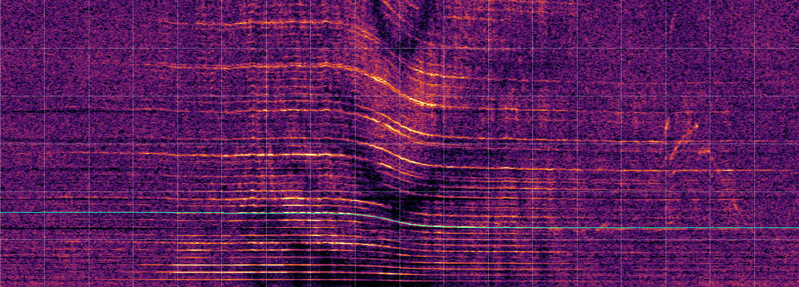

*Whitened spectrogram, 9:00.0–12:00.0 of the file, 0–600 Hz; grid every 10 s and 100 Hz; thin line = detector fit (lowest line only) when one falls in the window.*

Detector (`overhead-cli detect`, defaults):

| tc (file) | heard (UTC) | f0 Hz | v m/s [range] | d m [range] | lines | contrast | flags |
|---|---|---|---|---|---|---|---|
| 10:29.2 [10:26.6–10:32.5] | 07:29:29 | 137.5 | 39 [33–45] | 286 [129–506] | 3 | 15.5 | confident, ground? |

ADS-B (v2025.06.29-planes-readsb-prod-0), aircraft whose interpolated CPA was within 6 km slant of the site during the window (start −15 min … end +15 min); 7 aircraft were within 20 km in total:

None.


### 2. fs858688

**prop plane birds fens Kampina Netherlands 1140 am 250718_1173**

- Source: <https://freesound.org/people/klankbeeld/sounds/858688/> (Freesound (HQ preview MP3; the original needs a login))
- Recordist: klankbeeld. Licence: [CC BY 4.0](https://creativecommons.org/licenses/by/4.0/)
- **True location**: 51.57401, 5.27708 (Zandbergse vennen, Kampina, Van Gogh National Park, Boxtel; Noord-Brabant; Netherlands), elevation ~10 m, uncertainty ~50 m. [OpenStreetMap](https://www.openstreetmap.org/?mlat=51.57401&mlon=5.27708#map=15/51.57401/5.27708) · [Google Maps](https://www.google.com/maps?q=51.574010,5.277080). Recordist's GPS from the description ('Zandbergse vennen ... GPS 51.57401 5.27708'); OSM puts Zandbergsvennen at the same spot. The Freesound map pin (51.5787, 5.2573) is ~1.5 km west and is not used.
- **Date/time**: local start 2025-07-18 11:40:00 (Europe/Amsterdam, UTC+0200) = **2025-07-18 09:40:00Z**, uncertainty ±3 min. Date conflict: the title says '1140 am 250718' (18 July) but the description's 'Date/time' field says 'July 17, 2025, 11:40 am' (as does the sister file fs858591). ADS-B decides it (same local times, +-8 min): on the 17th nothing passes within 6 km slant during this file, and during fs858591 only an MD902 helicopter (D-HMDX, 1.5 km) that is heard ~10 min after that file ends, while on the 18th a Cessna 172 and a Robin DR400 pass at the right moments. So the 18th is used; the 17th in the description looks like a copy slip. The time of day agrees in title and description.
- Length: 2:00.0 (120 s). File: `~/overhead-data/testset/fs858688/audio.mp3`
- Audible: 'A small prop plane flying over' (recordist): strong propeller harmonics over the first ~80 s, closest around 0:30-0:40.

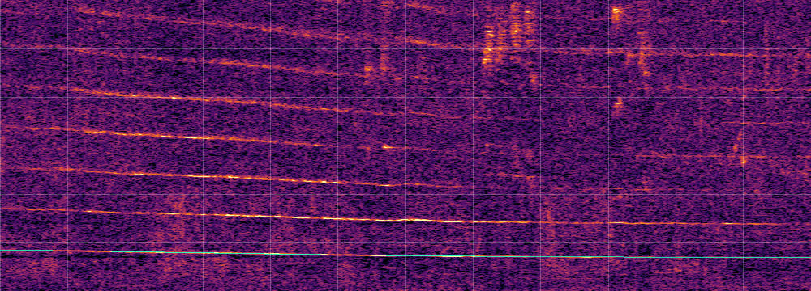

*Whitened spectrogram, 0:00.0–2:00.0 of the file, 0–600 Hz; grid every 10 s and 100 Hz; thin line = detector fit (lowest line only) when one falls in the window.*

Detector (`overhead-cli detect`, defaults):

| tc (file) | heard (UTC) | f0 Hz | v m/s [range] | d m [range] | lines | contrast | flags |
|---|---|---|---|---|---|---|---|
| 0:36.7 [0:06.3–0:52.6] | 09:40:36 | 77.2 | 48 [28–105] | 2391 [649–10238] | 3 | 44.1 | confident |

ADS-B (v2025.07.18-planes-readsb-prod-0), aircraft whose interpolated CPA was within 6 km slant of the site during the window (start −8 min … end +8 min); 15 aircraft were within 20 km in total:

| aircraft | hex | CPA (UTC) | heard at (file) | slant km | horiz km | baro ft | geom ft | above site m (from) | gs kt reported / flown |
|---|---|---|---|---|---|---|---|---|---|
| PH-TRG C172 | 484472 | 09:40:22 | 0:30.0 | 2.6 | 2.6 | 1475 | – | 464 (site) | 98.0 / 101.9 |

ADS-B on the alternative date 2025-07-17 (v2025.07.17-planes-readsb-prod-0), same local time and window: 12 aircraft within 20 km, 0 within 6 km slant.

**Most likely source of the fly-by**: PH-TRG C172, CPA 2.6 km, heard at 0:30.0 in file. Cessna 172 at 1475 ft pressure altitude (~460 m above the site after the QNH correction), 2.6 km slant from the recordist's GPS position, heard ~7 s before the detector's tc; the only low aircraft within 8 km in the window.

Detector vs ADS-B for this fly-by: tc 0:36.7 vs heard-CPA 0:30.0 (Δ +7 s, which also absorbs the error of the stated start time); v 48 m/s vs ground speed 52 m/s; d 2391 m vs slant CPA 2637 m.


### 3. fs858591

**prop plane voice insects birds fens Kampina Netherlands 1243 pm 250718_1173**

- Source: <https://freesound.org/people/klankbeeld/sounds/858591/> (Freesound (HQ preview MP3; the original needs a login))
- Recordist: klankbeeld. Licence: [CC BY 4.0](https://creativecommons.org/licenses/by/4.0/)
- **True location**: 51.57401, 5.27708 (Zandbergse vennen, Kampina, Van Gogh National Park, Boxtel; Noord-Brabant; Netherlands), elevation ~10 m, uncertainty ~50 m. [OpenStreetMap](https://www.openstreetmap.org/?mlat=51.57401&mlon=5.27708#map=15/51.57401/5.27708) · [Google Maps](https://www.google.com/maps?q=51.574010,5.277080). Recordist's GPS from the description ('Zandbergse vennen ... GPS 51.57401 5.27708'); OSM puts Zandbergsvennen at the same spot. The Freesound map pin (51.5787, 5.2573) is ~1.5 km west and is not used.
- **Date/time**: local start 2025-07-18 12:43:00 (Europe/Amsterdam, UTC+0200) = **2025-07-18 10:43:00Z**, uncertainty ±3 min. Time from title and description (12:43). Date conflict as in fs858688: title 18 July, description 'July 17, 2025'; ADS-B supports the 18th (see fs858688).
- Length: 2:45.0 (165 s). File: `~/overhead-data/testset/fs858591/audio.mp3`
- Audible: 'A prop plane over fens and heathlands' (recordist): two clear Doppler lines, closest around 1:45.

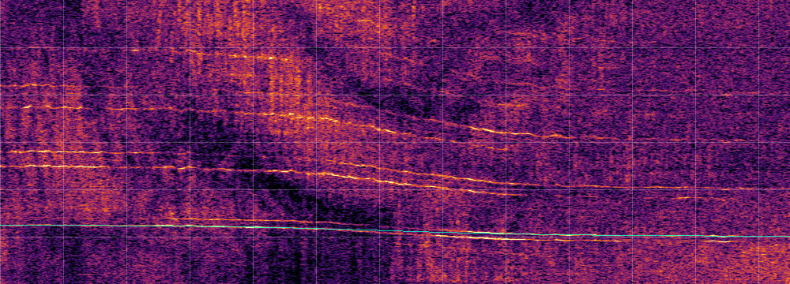

*Whitened spectrogram, 0:40.0–2:45.0 of the file, 0–600 Hz; grid every 10 s and 100 Hz; thin line = detector fit (lowest line only) when one falls in the window.*

Detector (`overhead-cli detect`, defaults):

| tc (file) | heard (UTC) | f0 Hz | v m/s [range] | d m [range] | lines | contrast | flags |
|---|---|---|---|---|---|---|---|
| 1:44.8 [1:33.3–1:55.5] | 10:44:44 | 111.2 | 40 [33–48] | 1241 [481–2067] | 1 | 31.4 | confident |
| 1:54.8 [1:24.6–1:57.6] | 10:44:54 | 220.5 | 29 [25–34] | 333 [205–5320] | 2 | 15.7 | ground? |

ADS-B (v2025.07.18-planes-readsb-prod-0), aircraft whose interpolated CPA was within 6 km slant of the site during the window (start −8 min … end +8 min); 19 aircraft were within 20 km in total:

| aircraft | hex | CPA (UTC) | heard at (file) | slant km | horiz km | baro ft | geom ft | above site m (from) | gs kt reported / flown |
|---|---|---|---|---|---|---|---|---|---|
| PH-HLR DR40 | 484457 | 10:44:02 | 1:04.0 | 0.8 | 0.3 | 2300 | – | 685 (site) | 426.0 / 117.1 |
| EI-EBS B738 | 4ca73b | 10:50:15 | 7:31.0 | 5.5 | 5.3 | 5350 | 5675 | 1670 (geom) | 236.1 / 234.3 |

ADS-B on the alternative date 2025-07-17 (v2025.07.17-planes-readsb-prod-0), same local time and window: 11 aircraft within 20 km, 1 within 6 km slant:

| aircraft | hex | CPA (UTC) | heard at (file) | slant km | above site m | gs kt |
|---|---|---|---|---|---|---|
| D-HMDX EXPL | 3df2b5 | 10:55:40 | 12:45.0 | 1.5 | 228 | 115.0 |

**Most likely source of the fly-by**: PH-HLR DR40, CPA 0.8 km, heard at 1:04.0 in file. Robin DR400 at 2300 ft pressure altitude (~690 m above the site), 0.8 km slant from the recordist's GPS position, the only light aircraft within 5 km. Its CPA is heard 1:04 into the file, 41 s before the detector's tc (1:45), well inside the +-3 min start uncertainty. Some of its trace points report ~420 kt ground speed (a decoding artefact); the speed flown between points is ~117 kt. (An EC135, PH-LLN, passed 8 km away and would be heard at ~1:47; too far to give these strong lines.)

Detector vs ADS-B for this fly-by: tc 1:44.8 vs heard-CPA 1:04.0 (Δ +41 s, which also absorbs the error of the stated start time); v 40 m/s vs ground speed 60 m/s; d 1241 m vs slant CPA 759 m.


### 4. xc941260

**XC941260 Soundscape, Wedgwood, Seattle**

- Source: <https://xeno-canto.org/941260> (xeno-canto)
- Recordist: Whitney Neufeld-Kaiser. Licence: [CC BY-NC-SA 4.0](https://creativecommons.org/licenses/by-nc-sa/4.0/)
- **True location**: 47.67660, -122.29400 (Wedgwood, Seattle, King County; Washington; United States), elevation ~100 m, uncertainty ~300 m. [OpenStreetMap](https://www.openstreetmap.org/?mlat=47.67660&mlon=-122.29400#map=15/47.67660/-122.29400) · [Google Maps](https://www.google.com/maps?q=47.676600,-122.294000). xeno-canto coordinates (4 decimals) given by the recordist.
- **Date/time**: local start 2024-03-13 08:46:00 (America/Los_Angeles, UTC-0700) = **2024-03-13 15:46:00Z**, uncertainty ±5 min. xeno-canto date/time field (minute precision; xeno-canto asks for the start time). Beginning and end were trimmed by the recordist, so the true start may be a little later.
- Length: 2:53.5 (174 s). File: `~/overhead-data/testset/xc941260/audio.wav`
- Audible: 'An annoyingly loud airplane flyover in the middle of the recording' (recordist): one strong falling Doppler line with ground-reflection interference from ~0:50 to ~1:50.

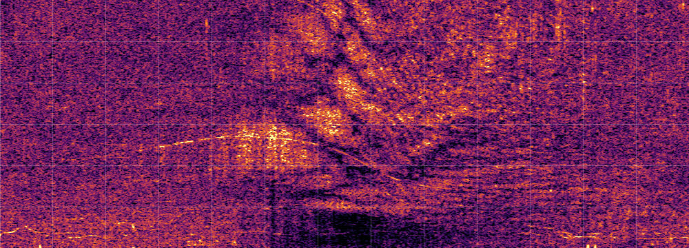

*Whitened spectrogram, 0:20.0–2:30.0 of the file, 0–600 Hz; grid every 10 s and 100 Hz; thin line = detector fit (lowest line only) when one falls in the window.*

Detector (`overhead-cli detect`, defaults):

No detections.

ADS-B (v2024.03.13-planes-readsb-prod-0), aircraft whose interpolated CPA was within 6 km slant of the site during the window (start −10 min … end +10 min); 32 aircraft were within 20 km in total:

| aircraft | hex | CPA (UTC) | heard at (file) | slant km | horiz km | baro ft | geom ft | above site m (from) | gs kt reported / flown |
|---|---|---|---|---|---|---|---|---|---|
| N486AS B739 | a5fef4 | 15:47:29 | 1:33.0 | 1.3 | 0.1 | 4425 | 4625 | 1328 (geom) | 233.9 / 233.0 |
| B-221S B77L | 781d6d | 15:53:47 | 7:52.0 | 1.5 | 0.9 | 4125 | 4375 | 1237 (geom) | 223.0 / 218.9 |
| XA-VRQ A20N | 0d0cb1 | 15:36:52 | −9:03.0 | 1.6 | 1.1 | 4000 | 4225 | 1207 (geom) | 224.1 / 223.3 |
| N3754A B738 | a44943 | 15:59:31 | 13:37.0 | 1.9 | 1.3 | 4550 | 4750 | 1364 (geom) | 221.0 / 223.4 |
| N297AK B739 | a30f85 | 15:50:14 | 4:20.0 | 2.0 | 1.7 | 3600 | 3850 | 1090 (geom) | 214.2 / 209.7 |
| N956AK B39M | ad4afb | 15:45:16 | −0:38.0 | 2.0 | 1.6 | 3975 | 4200 | 1200 (geom) | 198.5 / 196.6 |
| N622AS B737 | a81dbc | 15:44:24 | −1:27.0 | 3.1 | 2.8 | 3900 | 4175 | 1190 (geom) | 207.1 / 206.6 |
| N384DA B738 | a46a72 | 15:39:14 | −6:33.0 | 4.2 | 4.0 | 3575 | 3825 | 1082 (geom) | 207.2 / 202.2 |

**Most likely source of the fly-by**: N486AS B739, CPA 1.3 km, heard at 1:33.0 in file. Alaska Airlines Boeing 737-900 on approach at 4425 ft passing almost overhead (0.05 km horizontal, 1.3 km slant). So the 'airplane flyover' is an airliner, not a propeller aircraft; the detector does not pick up its line.


### 5. aporee_62753_72191

**Edgemere, Queens, New York - After bathing time**

- Source: <https://aporee.org/maps/?loc=62753&snd=72191> (radio aporee (Internet Archive mirror)), mirror <https://archive.org/details/aporee_62753_72191>
- Recordist: Peter Stets. Licence: [Public Domain Mark 1.0](https://creativecommons.org/publicdomain/mark/1.0/)
- **True location**: 40.59073, -73.76704 (Edgemere beach, Queens, New York City; New York; United States), elevation ~0 m, uncertainty ~100 m. [OpenStreetMap](https://www.openstreetmap.org/?mlat=40.59073&mlon=-73.76704#map=15/40.59073/-73.76704) · [Google Maps](https://www.google.com/maps?q=40.590735,-73.767043). radio aporee map pin placed by the recordist.
- **Date/time**: local start 2023-07-10 18:11:00 (America/New_York, UTC-0400) = **2023-07-10 22:11:00Z**, uncertainty ±10 min. Date and time from the radio aporee map entry.
- Length: 3:55.0 (235 s). File: `~/overhead-data/testset/aporee_62753_72191/audio.wav`
- Audible: Waves, siren, 'a helicopter which flew along the shore and some planes from JFK' (recordist). Helicopter harmonics very clear from ~0:20 to ~1:40, closest ~1:07.
- Notes: The fly-by is a helicopter, not an airliner: it shows a dense harmonic comb (14+ lines below 300 Hz) whose spacing falls from 21.6 Hz (approach) to 14.7 Hz (recede), i.e. a rest spacing of ~17.5 Hz and ~65 m/s (scripts/testset/comb.py). That is a main-rotor blade-passing comb; jet fan tones of an airliner on approach lie far higher and are not a 17 Hz comb. No helicopter appears in adsb.lol within 6 km in the window, so treat this like Mechlin: a clear fly-by the matcher must leave unmatched (or at most match to an unknown non-ADS-B aircraft). An earlier version of this page attributed it to the B739; that was wrong.

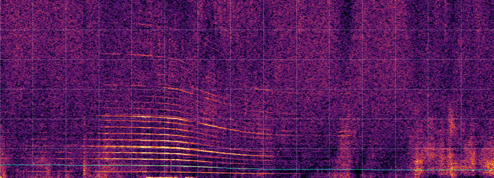

*Whitened spectrogram, 0:00.0–2:30.0 of the file, 0–600 Hz; grid every 10 s and 100 Hz; thin line = detector fit (lowest line only) when one falls in the window.*

Detector (`overhead-cli detect`, defaults):

| tc (file) | heard (UTC) | f0 Hz | v m/s [range] | d m [range] | lines | contrast | flags |
|---|---|---|---|---|---|---|---|
| 1:07.2 [1:04.4–1:10.2] | 22:12:07 | 34.2 | 74 [68–84] | 912 [680–1298] | 3 | 64.8 | confident |

ADS-B (v2023.07.10-planes-readsb-prod-0), aircraft whose interpolated CPA was within 6 km slant of the site during the window (start −15 min … end +15 min); 113 aircraft were within 20 km in total:

| aircraft | hex | CPA (UTC) | heard at (file) | slant km | horiz km | baro ft | geom ft | above site m (from) | gs kt reported / flown |
|---|---|---|---|---|---|---|---|---|---|
| ~2ac392 ? | ~2ac392 | 22:22:18 | 11:24.0 | 2.0 | 1.6 | 3600 | – | 1092 (site) | 137.3 / 143.2 |
| N913DU B739 | aca22e | 22:11:59 | 1:05.0 | 2.2 | 2.2 | 1300 | 1150 | 224 (geom) | 164.0 / – |
| N257AZ B763 | a27197 | 22:13:44 | 2:50.0 | 2.2 | 2.2 | 1350 | 1175 | 201 (geom) | 147.1 / – |
| N313PQ CRJ9 | a3534a | 22:00:25 | −10:29.0 | 2.2 | 2.2 | 1300 | 1100 | 214 (geom) | 150.6 / – |
| N197PQ CRJ9 | a18380 | 22:18:13 | 7:20.0 | 2.2 | 2.2 | 1275 | 1075 | 198 (geom) | 147.5 / 149.4 |
| F-GSQG B77W | 394a06 | 22:09:39 | −1:15.0 | 2.2 | 2.2 | 1325 | 1200 | 226 (geom) | 156.1 / – |
| N323JB E190 | a37a3f | 22:19:43 | 8:50.0 | 2.2 | 2.2 | 775 | 575 | 190 (geom) | 140.5 / 141.3 |
| N918DU B739 | acb4c1 | 22:24:43 | 13:50.0 | 2.2 | 2.2 | 1350 | 1225 | 241 (geom) | 172.7 / – |
| N927XJ CRJ9 | acda41 | 22:15:51 | 4:58.0 | 2.2 | 2.2 | 1300 | 1100 | 231 (geom) | 147.1 / – |
| N913JB A321 | aca29a | 22:30:39 | 19:45.0 | 2.2 | 2.2 | 1250 | 1100 | 226 (geom) | 156.6 / – |
| N3102J BCS3 | a34978 | 21:54:43 | −16:10.0 | 2.6 | 1.8 | 6150 | 6175 | 1915 (geom) | 287.4 / 287.9 |
| N852DN B739 | abaf1e | 22:02:46 | −8:04.0 | 3.2 | 3.2 | 1275 | 1100 | 315 (geom) | 161.0 / 160.9 |

**ADS-B candidate N913DU (rejected, not ground truth)**: Delta B739 on approach to JFK, heard ~2 s from the detector's tc. Rejected: approach jets pass at this same ~2.2 km slant every 2-3 min (9 in the window), so a timing coincidence within the +-10 min uncertainty is expected, and the sound is a helicopter (see notes).


### 6. aporee_64975_75055

**3 2nd St, Jersey City - Waves near Harborside and Hudson River Waterfront walkway**

- Source: <https://aporee.org/maps/?loc=64975&snd=75055> (radio aporee (Internet Archive mirror)), mirror <https://archive.org/details/aporee_64975_75055>
- Recordist: rsj49. Licence: [CC BY-SA 3.0](https://creativecommons.org/licenses/by-sa/3.0/)
- **True location**: 40.72087, -74.03135 (Hudson River Waterfront walkway near Harborside light-rail station, Jersey City; New Jersey; United States), elevation ~0 m, uncertainty ~100 m. [OpenStreetMap](https://www.openstreetmap.org/?mlat=40.72087&mlon=-74.03135#map=15/40.72087/-74.03135) · [Google Maps](https://www.google.com/maps?q=40.720875,-74.031346). radio aporee map pin; the title gives the street address (3 2nd St).
- **Date/time**: local start 2024-08-11 19:50:00 (America/New_York, UTC-0400) = **2024-08-11 23:50:00Z**, uncertainty ±10 min. Date and time from the radio aporee map entry.
- Length: 5:01.6 (302 s). File: `~/overhead-data/testset/aporee_64975_75055/audio.wav`
- Audible: Waves, pedestrians; 'a helicopter can be heard passing overhead' (recordist). Very clear, fast and close helicopter fly-by from ~1:30 to ~2:20, closest ~2:05.
- Notes: Rotor comb (scripts/testset/comb.py): spacing 26.9 Hz on approach, ~18.9 Hz receding, so ~22 Hz at rest and ~60 m/s. ADS-B was checked on both UTC days (the window crosses midnight). The detector misses this very clear, fast, close pass.

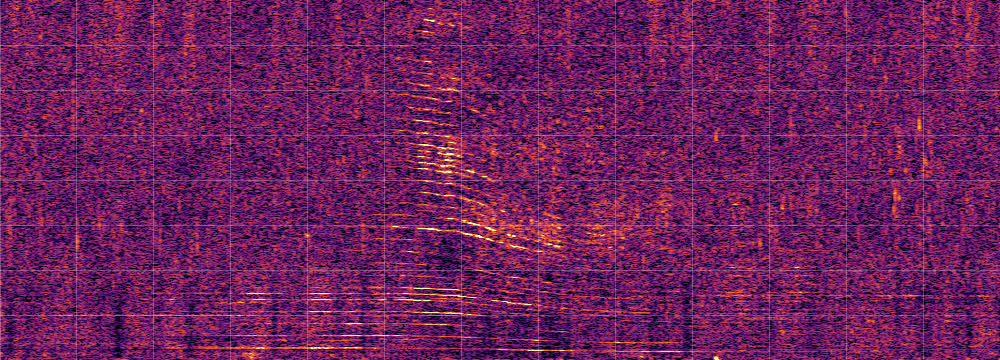

*Whitened spectrogram, 1:10.0–3:20.0 of the file, 0–800 Hz; grid every 10 s and 100 Hz; thin line = detector fit (lowest line only) when one falls in the window.*

Detector (`overhead-cli detect`, defaults):

No detections.

ADS-B (v2024.08.11-planes-readsb-prod-0, v2024.08.12-planes-readsb-prod-0), aircraft whose interpolated CPA was within 6 km slant of the site during the window (start −15 min … end +15 min); 226 aircraft were within 20 km in total:

| aircraft | hex | CPA (UTC) | heard at (file) | slant km | horiz km | baro ft | geom ft | above site m (from) | gs kt reported / flown |
|---|---|---|---|---|---|---|---|---|---|
| N415PH B407 | a4e800 | 00:11:11 | 21:12.0 | 0.4 | 0.3 | 725 | 625 | 211 (geom) | 116.9 / 114.0 |
| N411PH B407 | a4d924 | 23:38:18 | −11:41.0 | 0.4 | 0.3 | 500 | 400 | 152 (geom) | 110.2 / 113.0 |
| N644PC R44 | a8755f | 23:37:01 | −12:58.0 | 0.4 | 0.3 | 900 | 775 | 269 (geom) | 91.0 / 90.3 |
| N6160Y B06 | a80777 | 00:02:11 | 12:13.0 | 0.4 | 0.4 | 575 | 500 | 188 (geom) | 87.0 / 86.3 |
| N38BL B407 | a45915 | 23:43:08 | −6:51.0 | 0.5 | 0.5 | 700 | 625 | 232 (geom) | 109.7 / 110.4 |
| N403TD B407 | a4b973 | 23:44:38 | −5:20.0 | 0.6 | 0.5 | 875 | 825 | 294 (geom) | 118.3 / 117.9 |
| N4332N P28A | a530ee | 00:10:21 | 20:23.0 | 0.6 | 0.2 | 1900 | 1875 | 604 (geom) | 73.8 / 73.0 |
| N8437N PA34 | ab8e58 | 23:41:32 | −8:26.0 | 0.6 | 0.4 | 1700 | 1625 | 509 (geom) | 139.2 / 136.9 |
| N217MH B06 | a1d49e | 23:43:34 | −6:23.0 | 0.9 | 0.6 | 2000 | 1975 | 627 (geom) | 97.2 / 88.1 |
| N28BB B429 | a2cbbd | 00:05:00 | 15:03.0 | 0.9 | 0.9 | 675 | 650 | 224 (geom) | 147.0 / 139.5 |
| N821SS S76 | ab3633 | 23:51:40 | 1:43.0 | 0.9 | 0.9 | 700 | 675 | 239 (geom) | 135.1 / 128.0 |
| N84BL B407 | ab7da4 | 23:47:07 | −2:50.0 | 1.0 | 1.0 | 600 | 500 | 155 (geom) | 141.0 / 137.8 |

**ADS-B candidate N821SS (ambiguous, not ground truth)**: Sikorsky S-76, 0.9 km slant, heard 1:43 into the file at the stated start, the nearest in time to the loud pass (Doppler midpoint ~2:18). But in the +-10 min window there are 11 helicopter passes within 2 km slant (Hudson corridor): 6 by Bell 206s, 4 by Bell 407s (N38BL, N403TD, N84BL, N401TD) and this S-76, any of which fits if the start is off by a few minutes. The rotor comb (rest ~22 Hz, see notes) points to a 4-blade rotor (S-76 ~19.5 Hz, B407 ~27.5 Hz by published rotor speed) and argues against the 2-blade Bell 206 / R44 (~13 Hz), but cannot pick one aircraft. Not ground truth.


### 7. aporee_60944_74426

**Wusterauer Anger, Kirchmöser Ost - garden ambience, morning rain, helicopter**

- Source: <https://aporee.org/maps/?loc=60944&snd=74426> (radio aporee fieldradio stream (Internet Archive mirror)), mirror <https://archive.org/details/aporee_60944_74426>
- Recordist: radio aporee fieldradio (fixed remote microphone). Licence: [CC BY-SA 3.0](https://creativecommons.org/licenses/by-sa/3.0/)
- **True location**: 52.38366, 12.44077 (Wusterauer Anger, Kirchmöser, Brandenburg an der Havel; Brandenburg; Germany), elevation ~32 m, uncertainty ~100 m. [OpenStreetMap](https://www.openstreetmap.org/?mlat=52.38366&mlon=12.44077#map=15/52.38366/12.44077) · [Google Maps](https://www.google.com/maps?q=52.383656,12.440769). radio aporee map pin of the fixed fieldradio microphone.
- **Date/time**: local start 2024-06-15 09:19:00 (Europe/Berlin, UTC+0200) = **2024-06-15 07:19:00Z**, uncertainty ±5 min. Time from the title and map entry of a 10-minute excerpt of a live remote-microphone stream.
- Length: 10:00.0 (600 s). File: `~/overhead-data/testset/aporee_60944_74426/audio.mp3`
- Audible: Garden ambience, rain, a helicopter (title). Clear Doppler fly-by with harmonics, closest ~4:49; a second weaker one later.
- Notes: ADS-B: only airliners above 10 000 ft within 20 km in the window; the helicopter is not in adsb.lol. A hard case for the matcher (clear fly-by, nothing to match).

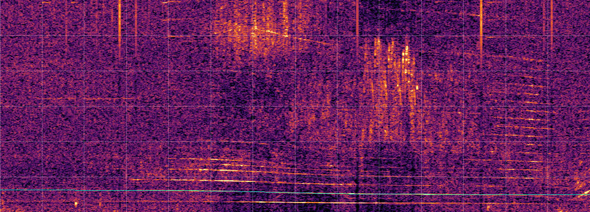

*Whitened spectrogram, 3:40.0–6:00.0 of the file, 0–600 Hz; grid every 10 s and 100 Hz; thin line = detector fit (lowest line only) when one falls in the window.*

Detector (`overhead-cli detect`, defaults):

| tc (file) | heard (UTC) | f0 Hz | v m/s [range] | d m [range] | lines | contrast | flags |
|---|---|---|---|---|---|---|---|
| 4:48.6 [4:45.4–4:55.0] | 07:23:48 | 54.9 | 41 [34–61] | 882 [510–2472] | 2 | 34.9 | confident |
| 8:43.1 [8:38.6–8:48.5] | 07:27:43 | 175.0 | 30 [25–36] | 400 [196–866] | 1 | 13.7 | confident, ground? |
| 9:34.7 [9:02.8–10:14.7] | 07:28:34 | 37.7 | 36 [24–96] | 759 [47–12149] | 1 | 16.8 | unconfident |

ADS-B (v2024.06.15-planes-readsb-prod-0), aircraft whose interpolated CPA was within 6 km slant of the site during the window (start −10 min … end +10 min); 6 aircraft were within 20 km in total:

None.


### 8. aporee_66516_76914

**Emmauswald, Neukölln, Berlin - urban forest ambience, w/ goshawk, churchbells, helicopter**

- Source: <https://aporee.org/maps/?loc=66516&snd=76914> (radio aporee fieldradio stream (Internet Archive mirror)), mirror <https://archive.org/details/aporee_66516_76914>
- Recordist: radio aporee fieldradio (fixed remote microphone). Licence: [CC BY-SA 3.0](https://creativecommons.org/licenses/by-sa/3.0/)
- **True location**: 52.46227, 13.42426 (Emmauswald, Neukölln, Berlin; Berlin; Germany), elevation ~53 m, uncertainty ~100 m. [OpenStreetMap](https://www.openstreetmap.org/?mlat=52.46227&mlon=13.42426#map=15/52.46227/13.42426) · [Google Maps](https://www.google.com/maps?q=52.462273,13.424262). radio aporee map pin of the fixed fieldradio microphone.
- **Date/time**: local start 2025-02-09 09:58:00 (Europe/Berlin, UTC+0100) = **2025-02-09 08:58:00Z**, uncertainty ±5 min. Time from the title and map entry of a 10-minute excerpt of a live remote-microphone stream.
- Length: 10:00.0 (600 s). File: `~/overhead-data/testset/aporee_66516_76914/audio.mp3`
- Audible: Urban forest, goshawk, church bells, a helicopter (title). Helicopter harmonics fan out around 8:20-8:45, closest ~8:33.

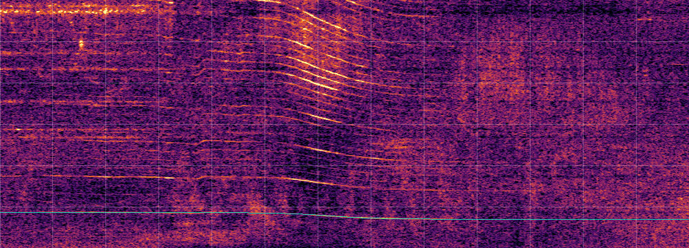

*Whitened spectrogram, 7:30.0–9:40.0 of the file, 0–600 Hz; grid every 10 s and 100 Hz; thin line = detector fit (lowest line only) when one falls in the window.*

Detector (`overhead-cli detect`, defaults):

| tc (file) | heard (UTC) | f0 Hz | v m/s [range] | d m [range] | lines | contrast | flags |
|---|---|---|---|---|---|---|---|
| 8:33.4 [8:31.8–8:34.7] | 09:06:33 | 76.7 | 39 [35–45] | 391 [268–535] | 4 | 38.6 | confident, ground? |

ADS-B (v2025.02.09-planes-readsb-prod-0), aircraft whose interpolated CPA was within 6 km slant of the site during the window (start −10 min … end +10 min); 28 aircraft were within 20 km in total:

| aircraft | hex | CPA (UTC) | heard at (file) | slant km | horiz km | baro ft | geom ft | above site m (from) | gs kt reported / flown |
|---|---|---|---|---|---|---|---|---|---|
| D-EMFM C152 | 3d24e6 | 09:06:48 | 8:50.0 | 0.6 | 0.4 | 1500 | – | 509 (site) | 103.0 / 93.3 |
| D-HYAS EC45 | 3e1212 | 08:55:05 | −2:43.0 | 4.1 | 4.1 | 525 | 1100 | 235 (geom) | 130.9 / 130.0 |
| HB-JPD A21N | 4b194d | 08:46:40 | −11:07.0 | 4.5 | 1.4 | 13775 | 14150 | 4265 (geom) | 363.8 / 361.8 |
| EI-DPN B738 | 4ca4f2 | 09:07:07 | 9:21.0 | 5.1 | 2.4 | 14475 | 14750 | 4487 (geom) | 350.4 / 349.8 |
| EI-ENM B738 | 4ca8d8 | 09:10:10 | 12:27.0 | 5.7 | 4.2 | 12475 | 12800 | 3846 (geom) | 340.3 / 337.5 |

**Most likely source of the fly-by**: D-EMFM C152, CPA 0.6 km, heard at 8:50.0 in file. Cessna 152 at 1500 ft pressure altitude, ~510 m above the site after the QNH correction (that morning geometric altitudes ran ~475 ft above pressure altitudes, i.e. high pressure), 0.6 km slant, heard 8:50 into the file, 17 s after the detector's tc. So the fan of lines at ~8:33 is this light aircraft, not the helicopter of the title (an EC145 D-HYAS passed 4 km away ~3 min before the file starts). The detector flags it 'ground?' because its fitted speed (39 m/s) is low.

Detector vs ADS-B for this fly-by: tc 8:33.4 vs heard-CPA 8:50.0 (Δ -17 s, which also absorbs the error of the stated start time); v 39 m/s vs ground speed 48 m/s; d 391 m vs slant CPA 619 m.


### 9. xc1152845

**XC1152845 Marsh Warbler, parc du Biez, Mondeville**

- Source: <https://xeno-canto.org/1152845> (xeno-canto)
- Recordist: Guillaume DEBOUT. Licence: [CC BY-NC-SA 4.0](https://creativecommons.org/licenses/by-nc-sa/4.0/)
- **True location**: 49.18150, -0.31510 (Parc du Biez, Mondeville (near Caen); Calvados, Normandie; France), elevation ~10 m, uncertainty ~300 m. [OpenStreetMap](https://www.openstreetmap.org/?mlat=49.18150&mlon=-0.31510#map=15/49.18150/-0.31510) · [Google Maps](https://www.google.com/maps?q=49.181500,-0.315100). xeno-canto coordinates (4 decimals) given by the recordist.
- **Date/time**: local start 2026-07-04 12:00:00 (Europe/Paris, UTC+0200) = **2026-07-04 10:00:00Z**, uncertainty ±60 min. xeno-canto time is a round 12:00, so treat it as 'around midday' (we assume +-1 h).
- Length: 5:43.3 (343 s). File: `~/overhead-data/testset/xc1152845/audio.mp3`
- Audible: Urban park, traffic, 'hélicoptère' (recordist). Clear helicopter fly-by, closest ~2:28.
- Notes: ADS-B (+-1 h window): the only low traffic near the site is a Citation jet (D-CXLS, 1.9 km, 10:00 UTC) and an unregistered French address at 83 kt, 1550 ft, 8.4 km (09:41 UTC), which is slow enough to be a helicopter but too far for the loud pass in the file. No convincing match: treat as a hard case where the helicopter is not in ADS-B.

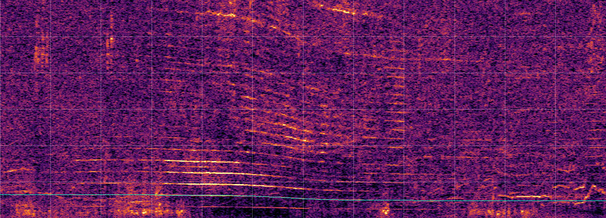

*Whitened spectrogram, 1:30.0–3:30.0 of the file, 0–600 Hz; grid every 10 s and 100 Hz; thin line = detector fit (lowest line only) when one falls in the window.*

Detector (`overhead-cli detect`, defaults):

| tc (file) | heard (UTC) | f0 Hz | v m/s [range] | d m [range] | lines | contrast | flags |
|---|---|---|---|---|---|---|---|
| 2:28.0 [2:25.4–2:32.5] | 10:02:27 | 54.7 | 49 [43–60] | 492 [300–1035] | 4 | 29.3 | confident |

ADS-B (v2026.07.04-planes-readsb-prod-0), aircraft whose interpolated CPA was within 6 km slant of the site during the window (start −65 min … end +65 min); 26 aircraft were within 20 km in total:

| aircraft | hex | CPA (UTC) | heard at (file) | slant km | horiz km | baro ft | geom ft | above site m (from) | gs kt reported / flown |
|---|---|---|---|---|---|---|---|---|---|
| D-CXLS C56X | 3cfdec | 10:00:20 | 0:25.0 | 1.9 | 0.6 | 5300 | 6000 | 1785 (geom) | 264.4 / 259.6 |
| N552XJ CL30 | a708ef | 10:35:27 | 35:38.0 | 3.9 | 3.4 | 5450 | 6225 | 1863 (geom) | 263.8 / 264.8 |


### 10. xc883367

**XC883367 Soundscape, Dünserberg (mit Hubschrauber)**

- Source: <https://xeno-canto.org/883367> (xeno-canto)
- Recordist: Georg Amann. Licence: [CC BY-NC-SA 4.0](https://creativecommons.org/licenses/by-nc-sa/4.0/)
- **True location**: 47.23650, 9.73410 (Gemeinde Dünserberg, Feldkirch district; Vorarlberg; Austria), elevation ~1600 m, uncertainty ~500 m. [OpenStreetMap](https://www.openstreetmap.org/?mlat=47.23650&mlon=9.73410#map=15/47.23650/9.73410) · [Google Maps](https://www.google.com/maps?q=47.236500,9.734100). xeno-canto coordinates (4 decimals); the locality is the whole Gemeinde.
- **Date/time**: local start 2024-03-20 12:00:00 (Europe/Vienna, UTC+0100) = **2024-03-20 11:00:00Z**, uncertainty ±60 min. xeno-canto time is a round 12:00; treat as 'around midday' (+-1 h assumed).
- Length: 4:42.1 (282 s). File: `~/overhead-data/testset/xc883367/audio.mp3`
- Audible: Subalpine spruce forest, 'helicopter' (remarks; the file name says 'mit Hubschrauber'). Helicopter harmonics from ~1:00 to ~3:30, closest ~2:26. Mountain site, 1600 m.
- Notes: A helicopter by its sound: a harmonic comb with ~21 Hz spacing at rest (23 Hz -> 19 Hz from 0:40 to 2:55, scripts/testset/comb.py). No convincing ADS-B source; treat as unmatched.

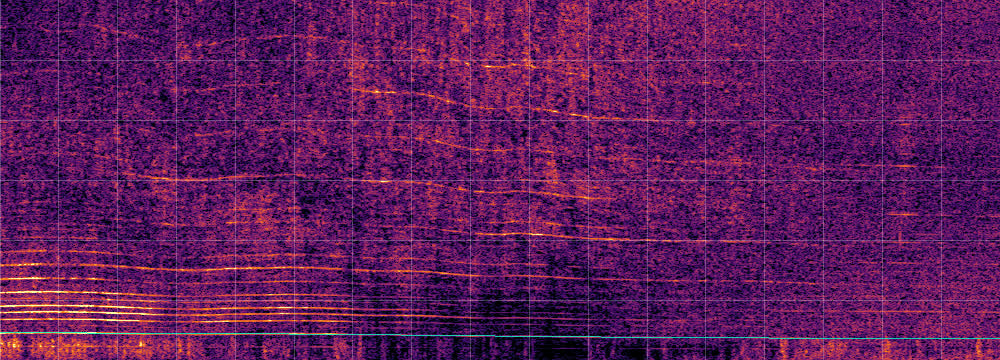

*Whitened spectrogram, 1:00.0–3:50.0 of the file, 0–600 Hz; grid every 10 s and 100 Hz; thin line = detector fit (lowest line only) when one falls in the window.*

Detector (`overhead-cli detect`, defaults):

| tc (file) | heard (UTC) | f0 Hz | v m/s [range] | d m [range] | lines | contrast | flags |
|---|---|---|---|---|---|---|---|
| 2:25.7 [2:05.9–3:05.7] | 11:02:25 | 39.8 | 48 [32–108] | 2679 [765–28285] | 4 | 35.2 | unconfident |

ADS-B (v2024.03.20-planes-readsb-prod-0), aircraft whose interpolated CPA was within 6 km slant of the site during the window (start −65 min … end +65 min); 39 aircraft were within 20 km in total:

| aircraft | hex | CPA (UTC) | heard at (file) | slant km | horiz km | baro ft | geom ft | above site m (from) | gs kt reported / flown |
|---|---|---|---|---|---|---|---|---|---|
| 3e6f61 ? | 3e6f61 | 11:35:08 | 35:10.0 | 0.6 | 0.2 | 6650 | 7125 | 525 (geom) | 74.7 / 75.5 |
| D-EMGK DV20 | 3d24fe | 10:34:00 | −25:50.0 | 3.4 | 3.4 | 4575 | – | 0 (site) | 102.9 / 102.2 |
| D-MBFG NG5 | 3ff94d | 10:03:52 | −55:53.0 | 5.0 | 4.8 | 9575 | – | 1401 (site) | 101.0 / 99.2 |
| OE-AFM A210 | 440c3d | 11:10:45 | 11:02.0 | 5.6 | 5.4 | 10275 | – | 1614 (site) | None / 178.2 |

**ADS-B candidate 3e6f61 (speculative, not ground truth)**: Unregistered German address passing 0.6 km slant (~525 m above the site) at 11:35 UTC, which needs the stated 12:00 local start to be ~33 min early. Not supported: its trace (~100 kt climbing to ~8350 ft pressure altitude, then a turn and a steady 75-85 kt descent) looks like a light aircraft or motor glider rather than a helicopter, the detector puts the source at ~2.7 km (4.8x further), and the slow change of the comb over ~2 min also fits a distant source. Another unregistered target (3ff878, 76 kt, ~6800 ft) passed 11 km away at 10:59. Not ground truth.


### 11. fs847111

**Altenthann - Midday Rural Village Ambience with Birds, Children, Distant Traffic & Aircraft Events (03 Mar 2026)**

- Source: <https://freesound.org/people/TSP-Talk/sounds/847111/> (Freesound (HQ preview MP3; the original needs a login))
- Recordist: TSP-Talk. Licence: [CC0 1.0](https://creativecommons.org/publicdomain/zero/1.0/)
- **True location**: 49.08138, 12.30070 (Altenthann (93177), Regensburg district (Freesound geotag); Bavaria; Germany), elevation ~400 m, uncertainty ~1500 m. [OpenStreetMap](https://www.openstreetmap.org/?mlat=49.08138&mlon=12.30070#map=15/49.08138/12.30070) · [Google Maps](https://www.google.com/maps?q=49.081380,12.300700). Freesound map pin only; it lies ~1.3 km south of the village centre that Nominatim gives (49.0931, 12.3038), and the description just says 'Altenthann'.
- **Date/time**: local start 2026-03-03 13:30:00 (Europe/Berlin, UTC+0100) = **2026-03-03 12:30:00Z**, uncertainty ±15 min. Description: 'recorded on 03 March 2026 between 13:30-14:30 CET'. The file is only 33:43 long, so it can start anywhere from 13:30 to ~13:56; we use 13:30 +-15 min. The only ADS-B candidate needs a start of ~13:38.
- Length: 33:43.0 (2023 s). File: `~/overhead-data/testset/fs847111/audio.mp3`
- Audible: Village ambience; recordist marks '03:00 a distinctly audible low-altitude aircraft, likely a small helicopter' and '27:45 a large military aircraft flying overhead'. The helicopter is very clear (closest ~3:40); the second event is broadband and weaker.
- Notes: The description says 13:30-14:30 but the file is 33:43 long, so it is either an excerpt or the end time is loose; the start time is what matters here.

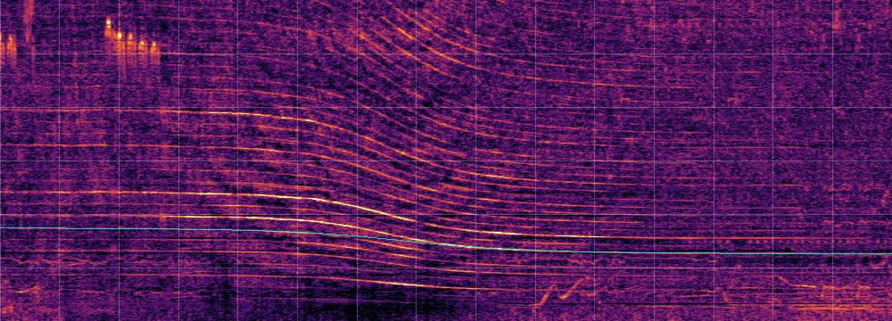

*Whitened spectrogram, 2:30.0–5:00.0 of the file, 0–600 Hz; grid every 10 s and 100 Hz; thin line = detector fit (lowest line only) when one falls in the window.*

Detector (`overhead-cli detect`, defaults):

| tc (file) | heard (UTC) | f0 Hz | v m/s [range] | d m [range] | lines | contrast | flags |
|---|---|---|---|---|---|---|---|
| 3:39.2 [3:27.7–3:45.8] | 12:33:39 | 77.1 | 77 [65–85] | 1203 [723–1890] | 4 | 15.6 | confident |
| 3:41.5 [3:36.7–3:46.3] | 12:33:41 | 145.7 | 57 [47–64] | 1246 [565–1816] | 1 | 15.6 | confident |
| 28:57.1 [28:33.4–29:23.6] | 12:58:57 | 62.5 | 81 [19–161] | 1387 [87–6157] | 2 | 13.0 | unconfident |

ADS-B (v2026.03.03-planes-readsb-prod-0), aircraft whose interpolated CPA was within 6 km slant of the site during the window (start −20 min … end +20 min); 41 aircraft were within 20 km in total:

| aircraft | hex | CPA (UTC) | heard at (file) | slant km | horiz km | baro ft | geom ft | above site m (from) | gs kt reported / flown |
|---|---|---|---|---|---|---|---|---|---|
| D-HAIB R44 | 3dd371 | 12:41:58 | 12:02.0 | 1.6 | 1.5 | 2275 | 2750 | 384 (geom) | 123.8 / 122.7 |
| D-HTAD R44 | 3e04cf | 12:08:06 | −21:42.0 | 4.4 | 4.4 | 2400 | – | 430 (site) | 152.0 / 202.9 |

**Most likely source of the fly-by**: D-HAIB R44, CPA 1.6 km, heard at 12:02.0 in file (only if the file starts ~8 min after the stated time). Robinson R44 helicopter at 2275 ft pressure / 2750 ft geometric altitude (~380 m above the site), 1.6 km slant, the only low aircraft within 6 km in the window. Its CPA is heard 12:02 after the stated 13:30 start, while the recordist marks the helicopter at 03:00 and the detector puts it at 3:39, so the file most likely starts ~13:38 local (it is 33:43 long, not the stated hour, so a start after 13:30 is consistent with the description). This is a match only under that 8-minute shift; another R44, D-HTAD, passed 4.4 km away ~22 min before 13:30. The 27:45 'large military aircraft' is not in ADS-B.

Detector vs ADS-B for this fly-by: tc 3:39.2 vs heard-CPA 12:02.0 (Δ -503 s, which also absorbs the error of the stated start time); v 77 m/s vs ground speed 63 m/s; d 1203 m vs slant CPA 1568 m.


## Rejected candidates

| candidate | why not |
|---|---|
| [radio aporee 62004/71347 (Reykjavík harbour, wind harp and helicopter, 2023-10-23 16:08)](https://aporee.org/maps/?loc=62004&snd=71347) | Superb, very clear helicopter fly-by, but adsb.lol has no aircraft at all within 20 km of Reykjavík in the window (no feeder coverage there in 2023), so nothing to verify against. |
| [xeno-canto XC1145145 (Poland, Corn Bunting, 2025-05-24)](https://xeno-canto.org/1145145) | 'Passing aircraft' is only a faint broadband rumble; no tonal Doppler line; detector finds nothing. |
| [xeno-canto XC1093293 (Croatia, Eagle-Owl, 2026-03-05)](https://xeno-canto.org/1093293) | Airplane noise is broadband (jet), no lines; detector finds nothing. |
| [xeno-canto XC960630 / XC960631 (Frankfurt, 2024-12-25)](https://xeno-canto.org/960631) | Airliners on approach (broadband, ground-reflection fringes) and a 400 Hz high-pass by the recordist; detections are unconfident. Usable later as a jet test, not for propeller/helicopter lines. |
| [xeno-canto XC1050957 (Haverleij, NL, military helicopters, 2025-10-27 20:10)](https://xeno-canto.org/1050957) | Only the receding half of a helicopter pass (first 30 s); military helicopters often fly without ADS-B. Checked: nothing in adsb.lol below 6 km slant in the window (nearest a GLF4 at 16 km). |
| [xeno-canto XC961711 (Westland, New Zealand, helicopter tours, 2024-11-04)](https://xeno-canto.org/961711) | Helicopter lines only while receding (first ~30 s of a 92 s clip); ADS-B feeder coverage of the South Island West Coast is poor. Checked: adsb.lol has a single airliner at 37 000 ft in the window. |
| [xeno-canto XC1080406, XC1092456, XC1105861, XC904490, XC905295](https://xeno-canto.org/1092456) | Aircraft mentioned in the remarks but no tonal Doppler line visible in the spectrogram; detector finds nothing. |
| [xeno-canto, 12 long unedited Polish soundscapes (XC1136486, XC1148061/2, XC905328, XC905892, XC1144936-45, XC928277)](https://xeno-canto.org/1144945) | Mined blind for fly-bys (no aircraft in the remarks): the detector found only two slow 'ground?' tracks, nothing aircraft-like. |
| [xeno-canto XC792401 (Austria, snipe display with airplane noise)](https://xeno-canto.org/792401) | High-pass filtered below 150 Hz by the recordist, which removes the propeller band. |
| [xeno-canto XC906184 / radio aporee 64294 (Malton, UK, light aircraft take-off)](https://xeno-canto.org/906184) | 'Time edited extended recording': cut together, so file time does not map to clock time. |
| [xeno-canto XC941347 (Arizona, low-flying helicopter)](https://xeno-canto.org/941347) | 'Interval shortened' (edited); helicopter loiters rather than passes. |
| [Freesound 870002 (klankbeeld, Bokhoven NL, small prop plane, 2025-06-11)](https://freesound.org/people/klankbeeld/sounds/870002/) | Plane is weak and masked by waves and traffic; one unconfident detection; date in the title has a typo ('2500611'). |
| [Freesound 842369 (klankbeeld, Apache helicopters, 's-Hertogenbosch, 2026-01-16)](https://freesound.org/people/klankbeeld/sounds/842369/) | Military helicopters 'flying high'; weak lines, one confident detection only; Apaches rarely broadcast ADS-B. Checked: no Apache in adsb.lol; a police AW139 (PH-PXZ) passed overhead 6 min before the stated start, so it is not in the file unless the time is off. |
| [Freesound 853568 (klankbeeld, distant Chinook, Hedikhuizen NL, 2026-03-03)](https://freesound.org/people/klankbeeld/sounds/853568/) | Chinook is distant and masked by a cargo ship's engine; detections unconfident. |
| [Freesound 834307 (klankbeeld, two far C-130s, 2025-03-20)](https://freesound.org/people/klankbeeld/sounds/834307/) | Far military transports; detections unconfident (d ~ 12 km). |
| [Freesound 740864 (Brussels police helicopter, 2024-06-11)](https://freesound.org/people/Virgile_Loiseau/sounds/740864/) | Helicopter circles/hovers over the city for half an hour rather than passing; start time only implied by a file reference ('24_06_11_22_01'). |
| [Freesound 761008 (Nottingham police helicopter), 853223 (Barcelona helicopter), 784764, 801891](https://freesound.org/people/carthny/sounds/761008/) | No time of day stated (date only). |
| [radio aporee 67246/77796 (Wallingford UK, 'light aircraft and their falling tones')](https://aporee.org/maps/?loc=67246&snd=77796) | A soundwalk: the recordist moves along the river, so there is no single true location. |
| [radio aporee 60721/69782 (Bois Saint-Martin near Lognes aerodrome, light aircraft)](https://aporee.org/maps/?loc=60721&snd=69782) | Light aircraft present but weak and partly masked by the nestlings; detections mostly unconfident. Checked: adsb.lol only has airliners at cruise level there in the window. |
| [radio aporee 69616/81056 (Voila, Romania, military helicopter)](https://aporee.org/maps/?loc=69616&snd=81056) | 60 s, normalised, helicopter mostly broadband; detector finds nothing. |
| [radio aporee 60445/69430 (Braunschweig, whitethroat with helicopter)](https://aporee.org/maps/?loc=60445&snd=69430) | Helicopter too faint; detector finds nothing. |
| [radio aporee 65363/75502 (Ridgeway, Marlborough UK, light aircraft and motorbikes)](https://aporee.org/maps/?loc=65363&snd=75502) | Only slow 'ground?' detections (motorbikes); aircraft faint. |
| [YouTube 'Citizen Observer Perth' (e.g. JZE1i5mBAuY, k6PiaLJShWo)](https://www.youtube.com/watch?v=JZE1i5mBAuY) | Exact date, time and registration, but the filming location is not stated. |
| [YouTube spotting channels (e.g. 32TFS Aviation)](https://www.youtube.com/watch?v=8BF8vCIgCBM) | Edited compilations (cuts break the timeline), and the dated ones found were before 2023. |
| [GBIF mirror of xeno-canto; xeno-canto API v3](https://api.gbif.org/v1/occurrence/search) | GBIF returned 503 'too busy' all session; xeno-canto API v3 needs a personal key, so the public search pages were scraped instead. |

## How this was built

Sources searched: xeno-canto (remarks containing aircraft words in several languages, recordings
from 2023 on), Freesound (geotagged sounds uploaded since March 2023), radio aporee (through its
Internet Archive mirror, collection `radio-aporee-maps`) and a few YouTube searches. Licences are
Creative Commons or public domain, all allowing research use: CC0 1.0 and Public Domain Mark (1 each),
CC BY 4.0 (2), CC BY-SA 3.0 (3), CC BY-NC 3.0 (1) and CC BY-NC-SA 4.0 (3). None is ND. BY licences need
the recordist credited, which each entry does; each recording's licence is listed above.

All scripts are plain Python 3 (standard library only) plus `ffmpeg`/`ffprobe`, `curl` and
`yt-dlp`. Run them with `python3 -I`.

| script | what it does |
|---|---|
| `xc_fetch.py` | Fetches a xeno-canto page through its Anubis proof-of-work gate (the API v3 needs a key). |
| `xc_search.py` | Runs xeno-canto searches (e.g. `'rmk:helicopter year:">2022"'`) and prints one JSON line per recording. |
| `xc_get.py` | Downloads xeno-canto recordings (original file) and their page metadata. |
| `fs_search.py` / `fs_get.py` | Same for Freesound (public search pages; downloads the HQ MP3 preview, originals need a login). |
| `ia_get.py` | Downloads radio aporee recordings and metadata from archive.org. |
| `yt_meta.py` | Prints YouTube metadata (search or ids). |
| `catalog.py` | The curated list (`ENTRIES`, `REJECTED`); writes each `meta.json` and the ADS-B site windows (merged into existing `sites_<day>.json`, so hand-added sites survive; `alt_dates` add `<id>@<date>` sites for conflicting dates). |
| `run_detect.py` | Runs `overhead-cli detect` on each recording, writes `detect.json`. |
| `make_specs.py` / `thumbs.py` | Spectrogram PNGs for inspection / the JPEGs in `docs/testset/`. |
| `adsb_check.py` | Streams one adsb.lol `globe_history` day (3-4 GB, nothing stored) and lists every aircraft within 20 km of each site in its time window, with an interpolated CPA using geometric altitude (or QNH-corrected baro). `--recompute HITS SITES` redoes the CPAs for moved sites from the stored points. |
| `adsb_days.py` | Runs `adsb_check.py` for every `sites_<day>.json`. |
| `comb.py` | Harmonic (rotor) comb spacing over time, `comb.py AUDIO T0 T1 [FMAX]`; approach and recede spacings give the rest spacing and speed. |
| `make_doc.py` | Writes this page. |

```sh
B=~/overhead-data/target-testset/release/overhead-cli      # cargo build --release -p overhead-cli
T=~/overhead-data/testset
python3 -I scripts/testset/catalog.py meta $T
python3 -I scripts/testset/run_detect.py $B $T/*/
python3 -I scripts/testset/catalog.py sites $T $T/adsb
python3 -I scripts/testset/adsb_days.py $T/adsb --jobs 4   # only days without a hits file
python3 -I scripts/testset/thumbs.py $B $T docs/testset
python3 -I scripts/testset/make_doc.py $T $T/adsb docs/testset.md
```

ADS-B data: adsb.lol globe_history releases on GitHub (ODbL 1.0, see the LICENSE-ODbL.txt inside each
release). Only derived hit lists are kept, in `~/overhead-data/testset/adsb/`.

## Long recordings with several fly-bys

*Hand-written section (track `wf3/longrec`, 2026-11-03); `scripts/testset/make_doc.py` does not produce it but
keeps it (everything from this heading on) when it regenerates the page. Scripts: `scripts/longrec/`.
`scripts/evidence/detect_all.sh` now also runs stage 1 on these three recordings (~4 h of audio); set
`EXCLUDE_LONG=1` to skip them.*

The 11 clips above are 2–34 min long and mostly hold one fly-by, and one Doppler curve cannot fix a place
(docs/evidence.md). This section adds long real recordings (1–2 h) in which several aircraft can be heard.

**How they were found.** Freesound searched for geotagged recordings of 15 min or more uploaded since March 2023
(`fs_long.py`, aircraft words plus all long recordings by the Dutch recordist klankbeeld, who states GPS
position, date and start time to the minute), plus radio aporee, xeno-canto and YouTube searches (below). Instead
of listening to hours of audio, each candidate was first **screened on ADS-B** (`screen.py`): how many
propeller, rotor or unknown-type aircraft came within 5 km slant of the stated place during the stated window,
from the `overhead-adsb fetch` cache. 23 candidates were screened this way, 8 recordings downloaded and run
through stage 1.

**How the ground truth was checked** (`cache_hits.py`, `pair_all.sh`). The cache's propeller/rotor/unknown traces
(jets are indexed but not kept, so jets are not in these lists) within 10 km of the true place are split into
separate passes (an aircraft can pass several times), with the interpolated closest approach (CPA) and the
heard time (CPA + slant / 343 m/s) as in `adsb_check.py`. Stage-1 detections are then paired one-to-one with
passes whose heard time lies within ±15 s of the detection's `tc`, at **one common recording start** searched
within ±3 min of the stated start (two detections of the same pass count once). The pairing tables below were
read by hand: time residual, speed and distance of each pair. **A recording counts only if at least 3
detections pair with real flights.**

Chance check (`null_test.py`): the same search run with the stated start moved by ±8…40 min (a wrong clock,
10 shifts), where any pairing is a coincidence. With ±15 s and 10 km, wrong clocks pair 0–3 detections (3 once,
for Vlissingen at −32 min, with residuals up to 15 s and a pass 7.8 km away). With a strict ±5 s and 5 km the
true clocks pair 3 (Vlissingen), 4 (Amer) and 3 (Oosterschelde; the 9.6 km PC-12 and the 7 s pair drop out),
wrong clocks at most 1, 2 and 1. Moerdijk (2 pairs at ±15 s, 1 at ±5 s) is not above chance.

Wider chance check (`null_test.py --wide`, review round): 50 wrong clocks at 6-min steps over ±150 min (shifts
under 6 min left out). Counts are "wrong clocks that pair at least as many detections as the stated clock / the
most any wrong clock pairs":

| recording | stated clock ±5 s, 5 km | wrong clocks ±5 s, 5 km | stated clock ±15 s, 10 km | wrong clocks ±15 s, 10 km |
|---|---|---|---|---|
| fs794275 Oosterschelde | 3 | 0 of 50 reach 3, max 2 | 5 | 0 of 50 reach 5, max 3 |
| fs801327 Amer | 4 | 0 of 50 reach 4, max 2 | 4 | 0 of 50 reach 4, max 3 |
| fs864478 Vlissingen | 3 | 0 of 50 reach 3, max 2 | 3 | **2 of 50 reach 3** (p ≈ 0.04), max 3 |

The early-morning shifts of the two morning recordings (before ~06:00Z) see almost no light aircraft and count
as zeros, so the maximum of the later shifts is the fairer comparison. Outputs are in
`~/overhead-data/longrec/null/`.

**Result: 3 recordings qualify, not the 4 asked for.** All are Dutch (klankbeeld, CC BY 4.0, HQ MP3 previews from
Freesound), from one recordist, and none is from the US, so this set is small and uniform. A second search for a
fourth (review round: every screened candidate re-screened at 10 km instead of 5 km, plus the unscreened long
recordings whose descriptions annotate planes) found none: fs846103 and fs834345 were downloaded and run through
stage 1 and pair 0 and 2 detections, fs686522 has one propeller pass within 10 km (see the rejected list). Two
near misses and the rejected candidates are listed after them.

**How firm the pairs are.** In Oosterschelde time, speed and distance agree for 4 of the 5 pairs. In Amer and
Vlissingen several pairs agree **in time only**: stage 1's speed is 30–60 % below the ADS-B ground speed and its
distance is off by a factor 1.3–4.6 (Amer det 2 and det 6, all three Vlissingen pairs; see the pairing tables).
For those two recordings the count of ≥ 3 rests on the timing and the chance check above, not on per-flight
identity.

| id | recording | place | true location | stated start (local) | length | detections (confident) | paired with ADS-B | flights paired |
|---|---|---|---|---|---|---|---|---|
| [fs794275](https://freesound.org/people/klankbeeld/sounds/794275/) | mud flats salt marshes Oosterschelde NL LONG 923 AM 240818_0899 | Oosterschelde salt marsh near Rilland, Zeeland | [51.43263, 4.15276](https://www.openstreetmap.org/?mlat=51.43263&mlon=4.15276#map=15/51.43263/4.15276) ±50 m (recordist's GPS) | 2024-08-18 09:23 +02 (07:23Z) ±3 min | 1:58:27 | 7 (6) | 5 | 9H-WIT PC12, PH-WKB P28A, ES-ILM DA62, PH-HJG TB20, PH-ZYS DA50 |
| [fs801327](https://freesound.org/people/klankbeeld/sounds/801327/) | amer river Netherlands in spring 927 AM 250423_1077 | River Amer dyke, Lage Zwaluwe, Noord-Brabant | [51.71823, 4.71655](https://www.openstreetmap.org/?mlat=51.71823&mlon=4.71655#map=15/51.71823/4.71655) ±50 m (recordist's GPS) | 2025-04-23 09:27 +02 (07:27Z) (title; the description says 10:01 and "afternoon", so the source fixes it only to 09:24–10:04 or later; see below) | 1:01:47 | 10 (3) | 4 (2 in time only) | PH-NSC DR40, L-08 PC7, L-03 PC7, PH-PXA EC35 |
| [fs864478](https://freesound.org/people/klankbeeld/sounds/864478/) | coastal riverside Westerschlelde Vlissingen Netherlands 255 pm 260724_0144 | Vlissingen sea front, Zeeland | [51.43994, 3.58148](https://www.openstreetmap.org/?mlat=51.43994&mlon=3.58148#map=15/51.43994/3.58148) ±50 m (recordist's GPS) | 2026-07-24 14:55 +02 (12:55Z) ±3 min | 1:00:00 | 7 (2) | 3 (all in time only) | D-EHIP R300, OO-VMX P28A, PH-HLF C182 |

The start implied by the pairing is 73 s (Oosterschelde), 105 s (Amer, after the title's 09:27) and 48 s
(Vlissingen) after the stated minute, all within the stated ±3 min. Files are in
`~/overhead-data/testset/<id>/` (`audio.mp3`, `meta.json`, `detect.json`, `adsb_hits.{json,txt}`); copies of
the meta.json files (with `adsb_matches` and `adsb_start_utc`) are in `docs/testset/long/`.

### `locate` on the long recordings

`overhead-adsb locate <audio>` (stage 1 on the audio + matching), main at 6b09851, release build, run with
`scripts/longrec/run_locate.py` (the evidence runner with these recordings added) pinned to 4 cores
(`taskset -c 12-15`, `RAYON_NUM_THREADS=4`). Inputs exactly as in docs/evidence.md: `--region "<province>,
Netherlands"` in every mode; (a') `--start` stated local start, `--start-tol 180`; (b) `--hours H-2..H+2`
(5 h of local time); (c) `--day` only; plus the best case (a) `--start` = the start implied by the ADS-B pairing,
`--start-tol 20`; for Amer also (a'') `--start` 09:44 `--start-tol 1200`, which covers both stated times (09:27
title, 10:01 description) without the ADS-B-informed choice of 09:27. **The hours and day windows are wider than
nominal for the two Zeeland recordings:** their province box reaches the open North Sea, where the time-zone
lookup returns Etc/GMT, so `locate` adds a UTC+0 offset next to +2 and searches 7 h in mode (b) and 26 h in (c)
(an existing matcher issue for coastal regions; the mode column shows the window actually searched, from the
output's `start_windows_utc`). Error = distance from the true place to #1. "Truth in #1" = flights of #1 that are paired
flights. Wall times include stage 1 on a 1–2 h file and are pessimistic: an ADS-B download and the null
test ran on the same machine at times.

| recording | mode | #1 error | score / margin | #1 matched (paired flights in bold) | truth in #1 | best candidate ≤ 2 km | flights | search / wall |
|---|---|---|---|---|---|---|---|---|
| fs749484 | (a) ADS-B start ±20 s (best case) | [18.3 km](https://www.openstreetmap.org/?mlat=51.62757&mlon=4.85783#map=13/51.62757/4.85783) | 2.06 / 0.32 | D-604 H47 (det 3, curve 1.13); D-604 H47 (det 6, curve 2.00) | 0/2 | #3, 758 m, score 1.36, 1 paired flight(s) | 210 | 11 s / 60 s |
| fs749484 | (a') stated start ±3 min | [40.2 km](https://www.openstreetmap.org/?mlat=51.35100&mlon=4.49460#map=13/51.35100/4.49460) | 3.42 / 0.85 | OO-STY C172 (det 2, curve 1.69); OO-STY C172 (det 6, curve 2.23) | 0/2 | none in top 10 | 212 | 9 s / 59 s |
| fs749484 | (b) hours (5 h searched, UTC +2) | [37.1 km](https://www.openstreetmap.org/?mlat=51.37116&mlon=4.58755#map=13/51.37116/4.58755) | 4.12 / 0.51 | OO-SCC CRUZ (det 2, curve 2.72) | 0/2 | none in top 10 | 271 | 24 s / 110 s |
| fs749484 | (c) day only (24 h searched, UTC +2) | [39.3 km](https://www.openstreetmap.org/?mlat=51.35962&mlon=4.49817#map=13/51.35962/4.49817) | 3.89 / 0.71 | OO-SCB CRUZ (det 2, curve 3.06) | 0/2 | none in top 10 | 293 | 22 s / 140 s |
| fs794275 | (a) ADS-B start ±20 s (best case) | [0.1 km](https://www.openstreetmap.org/?mlat=51.43302&mlon=4.15210#map=13/51.43302/4.15210) **located** | 3.35 / 2.30 | **9H-WIT PC12** (det 0, curve 0.94); **ES-ILM DA62** (det 4, curve 1.00); **PH-HJG TB20** (det 5, curve 0.98); **PH-ZYS DA50** (det 6, curve 0.81) | 4/5 | #1, 63 m, score 3.35, 4 paired flight(s) | 119 | 28 s / 216 s |
| fs794275 | (a') stated start ±3 min | [0.1 km](https://www.openstreetmap.org/?mlat=51.43301&mlon=4.15209#map=13/51.43301/4.15209) **located** | 3.35 / 1.60 | **9H-WIT PC12** (det 0, curve 0.94); **ES-ILM DA62** (det 4, curve 1.00); **PH-HJG TB20** (det 5, curve 0.98); **PH-ZYS DA50** (det 6, curve 0.81) | 4/5 | #1, 63 m, score 3.35, 4 paired flight(s) | 120 | 38 s / 275 s |
| fs794275 | (b) hours (7 h searched, UTC +0/+2) | [32.4 km](https://www.openstreetmap.org/?mlat=51.72077&mlon=4.08584#map=13/51.72077/4.08584) | 3.76 / 0.40 | PH-VSQ DR40 (det 0, curve 2.52) | 0/5 | #2, 63 m, score 3.35, 4 paired flight(s) | 225 | 23 s / 129 s |
| fs794275 | (c) day only (26 h searched, UTC +0/+2) | [0.1 km](https://www.openstreetmap.org/?mlat=51.43301&mlon=4.15209#map=13/51.43301/4.15209) **located** | 3.35 / 0.61 | **9H-WIT PC12** (det 0, curve 0.94); **ES-ILM DA62** (det 4, curve 1.00); **PH-HJG TB20** (det 5, curve 0.98); **PH-ZYS DA50** (det 6, curve 0.81) | 4/5 | #1, 63 m, score 3.35, 4 paired flight(s) | 243 | 52 s / 350 s |
| fs801327 | (a) ADS-B start ±20 s (best case) | [0.7 km](https://www.openstreetmap.org/?mlat=51.71399&mlon=4.72378#map=13/51.71399/4.72378) **located** | 1.50 / 0.28 | **PH-NSC DR40** (det 1, curve 1.45); **L-03 PC7** (det 6, curve 0.80); **PH-PXA EC35** (det 9, curve 0.87) | 3/4 | #1, 686 m, score 1.50, 3 paired flight(s) | 85 | 7 s / 76 s |
| fs801327 | (a') stated start ±3 min | [20.0 km](https://www.openstreetmap.org/?mlat=51.64031&mlon=4.97739#map=13/51.64031/4.97739) | 2.36 / 0.55 | S-440 AS3B (det 4, curve 1.75) | 0/4 | #7, 832 m, score 1.64, 3 paired flight(s) | 85 | 6 s / 89 s |
| fs801327 | (a'') both stated times ±23 min | [19.9 km](https://www.openstreetmap.org/?mlat=51.63604&mlon=4.97343#map=13/51.63604/4.97343) | 2.24 / 0.36 | S-440 AS3B (det 4, curve 1.68) | 0/4 | #4, 832 m, score 1.64, 3 paired flight(s) | 100 | 7 s / 68 s |
| fs801327 | (b) hours (5 h searched, UTC +2) | [95.2 km](https://www.openstreetmap.org/?mlat=51.32207&mlon=5.93627#map=13/51.32207/5.93627) | 2.01 / 0.14 | PH-KDF C150 (det 4, curve 1.49); PH-KDF C150 (det 6, curve 0.66) | 0/4 | none in top 10 | 124 | 13 s / 89 s |
| fs801327 | (c) day only (24 h searched, UTC +2) | [95.2 km](https://www.openstreetmap.org/?mlat=51.32207&mlon=5.93627#map=13/51.32207/5.93627) | 2.01 / 0.14 | PH-KDF C150 (det 4, curve 1.49); PH-KDF C150 (det 6, curve 0.66) | 0/4 | none in top 10 | 174 | 18 s / 186 s |
| fs864478 | (a) ADS-B start ±20 s (best case) | [24.2 km](https://www.openstreetmap.org/?mlat=51.65138&mlon=3.66515#map=13/51.65138/3.66515) | 0.69 / 0.02 | DMYKR ? (det 1, curve 1.22) | 0/3 | #3, 18 m, score 0.51, 2 paired flight(s) | 179 | 2 s / 35 s |
| fs864478 | (a') stated start ±3 min | [14.9 km](https://www.openstreetmap.org/?mlat=51.56409&mlon=3.66132#map=13/51.56409/3.66132) | 1.14 / 0.18 | DMYKR ? (det 1, curve 1.73) | 0/3 | none in top 10 | 179 | 3 s / 36 s |
| fs864478 | (b) hours (7 h searched, UTC +0/+2) | [61.0 km](https://www.openstreetmap.org/?mlat=51.79212&mlon=4.25911#map=13/51.79212/4.25911) | 1.05 / 0.06 | PH-BAN A210 (det 1, curve 1.60) | 0/3 | none in top 10 | 242 | 10 s / 54 s |
| fs864478 | (c) day only (26 h searched, UTC +0/+2) | [48.1 km](https://www.openstreetmap.org/?mlat=51.67634&mlon=4.16370#map=13/51.67634/4.16370) | 0.99 / 0.00 | PH-BAT A210 (det 1, curve 1.46); PH-BAR TWEN (det 5, curve 0.62) | 0/3 | none in top 10 | 278 | 18 s / 188 s |

(Moerdijk, a near miss that does not count, is included for comparison; its "paired flights" are only 2.)

**In short.** With several fly-bys the pipeline does locate a real recording: **Oosterschelde is placed 63 m
from the recordist's GPS** with the stated start (margin 1.60, the first confident correct answer on a real
recording; docs/evidence.md never reached margin 1), with the day only (margin 0.61) and with the ADS-B start
(margin 2.30). #1 uses 4 of the 5 paired flights. With the hours window, however, it loses to a single-detection
match (the DR400 PH-VSQ 32 km away, curve 2.52 on det 0, score 3.76 against 3.35), and that wrong candidate is
not in the day-only result although its start lies inside the day: the search is not exhaustive, so the
day-only success is partly luck. Amer is located 0.7 km off only with the ADS-B start (3 of 4 paired flights
in #1, margin 0.28); with the stated start ±3 min the right solution is #7 (832 m, score 1.64) behind a single
AS332/AS532 match (S-440, curve 1.75) 20 km away, and with both stated times (±23 min) it is #4 behind the same
S-440. Vlissingen fails in every mode: its three paired detections are
unconfident or badly fitted (speeds 28–51 m/s against 58–68 m/s, one fitted on a 612 Hz line), the right place
is only #3 even with the ADS-B start (18 m, score 0.51), and #1 always rests on det 1 fitted to
other aircraft. The pattern of docs/evidence.md holds: one detection with a high curve score still beats three
or four detections with ordinary scores, so whether several fly-bys win depends on how well stage 1 fits each
of them.

#### Pairing tables

Stage 1 against the ADS-B pass each detection pairs with, at the common start. "heard − tc" is the residual;
ADS-B ground speed is the speed flown over ±30 s around the CPA (reported speeds can be corrupt).

##### fs794275

Start at which the detections pair best: **2024-08-18T07:24:13Z** (+73 s from the stated start); 5 of 7 detections pair one-to-one with an ADS-B pass heard within ±15 s.

| det | tc | f0 Hz | v m/s | d m | conf | ADS-B pass (heard − tc) | ADS-B gs m/s | slant m | AGL m |
|---|---|---|---|---|---|---|---|---|---|
| 0 | 24:36.4 | 139 | 99 | 9142 | yes | **9H-WIT** PC12 (-3 s) | 101 | 9605 | 6072 |
| 1 | 58:20.4 | 103 | 55 | 740 | yes | – | – | – | – |
| 2 | 80:09.4 | 106 | 63 | 697 | no | – | – | – | – |
| 3 | 82:18.0 | 77 | 53 | 2018 | yes | **PH-WKB** P28A (+7 s) | 52 | 2219 | 1485 |
| 4 | 96:21.8 | 106 | 83 | 4465 | yes | **ES-ILM** DA62 (+0 s) | 81 | 4351 | 2773 |
| 5 | 100:12.6 | 76 | 68 | 3539 | yes | **PH-HJG** TB20 (+1 s) | 68 | 3648 | 792 |
| 6 | 103:00.1 | 83 | 63 | 3363 | yes | **PH-ZYS** DA50 (-4 s) | 73 | 4398 | 632 |

ADS-B passes within 5 km slant inside the file that no detection took: PH-BAE A210 at 107:30.0 (3.6 km).

##### fs801327

Start at which the detections pair best: **2025-04-23T07:28:45Z** (+105 s from the stated start); 4 of 10 detections pair one-to-one with an ADS-B pass heard within ±15 s.

| det | tc | f0 Hz | v m/s | d m | conf | ADS-B pass (heard − tc) | ADS-B gs m/s | slant m | AGL m |
|---|---|---|---|---|---|---|---|---|---|
| 0 | 11:41.2 | 234 | 168 | 10255 | yes | – | – | – | – |
| 1 | 31:57.8 | 420 | 38 | 424 | no | – | – | – | – |
| 2 | 32:12.6 | 323 | 30 | 492 | no | **PH-NSC** DR40 (-1 s) | 57 | 2268 | 885 |
| 3 | 40:10.8 | 107 | 32 | 736 | no | – | – | – | – |
| 4 | 41:45.6 | 96 | 75 | 652 | yes | **L-08** PC7 (+7 s) | 82 | 1673 | 473 |
| 5 | 42:27.9 | 220 | 182 | 2613 | no | – | – | – | – |
| 6 | 42:45.6 | 597 | 40 | 470 | no | **L-03** PC7 (-2 s) | 90 | 1688 | 481 |
| 7 | 45:30.6 | 183 | 32 | 285 | no | – | – | – | – |
| 8 | 45:41.2 | 73 | 36 | 1007 | no | – | – | – | – |
| 9 | 55:30.5 | 53 | 53 | 678 | yes | **PH-PXA** EC35 (+4 s) | 53 | 694 | 443 |

##### fs864478

Start at which the detections pair best: **2026-07-24T12:55:48Z** (+48 s from the stated start); 3 of 7 detections pair one-to-one with an ADS-B pass heard within ±15 s.

| det | tc | f0 Hz | v m/s | d m | conf | ADS-B pass (heard − tc) | ADS-B gs m/s | slant m | AGL m |
|---|---|---|---|---|---|---|---|---|---|
| 0 | 0:07.2 | 156 | 51 | 690 | no | **D-EHIP** R300 (+1 s) | 68 | 914 | 914 |
| 1 | 12:16.1 | 612 | 28 | 395 | yes | **OO-VMX** P28A (-0 s) | 59 | 1253 | 1099 |
| 2 | 13:15.7 | 232 | 37 | 729 | yes | **PH-HLF** C182 (-2 s) | 58 | 927 | 484 |
| 3 | 19:07.2 | 832 | 50 | 103 | no | – | – | – | – |
| 4 | 40:07.7 | 75 | 36 | 50 | no | – | – | – | – |
| 5 | 48:41.8 | 144 | 34 | 39 | no | – | – | – | – |
| 6 | 56:50.9 | 61 | 92 | 243 | no | – | – | – | – |

ADS-B passes within 5 km slant inside the file that no detection took: 3ffb79 ? at 3:50.0 (1.6 km).

Notes per recording:

- **fs794275 Oosterschelde.** 5 of 7 detections pair, all within 7 s, and stage 1's speed and distance agree
  with ADS-B for 4 of them (the PC-12 9H-WIT at 6 km height: 99/101 m/s, 9.1/9.6 km). Det 1 (58:20, confident,
  740 m) and det 2 have no ADS-B partner (an aircraft without ADS-B, or a jet). PH-BAE (A210, 3.6 km at 107:30)
  has no detection.
- **fs801327 Amer.** The title says 09:27, the description 10:01, and the description also calls it "a nice
  spring afternoon", so the source alone fixes the start only loosely. With the ±3 min search, 09:27 pairs 4
  detections; 10:01 pairs 1 (±5 s, 5 km) or 2 (±15 s, 10 km); the afternoon readings 13:27 and 14:01 pair 0 or
  0–2. The title time is taken as the stated start (as ADS-B settled the Kampina date conflict above), which
  makes mode (a') ADS-B-informed; mode (a''), which covers both stated morning times without that choice, gives
  the same wrong #1 (S-440, 19.9 km; the right place is #4). Two of the four pairs agree in time only (det 2 /
  PH-NSC: 30 against 57 m/s, 492 against 2268 m; det 6 / L-03: 40 against 90 m/s, 470 against 1688 m). The EC135 PH-PXA is the cleanest pair (53/53 m/s, 678/694 m); the two Dutch Air Force PC-7s
  pass 50 s apart. Stage 1 fits several detections on high lines (f0 323–597 Hz) with too low speeds, and 6 of
  10 detections have no partner.
- **fs864478 Vlissingen.** 3 of 7 detections pair within 2 s, but all speeds are low (28–51 m/s against
  58–68 m/s) and det 1 is fitted on a 612 Hz line. D-EHIP passes right overhead in the first seconds of the
  file (det 0 is cut by the file start). The unknown-type D-MYKR (hex 3ffb79, callsign DMYKR, 1.6 km at 3:50)
  has no detection; `locate`'s #1 in modes (a) and (a') fits det 1 to this aircraft 15–24 km away.

### Near misses (not counted)

| id | recording | why it does not count |
|---|---|---|
| [fs749484](https://freesound.org/people/klankbeeld/sounds/749484/) | Moerdijk village harbour, Noord-Brabant (map pin 51.70397, 4.62306 ±150 m), 2024-07-30 13:06 +02, 1:18:59, 7 detections | Only 2 detections pair (PH-MDZ DA62, PH-SKC C172), which wrong clocks match too. The recordist annotated '#4:10 small propeller plane', '#13:24 small propeller plane', '#33:29 … a helicopter': ADS-B fits all three if the file starts ~1 min after 13:06 (PH-MDZ at ~4:21, the gyrocopter PH-4U7 at 5.7 km at ~13:22, the EC135 PH-PXF at 1.4 km at ~33:51), but stage 1 finds neither the gyrocopter nor the helicopter. `locate` fails in all modes (18–40 km). |
| [fs796004](https://freesound.org/people/klankbeeld/sounds/796004/) | Moerputten, Vlijmen, Noord-Brabant (GPS 51.68882, 5.23562), 13:02 +01 on 2025-03-27 (title) or 2025-03-17 (description), 54:06, 5 detections (0 confident) | On the 27th a PA-31T Cheyenne (PH-SVY) flew aerial-survey lines over the site: 8 passes at 0.9–3.4 km within the hour. Stage 1 finds none of them; 1 detection pairs on the 27th (an AH-64, 5.2 km), 2 on the 17th (R44 OO-SAF). Date unresolved. |

Both are kept in `~/overhead-data/testset/candidates/<id>/` with meta.json and adsb_hits, as are the two
recordings downloaded in the review round (fs846103, fs834345; meta copies in `docs/testset/long/`).

### Screened and rejected (this track)

ADS-B screen = propeller/rotor/unknown passes within 5 km slant in the stated window ± 3 min. In the review round
all of them were re-screened at 10 km (the Oosterschelde PC-12 pair was 9.6 km away): besides fs846103 and
fs834345 (downloaded, below) only fs700161 (6, but 2 inside the file and within 5 km) and fs854034 (5, 2 inside its
35 min) have more than 3, the rest 0–3.

| candidate | length | ADS-B screen | outcome |
|---|---|---|---|
| [Freesound 792625](https://freesound.org/people/klankbeeld/sounds/792625/) Haanwijk park, 's-Hertogenbosch, 2025-03-06 (title 11:27, description 12:27) | 54:15 | 10 (survey PA-31 PH-PNX lines, C-130, Bristell) | stage 1: 2 unconfident detections, 2 weak pairs |
| [Freesound 835182](https://freesound.org/people/klankbeeld/sounds/835182/) Loonse en Drunense Duinen, 2025-04-04 09:53 | 62:37 | 3 | stage 1: 3 detections, 1 pair (PH-MAV P68) |
| [Freesound 853666](https://freesound.org/people/klankbeeld/sounds/853666/) Hollands Diep, Moerdijk, 2025-05-01 14:39 | 30:00 | 3 | stage 1: no detection (waves, shipping) |
| [Freesound 846103](https://freesound.org/people/klankbeeld/sounds/846103/) marina Lage Zwaluwe, 2025-04-28 13:38 (GPS 51.71812, 4.69615) | 97:21 | 4 (3 of them one ULM at 3.7–4.5 km); 6 inside the file within 10 km, all 3.7–8.3 km | review round: downloaded, stage 1: 4 detections, **0 pair** |
| [Freesound 834345](https://freesound.org/people/klankbeeld/sounds/834345/) Gelderse Waarden, Haarsteeg, 2025-03-20 "2 pm" (hour only, ±10 min; GPS 51.71588, 5.19204) | 61:01 | 2 inside the file within 5 km; 4 within 10 km (PA-31 PH-PNY survey lines, AH-64 Q-40) | review round: downloaded, stage 1: 6 unconfident detections, **2 pair** (PH-PNY −12 s, Q-40 +2 s) |
| [Freesound 686522](https://freesound.org/people/klankbeeld/sounds/686522/) river Amer, Drimmelen, 2023-04-27 09:54 (GPS 51.71848, 4.71733; planes annotated at 12:08, 27:00, 30:23 "prop plane", 32:22) | 46:15 | 0 within 5 km, 2 within 10 km (the DR400 PH-XYZ at 7.4 km is heard at ~30:27, matching the "prop plane" note); the others are 'high altitude planes', i.e. jets, which the cache does not keep | review round: not downloaded, too few |
| [Freesound 776236](https://freesound.org/people/klankbeeld/sounds/776236/) Cromvoirt, 2024-03-18 12:00 (R44 annotated at 54:33) | 60:50 | 2 (R44 PH-KTM 0.8 km, EC135 3.9 km) | too few |
| [Freesound 700161](https://freesound.org/people/klankbeeld/sounds/700161/) Gement polder, Vught, 2023-08-10 14:04 | 60:46 | 2 | too few |
| [Freesound 816300](https://freesound.org/people/klankbeeld/sounds/816300/) river Waal, Rossum, 2025-07-15 14:10 | 59:40 | 1 (C-130) | too few |
| [Freesound 688082](https://freesound.org/people/klankbeeld/sounds/688082/) sea dike Westkapelle, 2023-05-19 15:46 | 1:53:04 | 1 | too few |
| [Freesound 829598](https://freesound.org/people/klankbeeld/sounds/829598/), [808023](https://freesound.org/people/klankbeeld/sounds/808023/), [843953](https://freesound.org/people/klankbeeld/sounds/843953/), [853167](https://freesound.org/people/klankbeeld/sounds/853167/), [854034](https://freesound.org/people/klankbeeld/sounds/854034/), [865699](https://freesound.org/people/klankbeeld/sounds/865699/), [837958](https://freesound.org/people/klankbeeld/sounds/837958/), [785812](https://freesound.org/people/klankbeeld/sounds/785812/) (Noord-Brabant and Gelderland, 2023–2026, 30–88 min) | | 0–2 each | too few |
| [Freesound 825930](https://freesound.org/people/Sadiquecat/sounds/825930/) Combe de Poisot, Côte-d'Or, 2025-09-09 14:50 (CC0) | 2:51:41 | 1 | too few |
| [Freesound 811306](https://freesound.org/people/klankbeeld/sounds/811306/) Prins Hendrikpark 2025-06-02, [835530](https://freesound.org/people/klankbeeld/sounds/835530/) Meuse 2025-04-09 | | not screened | adsb.lol has no archive for 2025-06-02; 835530 is an evening recording (skipped) |
| [Freesound 868926](https://freesound.org/people/Sadiquecat/sounds/868926/) Haughton Green, Manchester, 2026-09-03, 75 min | | not screened | "Geo location isn't exact", no start time, Manchester airport jets |
| [Freesound 702931](https://freesound.org/people/ShangusBurge/sounds/702931/) above Malibu, 2023-07-15, 25 min, "lots of distant propeller planes" | | not screened | no time of day stated |
| JanRou (Denmark, 78–140 min, 'some airplanes appear'), several | | – | no time of day stated |
| radio aporee (Internet Archive `radio-aporee-maps`, 492 items 2023+ with aircraft words) | | – | the archived pieces are 2–12 min excerpts, none long |
| xeno-canto, `len:">1200"` with aircraft in the remarks, or by country (US, DE, NL, UK) in daytime | | – | almost all dawn or night recordings (few light aircraft), or 'time edited' |
| YouTube live-stream replays at GA airports (e.g. sk Airplanes at Van Nuys, 1–3 h, exact stream start) | | – | not used: live ATC audio and commentary mixed in, spotting position not stated precisely, mostly jets on the runway |

### How to redo it

All scripts are standard-library Python 3 plus `curl`/`yt-dlp`, run with `python3 -I`; heavy steps pinned to
cores 12-15.

| script | what it does |
|---|---|
| `fs_long.py` | Freesound search with a ≥ 15 min duration filter (`FS_FILTER_EXTRA=username:klankbeeld` to restrict). |
| `fs_info.py` | Title, description, map pin (from the geotag modal) and HQ preview URL of Freesound sounds. |
| `ia_meta.py`, `yt_search.py`, `yt_info.py` | Metadata of Internet Archive items / YouTube search and video metadata. |
| `pget.py` | Parallel range download (the Freesound CDN gives ~80 kB/s per connection). |
| `screen.py` | ADS-B pre-screen of candidates from the `overhead-adsb fetch` cache. |
| `catalog.py` | The curated list; writes each `meta.json` (elevation and geoid from `overhead-adsb terrain`), adds `adsb_matches` from `adsb_hits.json`, copies to `docs/testset/long/`. |
| `detect.sh` | `overhead-cli detect` (defaults) on given recordings, pinned. |
| `cache_hits.py`, `pair_all.sh` | ADS-B passes near the site and the detection pairing (ground truth). |
| `null_test.py` | Chance check of the pairing with wrong clocks (`--wide`: 50 clocks over ±150 min). |
| `run_locate.py`, `locate_all.sh`, `analyze.py` | `locate` in all modes and the result tables. |
| `doc_tables.py` | The pairing tables of this section. |

```sh
B=~/overhead-data/target-longrec/release            # cargo build --release -p overhead-cli -p overhead-adsb
T=~/overhead-data/testset; S=scripts/longrec
taskset -c 12-15 $B/overhead-adsb fetch 2024-08-18 2025-04-23 2026-07-24
python3 -I $S/pget.py https://cdn.freesound.org/previews/794/794275_1648170-hq.mp3 $T/fs794275/audio.mp3 40   # same for 801327, 864478
python3 -I $S/catalog.py $T
bash $S/detect.sh 12-15 fs794275 fs801327 fs864478
bash $S/pair_all.sh fs794275 fs801327 fs864478
python3 -I $S/catalog.py $T --copy docs/testset/long        # adds adsb_matches
python3 -I $S/null_test.py --tol 5 --radius-km 5 fs794275 fs801327 fs864478
python3 -I $S/null_test.py --wide --tol 5 --radius-km 5 fs794275 fs801327 fs864478    # and --tol 15 --radius-km 10
bash $S/locate_all.sh ~/overhead-data/longrec/runs fs794275 fs801327 fs864478
python3 -I $S/run_locate.py ~/overhead-data/longrec/runs both fs801327   # (a''), both stated times
python3 -I $S/analyze.py ~/overhead-data/longrec/runs --md
```
